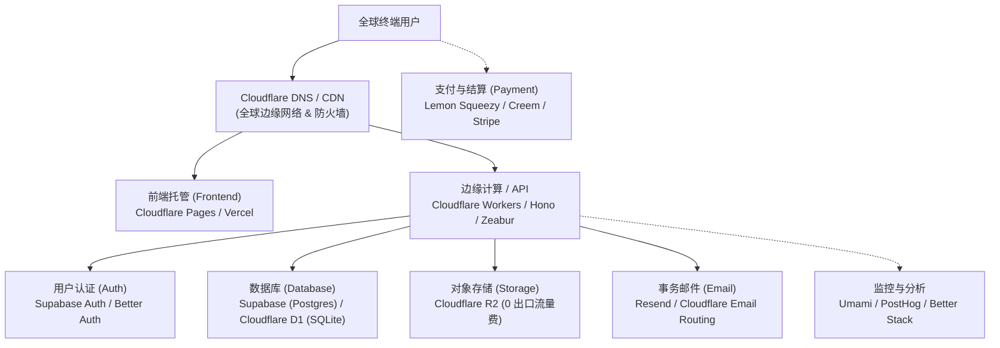
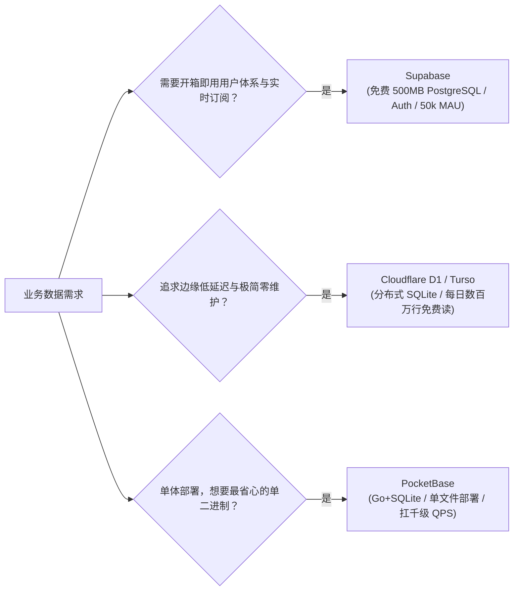
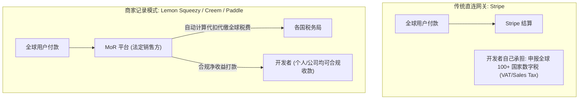

+++
title = '独立开发者“穷鬼套餐”：从 0 到 1 打造极低成本全栈 SaaS 选型指南'
date = '2026-10-12T14:30:00+08:00'
slug = 'indie-developer-budget-stack'
draft = false
tags = ['独立开发', '全栈开发', '技术选型', 'Serverless', '免费资源', 'SaaS', '出海']
+++

在独立开发（Indie Hacker）的世界里，有一句残酷却极其真实的格言：**90% 的 Side Project 在验证 PMF（Product-Market Fit，产品市场匹配）之前，甚至赚不回服务器的第一笔月租。**

传统的开发习惯往往是沉重的：开工前先买一台 2C4G 的云服务器（￥150/月），配一个托管 RDS 数据库（￥200/月），加上 Redis、对象存储、负载均衡、企业邮箱... 还没写出第一行让用户付费的业务代码，每月几百上千的固定开销已经开始侵蚀你的现金流与开发热情。

但在现代云计算和开源生态高度成熟的今天，游戏规则彻底改变了。全球涌现出一批慷慨的云服务商（被称为“赛博菩萨”），配合 Serverless、边缘计算、BaaS（后端即服务）以及开源轻量方案，独立开发者完全可以做到**在拥有真实付费用户之前，将固定基础设施成本压到近乎 0 元**。

这就是独立开发圈子里广为流传的**“穷鬼套餐”（Zero/Low-Cost Tech Stack）**。本文将为你梳理一套成熟、稳定、抗并发且具有优雅迁移路径的极低成本全栈技术栈选型与避坑指南。

<!-- more -->

---

## 核心理念：不要为未经验证的流量预付费

所谓的“穷鬼套餐”绝非粗制滥造或临时糊弄，而是现代软件工程的**极致资本效率（Capital Efficiency）**体现。在产品冷启动阶段，请务必坚守以下三条底线原则：

1. **Pay as you grow，而不是 Pay before you show**：在没有稳定现金流之前，固定月费能消灭就坚决消灭，优先采用“免费额度丰厚 + 超额按量付费（Pay-as-you-go）”的 Serverless 模式。
2. **警惕“账单刺客”（Billing Traps）**：绝不轻易绑定无消费硬顶（Hard Limit）的信用卡账户，防范爬虫攻击或逻辑漏洞导致天价账单。
3. **保留逃生通道（Exit Strategy）**：优先使用标准开源协议（PostgreSQL、SQLite、S3 兼容协议、标准 Docker 容器），避免被单一封闭闭源生态深度锁定。

---

## 全景架构：独立开发“穷鬼套餐”生态一览

一套完整的出海与商业化全栈 Web 应用，通常包含以下关键基础设施模块：



各个模块的核心选型与免费额度对比速查：

| 基础设施模块 | 终极推荐方案 | 免费额度 / 计费模式 | 核心杀手锏 |
| :--- | :--- | :--- | :--- |
| **网络与 DNS** | **Cloudflare** | 永久免费 | 全球 Anycast CDN、DDoS 防护、免费 Universal SSL 证书 |
| **域名邮箱** | **Cloudflare Email Routing** | 永久免费 | 自定义域名收信无限制，自动转发至个人 Gmail |
| **前端托管** | **Cloudflare Pages** | 无限带宽 / 无限静态请求 | 彻底摆脱带宽焦虑，无商业用途条款陷阱 |
| **边缘 API** | **Cloudflare Workers (Hono)** | 100,000 次请求/天 | 冷启动 < 5ms，全球边缘执行，轻量极致 |
| **数据库** | **Supabase (PostgreSQL)** | 500 MB 存储 / 50k MAU | 自带 Auth、Storage、Realtime，支持 pgvector 搞定 AI 搜索 |
| **边缘数据库** | **Cloudflare D1 (SQLite)** | 500 万行读/天，10 万行写/天 | 全球分布式，Serverless 零维护，存储免费 5GB |
| **对象存储** | **Cloudflare R2** | 10 GB 存储，读写海量免费 | **0 出口带宽费（Zero Egress Fees）**，击碎 S3 流量刺客 |
| **用户认证** | **Supabase Auth / Better Auth** | 50,000 MAU 免费 / 开源自由 | 支持 Google/GitHub 等多种 OAuth，免手写鉴权 |
| **事务邮件** | **Resend** | 3,000 封/月（日限 100） | DX 体验天花板，React Email 组件化，送达率极佳 |
| **支付与变现** | **Lemon Squeezy / Creem** | 0 月租，按单抽成（MoR） | 代扣代缴全球 100+ 国家数字税（VAT），个人即可申请出海 |
| **产品分析** | **Umami / PostHog** | 开源自建 / 100 万事件/月 | 隐私友好无 Cookie，漏斗与录屏全齐 |

---

## 分层选型深度剖析

### 1. 域名与网络护城河：Cloudflare 全家桶首发

在独立开发界，Cloudflare 被尊称为最伟大的“赛博菩萨”。没有之一。

- **域名购买**：不要在传统大厂或促销首年 $0.99 续费却要 $30 的奸商处买域名。推荐使用 **Spaceship** 或 **Cloudflare Registrar**。Cloudflare Registrar 以批发成本价直接售卖顶级域名，终身零加价续费；Spaceship 则是 Namecheap 旗下的新一代平台，界面现代且价格极其透明。
- **DNS 解析与 CDN**：将域名 Nameserver 托管至 Cloudflare。免费享受：
  - 全球 Anycast CDN 加速；
  - 自动颁发和续期的免费 Universal SSL 证书；
  - 极其强悍的 DDoS 基础防御与 WAF 规则（防 CC 攻击、爬虫拦截）；
  - Page Rules / Redirect Rules 重定向管理。
- **自定义域名企业邮箱（0 成本实现）**：
  - 很多独立开发者花钱去买 Google Workspace 或飞书企业邮箱，其实早期完全没必要。
  - 使用 **Cloudflare Email Routing**（电子邮件路由功能），只需添加几条 DNS 记录，即可免费配置任意前缀（如 `support@yourdomain.com`、`contact@yourdomain.com`），所有来信自动无缝转发至你的个人 Gmail。
  - 配合 Gmail 的“以其他别名发送邮件”结合免费 SMTP，甚至能做到 0 元收发双向支持。

---

### 2. 前端与全栈部署：Cloudflare Pages 还是 Vercel？

前端框架（Next.js、Nuxt、Astro、SvelteKit、Vite+React/Vue）构建出来的产物，部署到哪里最稳？

#### 选项 A：Cloudflare Pages（终极推荐，穷鬼战神）
- **免费额度**：每月无限请求次数、无限静态带宽，每月免费赠送 500 次构建次数。
- **核心优势**：
  - 没有“带宽刺客”。即使你的项目被 Hacker News 或 Product Hunt 送上头条带来百万 PV，你也不会收到任何带宽账单。
  - 商业合规：Cloudflare 明确支持免费计划用于商业化项目。
  - 深度集成：静态资源直接走边缘缓存，动态 API 可以通过 Pages Functions 无缝衔接 Workers。

#### 选项 B：Vercel（开发体验绝佳，但有商业与账单陷阱）
- **优点**：Next.js 的亲爹，开发体验（DX）、Git PR 预览环境、Edge Middleware 整合度无可挑剔。
- **隐患（务必注意）**：
  1. **商用协议限制**：Vercel 的 Hobby（免费）计划明确禁止用于**任何盈利性商业活动**。一旦被平台检测到带有收款链接或商业变现行为，可能收到警告邮件强制要求升级至 $20/月/席位的 Pro 计划。
  2. **Serverless Function 流量刺客**：Vercel 的 Edge 与 Serverless 函数调用、出站带宽超额费用极其昂贵，历史上出现过多起开发者因被恶意爬虫刷接口导致上千美元账单的惨痛案例。

> **最佳实践选型**：纯静态、Astro、SPA 或全栈轻量应用，**强烈建议首选 Cloudflare Pages**。如果深度依赖 Next.js 的 App Router 特性，开发早期可在 Vercel 快速跑通 MVP，但请在项目有商业盈利迹象时，迁移至 Cloudflare Pages 或独立的 Node 容器中。

---

### 3. 计算与后端 API：Serverless 边缘优先

很多开发者习惯在云服务器上跑一个 Spring Boot 或 Django 常驻进程，但这意味着每个月哪怕一个人都没访问，服务器也在持续空转扣费。

#### 方案 A：Cloudflare Workers + Hono（极客首选）
[Hono](https://hono.dev/) 是近年火遍全球的现代超轻量 Web 框架。
- **性能强悍**：基于 Web 标准 API 构建，包体积仅十几 KB，冷启动时间几乎为 0ms（运行在 V8 Isolate 上，而非笨重的 Node.js 虚拟机）。
- **免费额度**：Cloudflare Workers 免费计划每天提供 **100,000 次请求**，CPU 执行时间 10ms/请求（对于 I/O 密集型 API 足够充裕）。
- **开发体验**：TypeScript 友好，路由语法神似 Express，一行命令即可秒级部署到全球 300+ 边缘节点。

```typescript
import { Hono } from 'hono'
import { cors } from 'hono/cors'

const app = new Hono()
app.use('/*', cors())

app.get('/api/health', (c) => c.json({ status: 'ok', timestamp: Date.now() }))

export default app
```

#### 方案 B：Zeabur / Railway（轻量容器托管）
如果你有复杂的常驻任务、需要使用 Python/Go/Rust 跑特定脚本，或者必须部署现成的 Docker 镜像：
- **Zeabur**：对国内网络访问和出海兼顾极好的现代化 PaaS，支持自动拉取 Git 构建，按实际消耗的 CPU/内存资源计费，没有月租门槛。
- **Fly.io / Render**：提供小规格容器的免费或微量计费计划。

#### 方案 C：极客 VPS 兜底（Hetzner / 促销特价机）
如果你的架构中有些组件必须依赖常驻单体服务（如大型队列、长连接 WebSocket、多媒体转码）：
- **Hetzner 云主机**：欧洲机房性能怪兽，2C3G AMD 高性能机器仅约 €3.79/月，性价比秒杀 AWS/阿里云。
- **国内特价轻量云**：各大国内云厂商针对新老用户的年付特价机器（如阿里云 99 元/年、腾讯云轻量机），适合国内备案合规业务。

---

### 4. 数据库与 BaaS：从 0 到 10 万用户的免租之选

数据库往往是云计算中最昂贵、最让人头疼的部分。但现代开源生态提供了近乎完美的答案：



#### 方案 A：Supabase（现代 BaaS 瑞士军刀）
作为 Firebase 的开源替代方案，Supabase 是目前独立开发者最常用的全栈基石：
- **免费层额度**：
  - 500 MB 真实 PostgreSQL 数据库；
  - 50,000 月活跃用户（MAU）认证；
  - 1 GB 文件对象存储；
  - 500 万次 Edge Function 调用；
  - 内置 `pgvector` 扩展，可以直接用来存储 Embeddings，0 成本打造专属 AI 知识库与 RAG 检索。
- **局限与注意**：免费版项目在连续 7 天无请求后会进入**暂停休眠状态（Pause）**。用户再次访问时唤醒需要十余秒。可以通过设置定时自动化任务（如 GitHub Actions 定时 Ping 一次数据库健康检查 API）来避免冷休眠。

#### 方案 B：Cloudflare D1 / Turso（Serverless 边缘分布式 SQLite）
随着 SQLite 在现代 Web 中的复兴，边缘数据库正在成为主流：
- **Cloudflare D1**：运行在 Cloudflare 边缘的 Serverless SQL 数据库。免费版每天提供 **500 万次行读取**、**10 万次行写入**，以及 **5 GB 的数据库存储**！对于大多数初创工具类 SaaS，这套额度足够支撑月活几万的用户规模。
- **Turso**：基于 libSQL 的边缘数据库，支持海量多租户隔离，免费计划提供 9GB 存储和 500 个并发数据库。

#### 方案 C：PocketBase（极简主义黑马）
对于喜欢单体架构的开发者，[PocketBase](https://pocketbase.io/) 是单机性能与极简主义的典范：
- 整个后端就是一个单独的 Go 二进制文件，内置 SQLite（WAL 模式）、用户认证、文件存储和极其漂亮的 Admin 控制台。
- 部署在一台 1C1G 的廉价 VPS 上，轻松处理数千 QPS，且数据只需备份一个 `.db` 文件，灾备迁移极其轻松。

---

### 5. 对象存储：彻底摆脱 AWS S3 流量刺客

文件上传、用户头像、生成报告、导出文件——对象存储是 Web 应用不可或缺的一环。

在过去，AWS S3 虽然存储费用便宜，但其恶名昭彰的**按出站流量计费（Data Transfer Out）**让无数开发者战战兢兢：一旦某个公开下载链接被爬虫疯狂抓取，数千美元账单会在几天内摧毁你的信用卡。

**终极解法：Cloudflare R2**
- **免费额度**：每月免费赠送 **10 GB 存储容量**，100 万次写入（Class A），1000 万次读取（Class B）。
- **核心杀手锏：0 出口流量费用（Zero Egress Fees）**！
  - 无论你的用户下载了 100 GB 还是 10 TB 数据，Cloudflare R2 **完全不收出站带宽费**。
  - 完全兼容 AWS S3 API 协议标准，现有的 AWS SDK、Boto3、MinIO 客户端代码只需修改 Endpoint 即可无缝切换。

---

### 6. 用户认证（Authentication）：告别繁琐脏活

用户注册、登录、找回密码、OAuth 社交授权是每个项目最耗时且最容易出安全漏洞的环节。

- **Supabase Auth**：自带完备的 JWT 机制、支持 Google、GitHub、Apple、Twitter 等几十种 OAuth 登录方式，免费额度高达 50,000 MAU，且与 Postgres 的行级安全策略（RLS, Row Level Security）原生协同，安全可靠。
- **Clerk**：交互 UI 与开箱即用体验的行业标杆，React/Next.js 只需几行组件就能渲染出顶级的登录面板。免费额度 10,000 MAU，但超额后价格较贵（阶梯付费），适合高客单价商业产品。
- **全栈开源自建（Better Auth / Lucia）**：如果你希望将用户账户完全存放在自己的数据库中，不想依赖外部 SaaS 平台，推荐现代的 **Better Auth** 或 **Auth.js**。

---

### 7. 事务性邮件（Transactional Email）：高送达率与零月租

发送验证码邮件、重置密码通知、付费成功账单：

- **Resend**：现代开发者体验最好的邮件发送平台。原生支持 React Email，允许你像写 React 组件一样编写现代化的 HTML 邮件模板。免费计划每月支持 **3,000 封邮件**（每天上限 100 封），送达率极佳。
- **Brevo（原 Sendinblue）**：老牌邮件厂商，免费额度为**每天 300 封**，无月度限制，适合初期业务平稳发送验证码。

---

### 8. 支付与出海变现：搞钱闭环的终局选型

代码写得再好，收不到钱也是徒劳。对于出海独立开发者来说，收款面临的最大障碍不是技术，而是**全球税务合规（Tax Compliance）与海外主体**。



#### 传统支付网关：Stripe
- **特点**：全球行业标准，费率实惠（通常为 2.9% + $0.30/笔），无固定月费。
- **难点**：你作为法定销售方，需要自行处理各个国家与地区的数字消费税申报（如欧盟 VAT、美国各州 Sales Tax）。同时，国内个人开通 Stripe 需要海外公司主体（如通过 Stripe Atlas 注册美国 Delaware 公司，有设立和报税成本）。

#### 独立开发神器：Merchant of Record (MoR) 模式
- **代表平台**：**Lemon Squeezy**、**Paddle**、**Creem**。
- **为什么是独立开发者的首选？**
  1. **免除税务噩梦**：MoR 平台在法律上是商品的直接销售者，由他们统一负责代扣代缴全球上百个国家的增值税，你不需要在海外成立空壳公司和做账报税。
  2. **个人友好**：国内独立开发者凭借个人身份即可申请入驻，支持提现到本地银行账户（配合 Wise / 连连等工具）。
  3. **计费模式**：0 启动费用，0 固定月租，仅按单抽成（通常为 5% + $0.50 左右）。对于未经验证的产品，完全没有任何沉没成本。

---

### 9. 监控、产品分析与运行状态

- **网站流量统计**：
  - **Umami**：开源、隐私友好、无需 Cookie 授权弹窗的 Google Analytics 替代品。可在免费 Vercel/Cloudflare + Supabase 架构上自建，也有免费官方 Cloud 计划。
  - **Cloudflare Web Analytics**：在域名面板一键开启，轻量无感知，完全免费。
- **产品行为与漏斗分析**：
  - **PostHog**：产品分析界的“巨无霸”，每月提供 **100 万次事件免费**、每月 5,000 次用户录屏会话（Session Replay）免费。你可以清晰地回放用户在哪个步骤放弃了付款。
- **错误监控与告警**：
  - **Sentry**：开发者免费计划每月提供 5,000 个错误追踪事件，足以捕捉绝大多数未捕获异常。
- **运行状态页（Uptime Monitor）**：
  - **Better Stack** / **Uptime Kuma**：配置几个探针，服务挂掉时自动通过 Telegram/邮件报警。

---

## 两套经典“穷鬼组合拳”实战模板

### 组合一：“边缘全家桶”极客架构（月费 $0，全球高可用）

```
[前端: Next.js/Astro on Cloudflare Pages] 
   + [API: Hono on Cloudflare Workers] 
   + [DB: Cloudflare D1 (SQLite) / Turso] 
   + [存储: Cloudflare R2] 
   + [邮件: Resend] 
   + [收款: Lemon Squeezy]
```

- **月度固定账单**：**$0.00**
- **适用场景**：轻量级 SaaS、出海 AI 套壳工具、导航站、静态内容与知识付费系统。
- **核心优势**：
  - 全球分布式边缘执行，首屏与接口响应极快（< 50ms）；
  - 拥有无可匹敌的防刷能力和 0 流量费用保障；
  - 架构优雅现代，代码库极度纯粹。

### 组合二：“现代全能 BaaS”敏捷架构（月费 $0，省 80% 开发时间）

```
[全栈: Next.js on Vercel / Cloudflare Pages] 
   + [BaaS: Supabase (Postgres + Auth + Storage + pgvector)] 
   + [分析: PostHog + Umami] 
   + [邮件: Resend] 
   + [收款: Lemon Squeezy / Creem]
```

- **月度固定账单**：**$0.00**
- **适用场景**：具备复杂多租户权限、团队协作、实时协作、AI 知识库与复杂关系型业务的数据管理型 SaaS。
- **核心优势**：
  - 几乎不用手写任何用户认证与管理后台逻辑；
  - 拥有完整的 PostgreSQL 生态支持与 ORM（Prisma / Drizzle）集成体验；
  - 一个人在周末 48 小时内就能完整交付一套功能完备的商业 MVP。

---

## 避坑指南：“穷鬼套餐”的五大暗礁与防反噬铁律

很多开发者以为使用免费套餐就高枕无忧，结果被隐形限制或突发账单反噬。请务必牢记以下避坑要点：

### 1. 绝不轻易绑定无硬限额（Hard Limit）的云服务
- AWS、Google Cloud 等老牌公有云的免费套餐往往暗藏陷阱：超过免费额度后，系统**默认会自动扣费**，甚至连超额报警邮件都会延迟几小时送达。
- **防御手段**：
  - 优先选择超额后直接拒绝请求（Soft Fail / Hard Cap）而非无限透支的服务商；
  - 如果必须绑定信用卡，尽量使用**虚拟信用卡（Virtual Card）**，并将其单月消费限额严格设置为 $1~$5 美元，从物理层面杜绝天价穿仓。

### 2. 警惕 Vercel Hobby 计划的“商用被封”
- Vercel 服务条款严格禁止 Hobby 账户用于商业盈利项目。如果在页面上挂了付费订阅收款链接，一旦流量激增进入人工审核，可能会面临封禁或强制升级的风险。
- **对策**：只要涉及商业闭环，静态页面尽早迁移至 **Cloudflare Pages**，后端 API 剥离至 Workers 或独立容器。

### 3. Supabase 免费实例的“7 天休眠”机制
- Supabase 免费版实例在连续 7 天没有 API 请求或数据库查询时，会自动暂停以节省公共计算资源。如果碰巧有新用户在此时进入，会经历数十秒的冷启动等待甚至报错。
- **对策**：在产品上线后，配置一个定时的 GitHub Action 或 Cron-job 监控探针，每天向数据库健康检查端点发起一次轻量查询，保持数据库实例常驻活跃。

### 4. 严防第三方闭源黑盒锁定
- 业务代码尽量使用标准 Web API 和通用 SQL 语法。
- 数据库选用标准的 PostgreSQL 或 SQLite 格式，定时做好自动化数据 Dump 备份并同步至 R2。无论未来云服务商政策如何变动，随时具备在 1 小时内将数据导入独立 VPS 恢复运行的能力。

### 5. 警惕“过早优化”与“过度架构设计”
- 独立开发最容易犯的技术毛病是：**产品还没一个人用，先考虑千万级并发架构**。
- 不要一开始就上 Kubernetes、Kafka、微服务与分布式缓存。单机 SQLite / 单实例 Postgres 足以扛住绝大多数产品前 10,000 个付费用户的流量。MVP 唯一的度量标准是**用户愿不愿意付钱**。

---

## 结语：穷鬼是手段，生存与迭代才是目的

在独立开发的马拉松征程中，“穷鬼套餐”绝非寒酸的妥协，而是成熟开发者对抗不确定性的战略智慧。

一个独立开发者如果每个项目每个月都要背负 $100 的固定云开销，连续失败三个项目就会耗尽心理承受阈值；但如果每个项目的固定持有成本是 **$0.00**，你就拥有了**无限次尝试发射火箭的机会**——直到其中的某一枚真正穿越大气层，击中属于你的商业目标。

当你的产品迎来第一千位付费用户、MRR（月经常性收入）突破数千美元时，你随时可以优雅地给这些“赛博菩萨”打钱升级付费计划。但在那之前：

> **把固定开销降到最低，把发布速度提到最高，活下去，直到胜利。**
