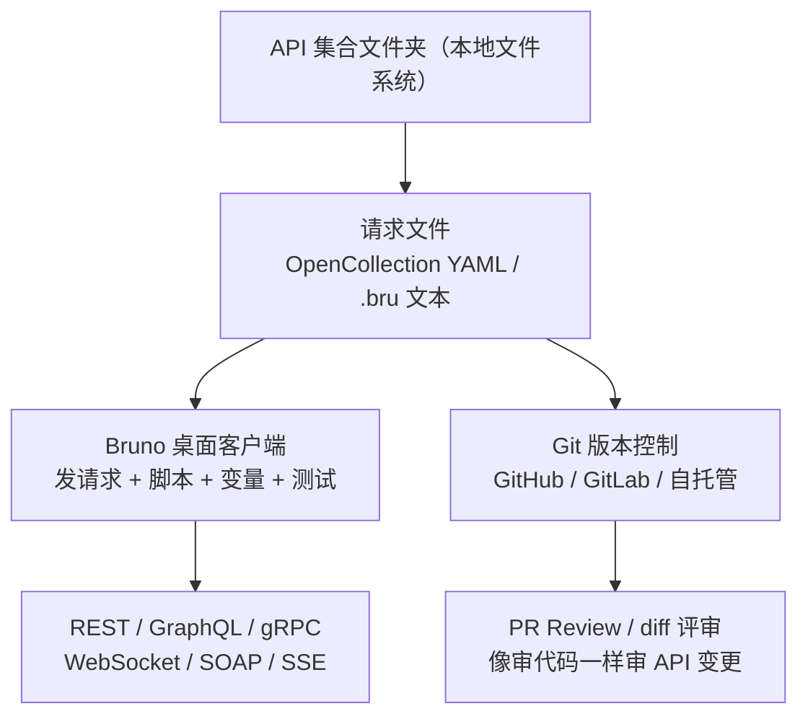

+++
title = 'Bruno：把 API 集合当代码存进 Git 的开源客户端'
date = '2026-10-19T10:00:00+08:00'
slug = 'bruno-git-native-api-client'
draft = false
tags = ['Bruno', 'API', 'Postman', '开源工具']
+++

> 官方仓库：[usebruno/bruno](https://github.com/usebruno/bruno) · 官网：[usebruno.com](https://www.usebruno.com/) · 许可证：MIT（GitHub 43k+ star）

## 一句话介绍

**Bruno** 是一个 **Git 原生（Git-native）、离线优先（offline-first）** 的开源 API 客户端，是 Postman / Insomnia 的轻量替代品。它的核心主张非常反主流：**API 集合不是存进厂商的云端，而是以纯文本文件存在你的 Git 仓库里，像代码一样协作和评审。**

> "If you wouldn't accept this for your normal codebase, why would you accept it for API collections?"
> —— 你的普通代码你不会接受锁死在私有云里，凭什么 API 集合就要？

## 痛点：Postman 把 API 集合锁进了云

这些年 Postman 主导市场，但它走了云优先（cloud-first）路线：

- 集合保存在厂商的**云端工作区**，要登录账号、要同步；
- 协作要依赖厂商的账号体系，一旦服务/价格变动，你的数据主动权不在自己手里；
- 客户端会捕获你的 PII、请求和响应内容（Key、token 等），数据都在别人服务器上过一遍。

Bruno 反其道而行，瞄准并解决两个核心问题：

1. **协作（Collaboration）**——通过 Git 实现：集合直接存在文件系统文件夹里，用纯文本标记语言描述 API 请求；
2. **数据隐私与安全（Data Privacy & Security）**——完全离线，**没有登录/账号概念，没有云连接，没有同步**，你的工作数据不离开本地。

## 核心工作方式

把集合当代码的关键在于：**每个请求就是一个可读、可 diff、可版本控制的文本文件**。团队用 Git 协作，review API 变更就像 review 代码——这在 Postman 的云端工作区里很难做到。

### 两种集合格式

- **`.bru` 标记语言**：Bruno 原创的纯文本格式，长期支持；
- **OpenCollection（YAML）**：Bruno 推出的**开源规范**，基于行业标准 YAML，现在是新集合的**推荐格式**，能无缝对接现有工具链；旧 `.bru` 集合可一键迁移到 YAML。

## 支持的能力

### 支持的协议

REST · GraphQL · SOAP · gRPC · WebSocket · SSE（Server-Sent Events，可用于测试 OpenAI 风格流式接口、实时事件流）。

### 核心功能

| 能力 | 说明 |
| :-- | :-- |
| **发送请求** | REST / GraphQL / gRPC / WebSocket / SOAP / SSE |
| **变量** | 跨环境、集合、文件夹、请求复用值 |
| **测试** | 写断言与测试套件，支持数据驱动自动化 |
| **脚本** | JavaScript（Node 运行时），pre-request / post-response 钩子 |
| **Secret 管理** | CLI 原生对接 AWS Secrets Manager、Azure Key Vault、HashiCorp Vault |
| **代码生成** | 一键生成多种语言的请求代码 |
| **文档** | 基于集合生成/分享 API 文档 |
| **CLI** | `bruno-cli`，用于 CI/CD 自动化跑测试 |
| **原生 Git 集成** | 内置 Git UI，可视化 diff 与协作 |

## v4.0.0：Native AI、类型化变量、Apps（2026-07-30）

v4 在保持"集合是纯文本、数据不出本地"核心契约不变的前提下，补上了用户最痛的点，并加了几个新能力：

- **Native AI（自带 Key）**：内置 AI 侧边栏，能根据当前请求帮你**写测试用例、脚本、文档**，解释没见过的响应、脚本自动补全、模型切换、diff review、对话历史。关键是 **BYOK（bring your own key）**——用你自己的 OpenAI / Anthropic 或兼容端点，**不经过 Bruno 的任何服务器，数据留在本地**；
- **Typed Variables（类型化变量）**：脚本拿到的不再是手写解析的字符串，而是真实数据类型，解决了以前到处 `.parse()` 的痛点；
- **Apps**：在单个请求或整个集合之上构建小的 HTML/JS UI，把请求包装成交互式小应用；
- **Secret Manager 架构**：CLI 原生支持真实团队在用的 secret store（AWS / Azure Key Vault / HashiCorp Vault）；
- **冷启动优化**：大集合打开不再那么慢。

## 与 Postman 的关键差异

| 维度 | Bruno | Postman |
| :-- | :-- | :-- |
| 集合存储 | 本地纯文本文件（YAML/.bru），进 Git 仓库 | 厂商云端工作区 |
| 账号 | 不需要登录 | 需要账号 |
| 离线 | 完全离线可用 | 桌面版也倾向云同步 |
| 协作方式 | Git PR / diff，像审代码 | 云端共享工作区 |
| 数据隐私 | 数据不出本地 | 请求/响应内容经其云 |
| 许可证 | MIT 开源（43k+ star） | 闭源 |
| 生态 | 相对较小、UI 偏简洁 | 大而全（mock、monitor 等） |

**何时选 Bruno**：要集合进 PR 评审、不要账号、不想数据出本地、偏好开源可控。
**何时选 Postman**：需要共享工作区、mock server、monitor 等更大生态，或团队已深度绑定云端协作。

## 定价（2026 年现行）

开源版之外是**两个年付订阅**（早期 $19 一次的 Golden Edition 已 sunset）：

| 版本 | 价格 | 定位 |
| :-- | :-- | :-- |
| **Open Source** | 免费 | 完整 API 客户端（REST/GraphQL/gRPC）、测试、脚本、Secret 管理、代码生成、CLI；2 个工作区，公共 Git 仓库 |
| **Pro** | $6 / 用户 / 月（年付） | 无限工作区，私有+公共 Git provider，高级 Git 客户端集成、OpenAPI 设计工具、可视变量查看器、优先支持、14 天试用 |
| **Ultimate** | $11 / 用户 / 月（年付） | 在 Pro 基础上加 SSO、SCIM、审计日志、AI 助手、mock server、负载测试、专属客户成功、SLA |

独立开发者用免费版即可拿到完整能力；需要 SSO/审计/私有 Git 的团队再按席位付费。

## 适合谁 / 结论

- 相信"**API 集合应该属于代码库而不是云端**"的开发者；
- 想让 API 变更进 Git、走 PR 评审流程的团队；
- 在意数据隐私、不想请求内容过厂商服务器的人；
- 想要一个轻量、快速、开源可控的 Postman 替代品的人。

一句话：**Bruno 用"集合即文件、协作走 Git、数据留在本地"三个原则，把 API 测试从厂商云里解放了出来。** 如果你的工作流本来就在 Git 里，它几乎是无缝的替代方案。

> 参考资料：[What is Bruno?](https://docs.usebruno.com/v2/introduction/what-is-bruno) · [Bruno Tutorial](https://blog.usebruno.com/bruno-tutorial) · [Bruno v4.0.0 发布](https://blog.usebruno.com/bruno-v4-0-0-native-ai-typed-variables-and-apps) · [Bruno vs Postman](https://www.usebruno.com/compare/bruno-vs-postman) · [Pricing](https://www.usebruno.com/pricing)
