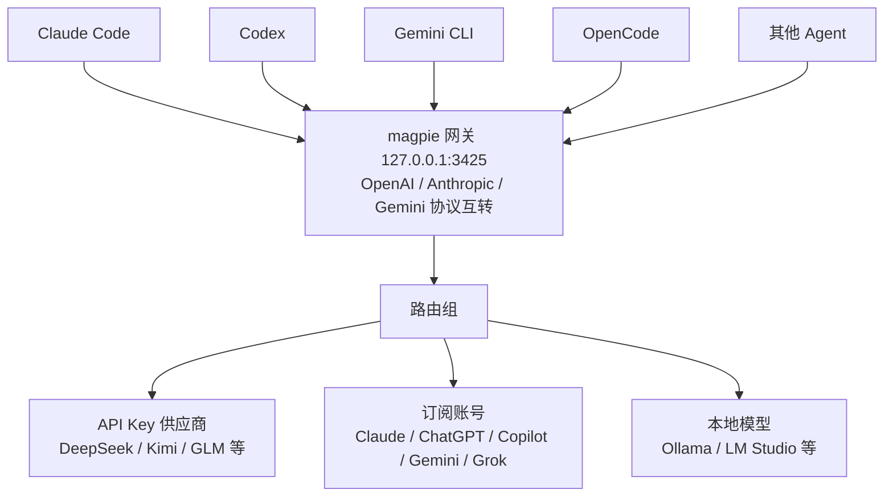

+++
title = 'magpie：一个网关，统一所有 AI Agent 的模型'
date = '2026-10-19T09:00:00+08:00'
slug = 'magpie-ai-agent-gateway'
draft = false
tags = ['magpie', 'AI', 'Agent', '网关']
+++

> 官方仓库：[yetone/magpie](https://github.com/yetone/magpie) · 官网/下载：[usemagpie.ai](https://usemagpie.ai) · 许可证：MIT

## 一句话介绍

**magpie** 是 [yetone](https://github.com/yetone) 开源的本地 AI 网关应用，口号是 *"Every agent's model. One place."*——把 Claude Code、Codex、Gemini CLI、OpenCode 等一堆 Agent 的模型配置，全部收进一个菜单栏应用里统一管理。

> Claude Code 跑在 Kimi 上、Codex 调 DeepSeek、Gemini CLI 用 GLM、OpenCode 用你的 ChatGPT 订阅……从菜单栏一键切换，额度用完自动换下一个账号。

## 痛点：为什么需要它

每个 AI 编码 Agent 都有自己的一套模型配置：

- 模型写在自己的配置文件里，格式各不相同（Claude Code、Codex、Gemini CLI 各有各的文件）；
- 每个 Agent 有自己的 API Key 和 base URL；
- 你买的某个订阅，往往只能在自家的那个 Agent 里用，换一个就废了。

于是重度用户经常要在 N 个配置文件之间来回改。magpie 把这些全部收拢到一个应用 + 一个本地网关背后：

- **任何模型配任何 Agent**——从一个列表里选，magpie 只改 Agent 配置里最关键的那么一个值；
- **一个供应商到处用**——一把 API Key、一个本地模型，或者你已登录的 Claude / ChatGPT / Copilot / Gemini / Grok 订阅，都能共享给所有 Agent；
- **额度用完不断流**——路由组自动切到下一个账号或模型，Agent 永远看不到报错。

如果你只用一个 Agent、只用它自家官方方案，那不需要它；只要你在用多个 Agent、多个供应商或多个账号，它就很有用。

## 核心架构

magpie 的本质是一个跑在本机 `127.0.0.1:3425` 的小网关，它同时讲 OpenAI Chat / OpenAI Responses / Anthropic Messages / Gemini 四种协议，并在它们之间做转换（流式输出、工具调用、reasoning 都支持）。所以理论上任何能填 base URL 的工具都能接进来：



不想用 App 时，也可以直接用标准 base URL 接任意工具：

```sh
export OPENAI_BASE_URL=http://127.0.0.1:3425/v1     OPENAI_API_KEY=magpie
export ANTHROPIC_BASE_URL=http://127.0.0.1:3425     ANTHROPIC_API_KEY=magpie
export GOOGLE_GEMINI_BASE_URL=http://127.0.0.1:3425 GEMINI_API_KEY=magpie
```

## 快速上手

1. **安装**——从 [usemagpie.ai](https://usemagpie.ai) 下载，或命令行安装：
   ```sh
   curl -fsSL https://usemagpie.ai/install.sh | sh
   ```
   Mac 构建已签名并公证，且会自动更新；也支持 `go install github.com/yetone/magpie@latest` 或 Docker 镜像。

2. **加供应商**——打开 magpie，进入 **Providers → Add provider**，选一个预设粘贴 Key，或直接登录订阅。

3. **给每个 Agent 选模型**——在 **Agents** 页面挑模型，开新会话就用上了。

全部命令行操作也可以：

```sh
magpie provider add deepseek sk-…              # 预设只需一把 Key
magpie claude deepseek/deepseek-v4-pro          # Claude Code 用 DeepSeek
magpie codex moonshot/kimi-k2.5                 # Codex 用 Kimi
magpie group add "Opus anywhere" models=claude/claude-opus-5-5,copilot/claude-opus-5.5 routing=smart
magpie claude group/opus-anywhere               # 多个订阅之间自动 failover
magpie save work && magpie use work             # 配置档案（profiles）
magpie quota                                    # 每个套餐还剩多少额度
magpie tui                                      # 整个应用放进终端
```

## 核心功能拆解

### 任何模型，任何 Agent

点一个值就弹出可搜索列表，所有供应商的所有模型都以 `供应商/模型` 形式列出。Agent 的配置文件会被**原子化重写**，原有注释、顺序、格式原样保留。**Profiles（档案）** 用一个名字（如 "Budget"、"Focus"）存下所有 Agent 的整套设置，一键整体切换；每个 Agent 也可以有自己的模型快捷列表。

### 供应商管理

选预设、贴 Key 即可。模型列表来自官方 vendor，名称和推理级别由 [models.dev](https://models.dev) 自动填充，所以今早刚发布的模型，下次刷新就会出现在选择器里。

> 预设覆盖 Anthropic · OpenAI · Gemini · DeepSeek · Kimi · Zhipu GLM · MiniMax · Qwen · 火山方舟 Ark · Ollama · LM Studio …… 以及任何 OpenAI/Anthropic 兼容的 URL。

还支持从 CC Switch、Claude Code、Codex 导入供应商；每个 Key、每个账号都能挂自己的代理。

### 订阅共享（Subscriptions）

已登录的 Agent 本身就是一个"背后有模型"的订阅，magpie 把它作为供应商提供给**其他所有 Agent**：

- **Claude**：驱动你机器上真实的 `claude` 二进制，并通过 MCP 桥接你的工具；
- **Codex / ChatGPT**：把你的 ChatGPT 套餐模型给别的 Agent 用；
- 还有 GitHub Copilot、Gemini (Code Assist)、Antigravity、Grok (SuperGrok) 等；
- 同一个订阅可以加多个账号，magpie 在它们之间自动 failover；
- **Daily warm-up**：按你设定的时间预热每个 Claude / ChatGPT 账号的 5 小时窗口，避免重置时白白浪费。

### 路由组（Routing Groups）

一个路由组就是几个模型打包成的一个选项，比如 `group/daily-coding`，网关把请求分摊到每个成员的 Key 和账号上：

| 模式 | 行为 |
| :-- | :-- |
| `smart` | 在还有额度的订阅里，优先用"最早到重置时间"的那个，减少浪费 |
| `order` | 先用第一个模型，直到它不能应答，再换下一个 |
| `rotate` | 每次请求轮换到下一个成员 |
| `usage` | 优先用当前用得最少的成员 |
| `pace` | 按"每小时还剩多少周额度"优先用剩余最多的账号 |

对话会**留在回答它的那个账号上**（只要供应商的 prompt cache 还值得保留）。组里可以再套组。**意图路由（intent routing）** 还能让你选一个小模型去读每个新回合，让"测试类"请求走强模型、"快速问答"走便宜模型——路由面板实时显示每次决策。

### 插件与网关中间件

插件跑在 [Bun](https://bun.sh) 上（首次用到时自动下载），负责登录、列模型、发请求。也可以作为**网关中间件**，用 JavaScript 看到每个 Agent 发来和收到的一切：

```js
// alias.middleware.js — magpie plugin add ./alias.middleware.js
export function onRequest(body, ctx) {
  if (body.model === "fast") return { ...body, model: "deepseek/deepseek-chat" };
}
```

中间件钩子 `onRequest` 可改写或拦截请求，`onEvent` 看每个流式事件，`onResponse` 看完整回复；抛异常或超时会原样放行请求。官方还打包了一批对标 [New API](https://github.com/QuantumNous/new-api) 的现成中间件（`param-override`、`model-map`、`system-prompt`、`word-guard`、`think-tags` 等）。

### 用量与成本

- **Tokens / 成本**：tokens、缓存读写、reasoning 和调用次数，按美元或人民币的官方列表价计费，也可自定义价格；
- **Quota**：每个 Key、套餐、账号的余额和额度窗口（`magpie quota`），窗口快重置却还剩很多时会提醒；
- **Sessions**：每个 Agent 对话的成本和标题，一键在终端重开；
- **Context**：每个请求上下文窗口的占用情况、缓存命中量；
- **Bills**：按账号和上游 Key 出账单，支持 OTLP 导出到自建可观测平台。

### 分享与多机

| 能力 | 说明 |
| :-- | :-- |
| 本地网络 | 开启后给每个客户端发一个带日/周/月额度限制的命名网关 Key |
| 远程 magpie | 笔记本复用台式机上 magpie 的供应商/账号/分组 |
| Docker | `ghcr.io/yetone/magpie` 跑在服务器或 NAS 上，用 Web UI 管理 |
| 同步 | 备份到文件，或经 WebDAV（坚果云/Nextcloud）、S3、加密 GitHub 仓库同步多机 |

### 其他亮点

- **Library**：指令、MCP server、skills 写一次，magpie 按各 Agent 的格式写入，且只删自己写过的东西；
- **任何模型的联网搜索**：不会搜索的模型用 magpie 的搜索（可接 Tavily / Brave / Exa / Firecrawl / SearXNG），一把 API 可放多个 Key 轮流用；
- **图片 / 视频**：通过 MCP 给任何 Agent 提供图片工具和 Grok 视频；
- **WSL**：Windows 下 WSL 发行版里的 Agent 也会被接好、会话计入统计。

## 支持的 Agent

Claude Code · Claude Desktop · Claude Science · Codex · Gemini CLI · Antigravity CLI · OpenCode · OpenChamber · MiMo Code · DevEco Code · Pi · oh-my-pi · StepCode · Goose · Cursor CLI · Zed · VS Code Chat · Copilot CLI · DeepSeek Harness · Reasonix Studio · Command Code · Devin · Kimi Code · Qwen Code · MiniMax Code · Cline · Qoder · Grok Build · Grok App · ZCode · WorkBuddy · CodeBuddy Code · Snow CLI · AtomCode ……（共 60+ 个）

magpie 只显示你机器上**已安装**的 Agent；其余凡是能填 base URL 的工具，用上面的环境变量接网关即可。

## 隐私

你的提示词、回复、Key 和账号**只会发给你自己使用的供应商**。每天一次"在用"上报只包含随机 ID、版本、系统，以及用了哪些 Agent / 供应商 / 模型（自己加的供应商只标为 `custom`），不含任何名字、URL、账号、Key、提示词或用量。可在 **Settings → Privacy** 关闭，或设 `DO_NOT_TRACK=1`。

## 许可与作者

- **MIT 许可证**，仓库明确声明**不接受 PR**（只有维护者能开），有需求去 [Discord](https://discord.gg/vGSnD3ZKQF) 提，由官方来构建。
- 作者 **yetone** 也是知名 Neovim AI 插件 [avante.nvim](https://github.com/yetone/avante.nvim) 的作者（该项目 17k+ star），专注 AI 编码体验，magpie 是其从"编辑器内 AI"向"跨 Agent 模型层"的一次延伸。

## 适合谁 / 结论

- 装了好几个 AI 编码 Agent、同时订了多家服务的人；
- 想把某家订阅额度"借"给其他 Agent 用的人；
- 怕某个账号/模型额度断档、希望自动 failover 的人；
- 想集中看所有 Agent 用了多少 token、花了多少钱的人。

一句话：**magpie 不是又一个 AI 编码工具，而是管"所有 AI 编码工具用什么模型"的那一层。** 装上它，改配置的痛苦从"改 N 个文件"变成"在一个菜单栏里点一下"。

> 参考资料：[magpie README](https://github.com/yetone/magpie) · [magpie 中文文档（快速上手）](https://usemagpie.ai/docs/zh/start)
