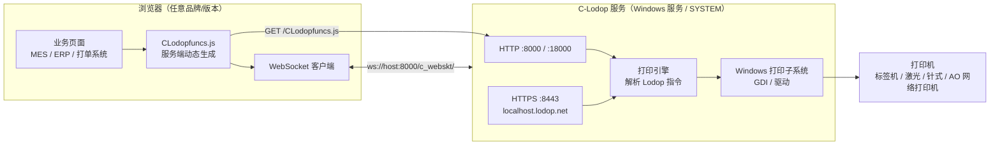
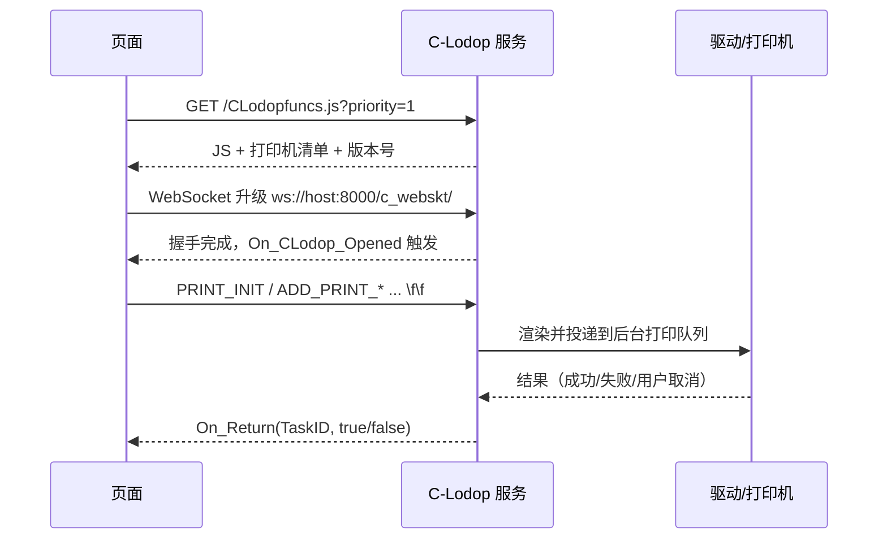

+++
title = 'C-Lodop 6.6.4.2 安装包分析：一个跑在 localhost 上的「网络打印服务」'
date = '2026-11-04T15:30:00+08:00'
slug = 'clodop-network-print-service-analysis'
draft = false
tags = ['lodop', 'web-print', 'reverse-engineering', 'windows', 'security', 'mes']
+++

车间里的标签打印机、质检工位的合格证、仓库的入库单——这些场景有一个共同的技术前提：**浏览器里点一下，纸就从打印机里出来**。在 IE 时代这靠 ActiveX / NPAPI 插件（Lodop 控件就是这么干的）。但从 Chrome 45 开始 NPAPI 被彻底移除，插件这条路线被判了死刑。

C-Lodop 就是这条死路的替代品：不再往浏览器里塞 OCX/DLL，而是在本机装一个 **HTTP + WebSocket 服务**，页面用 `<script>` 引一个 JS，JS 再和这个服务对话。听起来很轻，但它同时意味着——**你的打印机被挂到了一个 TCP 端口上**。

本文对我手头这个 `CLodop6.642_Setup_Win64EN_JD4Z22.exe` 做一次完整的静态分析：它是什么、里面装了什么、协议怎么跑、以及默认配置下它到底有多"开放"。

<!-- more -->

## 一、先给文件验明正身

```powershell
Get-FileHash -LiteralPath 'D:\download\CLodop6.642_Setup_Win64EN_JD4Z22.exe' -Algorithm SHA256
Get-AuthenticodeSignature -LiteralPath 'D:\download\CLodop6.642_Setup_Win64EN_JD4Z22.exe'
```

| 项目 | 结果 |
| --- | --- |
| 文件大小 | 6,154,049 字节（约 5.87 MiB） |
| MD5 | `CB2FD21154FED5199783C15A119E1A27` |
| SHA256 | `DE1D67A42331992BD843797B8BEC360CEFA7551357E8DF81A5948E262A4CF334` |
| 版本资源 | `MTSoftware(CN)` / `C-Lodop(64-bit) Setup` / `6.6.4.2` |
| 数字签名 | **无**（`NotSigned`，安全目录 Size = 0） |
| 安装器类型 | Inno Setup（Setup Data 版本串 `5.1.10`） |

版本资源里那句 `Comments = 此安装程序由 Inno Setup 构建。` 直接暴露了外壳身份。也就是说，这 6 MB 里真正有内容的不是 PE 代码，而是被 Inno 压缩后**附加在文件尾部**的负载。

### PE 结构：一个"很薄"的加载器

用 `pefile` 拉出来的头部信息：

```text
Machine:              0x014C  (i386 / 32 位)
NumberOfSections:     8       (CODE, DATA, BSS, .idata, .tls, .rdata, .reloc, .rsrc)
Subsystem:            2       (Windows GUI)
LinkerVersion:        2.25    (Delphi 编译特征)
TimeDateStamp:        0x2A425E19
Checksum:             verify=False
Security directory:   VirtualAddress=0x0  Size=0
Overlay start:        0xC800
```

几个值得读的点：

1. **`Machine = 0x014C`**：安装器本身是 32 位程序，但产品是 64 位（`C-Lodop(64-bit) Setup`）。这在 Inno 时代很常见——32 位外壳在 64 位系统上照样能跑，装进去的才是 64 位服务。
2. **`TimeDateStamp = 0x2A425E19`（1992-06-19）**：这不是构建时间，而是 Delphi 编译器写死的常量。把它当"文件年龄"来判断版本新旧，会得出完全错误的结论。
3. **导入表只有 `kernel32 / user32 / advapi32 / comctl32 / oleaut32`**：没有网络、没有加密、没有打印相关的 DLL。加载器只负责解压 + 写文件 + 建服务，真正的业务逻辑在压缩负载里。
4. **`CODE` 段熵 6.56、`.rsrc` 段熵 4.92**：外壳没有加壳。高熵在尾部 overlay（从 `0xC800` 到文件末尾约 6.08 MB），那是 LZMA 压缩的安装数据。

一个有点意外的细节：`Inno Setup Setup Data (5.1.10)` 对应的是 2008 年前后的 Inno Setup 5.1 系列，而产品版本已经到 6.6.4.2。**安装脚本的骨架十几年没换过**——这也解释了为什么它还在用 32 位 Delphi 外壳、没有签名。

### 文件名其实是三段信息

`CLodop6.642_Setup_Win64EN_JD4Z22.exe` 拆开看：

- `CLodop` —— 产品名（Cloud Lodop）
- `6.642` —— 版本号的"去点写法"，即 **6.6.4.2**（和版本资源一致）
- `Win64EN` —— 64 位版、英文界面
- `_JD4Z22` —— **官方发布包里没有这一段**

官方下载中心的当前发布物是 `CLodop6.647_Setup_Win64EN.zip`（对应 6.6.4.7），压缩包里才是同名的 `.exe`。而 C-Lodop 的更新记录里明确提到过"云打印安装程序可以定做"、"定制安装程序的繁体名称乱码"等条目，说明厂商支持给客户出定制安装包。所以 `_JD4Z22` 更可能是**渠道/客户定制构建的标记**（比如内嵌了预设的 logo、端口、工作模式），而不是病毒改名。

> 这条是推断，证据等级：中。确定的部分是"官方命名不含该后缀"，不确定的是后缀具体代表哪个客户。

## 二、它到底装了什么

64 位版的落盘位置和主进程：

```text
C:\Program Files\MountTaiSoftware\CLodop64\
├── CLodopPrint64.exe          # 主服务程序（托盘 + 服务本体）
├── CLodopService*.exe        # 免登录启动服务（可选，随 32/64 位命名）
├── SetupOption\MainOption.ini # 端口/白名单/AO 参数
├── Rootdir\CLodopDemos\       # 样例与 LodopFuncs.js
└── Logs\                      # 运行日志（需手动开启）
```

32 位版对应 `Program Files (x86)\MountTaiSoftware\CLodop32\`，主程序 `CLodopPrint32.exe`。判断有没有装过，最直接的办法是看这两个目录里有没有 `CLodopPrint32.exe / CLodopPrint64.exe`——只有 `Lodop` 目录说明装的是老控件，不是 C-Lodop。

安装完成后它会做三件事：

1. 注册一个 Windows 服务（开机即起，**不依赖用户登录**，所以能跑在"黑盒子"打印服务器上）；
2. 监听 **8000 / 18000** 两个 HTTP 端口（双端口是为了防占用，一个可用即可）；
3. 起一个托盘界面，右键菜单里能改端口、开日志、开关 AO 打印。

## 三、运行时架构：一次打印的完整路径



关键点在于**谁在干活**：浏览器只负责把"要打什么"翻译成一串 Lodop 语句（`PRINT_INIT` / `ADD_PRINT_TEXT` / `ADD_PRINT_BARCODE` / `PRINT`），真正的排版、调驱动、进后台队列，全在服务进程里。所以客户端可以是手机、平板、Linux 上的浏览器——只要能发包就行。

这也是它和控件版最本质的区别：**控件在浏览器进程内，C-Lodop 在另一个进程（甚至是另一台机器）**。

| 维度 | Lodop 控件 | C-Lodop 服务 |
| --- | --- | --- |
| 形态 | OCX / NPAPI 插件 | 独立 Windows 服务 + HTTP/WS |
| 浏览器依赖 | IE、Chrome≤44、Firefox≤51 | 所有现代浏览器 |
| 位数匹配 | 跟**浏览器**位数走 | 跟**操作系统**位数走 |
| 本机预览 | 进程内窗口 | 服务弹窗（或页内 iframe 临摹） |
| 远程/集中打印 | 不支持 | 原生支持（局域网 / AO 广域网） |
| 返回值 | 同步 | **异步回调 `On_Return`** |
| 打印设计器 | 支持 | 本地支持，远程不支持 |

## 四、协议层拆解：一个 300KB 的 JS 说了什么

C-Lodop 最值得看的设计是：**协议不在文档里，协议在 JS 里**。`CLodopfuncs.js` 不是静态文件，而是**服务启动时实时生成的**——它把当前机器上的打印机清单、纸张列表、版本号直接内联进 JS。

从官方演示主机抓一份下来（333,940 字节，1,589 行），开头就是配置对象：

```javascript
var CLODOP = {
  strWebPageID: "541AAn6", strTaskID: "",
  strHostURI: "http://demo.c-lodop.com:8000",
  VERSION: "6.6.4.7", IVERSION: "6647", CVERSION: "6.6.4.7",
  HTTPS_STATUS: 0, VERSION_EXT: true,
  ...
  DelimChar: "\f\f",
  On_Return: null, On_Broadcast_Remain: false,
  Printers: { "default": "3", "list": [ { "name": "RPP320AO-ZPL", ... } ] }
}
```

几个能直接读出结论的字段：

- **`VERSION: "6.6.4.7"`**：演示机跑的是 6.6.4.7，比手头安装包（6.6.4.2）新 5 个小版本。这也说明"`6.642` 从哪来"——就是版本号的紧凑写法。
- **`Printers.list`**：打印机名、驱动名、端口（`LPT1:`）、方向、纸张规格、可打印区域全部以 JSON 内联。也就是说，**任何能取到这个 JS 的人，都能枚举出这台机器的打印机型号和纸张能力**。`AOListCount=5` 这个 URL 参数就是用来裁剪这个清单长度的（官方说明是为了"避免拖累速度"，顺带减少信息暴露）。
- **`DelimChar: "\f\f"`**：指令流用两个换页符（0x0C）分隔。更新记录里有一条"忽略对象内容中的双分页符"，反过来印证了这个分隔符带来的解析歧义一直在被修补。
- **`strWebPageID` + 任务号**：任务 ID 形如 `541AAn6` + `时分秒` + `_` + 自增序号，例如 `541AAn6102730_1`。所以页面上的任务 ID 是可预测的，适合做日志关联，但也意味着**不同客户端之间没有天然的隔离**。

连接建立过程（从代码里能看出的时序）：

```javascript
this.webskt = new WebSocket('ws://demo.c-lodop.com:8000/c_webskt/');
// onclose / onerror → setTimeout("CLODOP.OpenWebSocket()", 2000)   // 2 秒重连
```



注意最后一步：**控件时代是同步返回，C-Lodop 必须用回调**。因为指令跨了进程，`PRINT()` 返回值只代表"发出去没有"，不代表"打出来了"。业务系统里"打印成功才置为已打印"的逻辑，如果没挂 `On_Return`，就会出现"显示成功但纸卡住了"的经典事故。

还有几个协议层的细节值得记一笔：

| 机制 | 说明 |
| --- | --- |
| `?priority=` | 多个云主机共存时的优先级，数值越大越优先，失效自动降级到下一个 |
| `?name=CLODOPA` | 一个页面同时引用多台服务时，用不同变量名区分（`LODOP == CLODOP` 的默认约定被打破） |
| `?AOListCount=` | 限制 JS 中打印机清单条数 |
| `window.On_CLodop_Opened` | 服务就绪事件，早了会报"没准备好" |
| `On_Broadcast` | 服务端广播，`PRINTER_CHANGED` 表示打印机增删/改名 |
| `HTTPS_STATUS` | `0` 未装 / `1` 已装 / `2` 已启动 |
| AO 打印 | 独立端口 **9200**，心跳 50s、指令超时 60s、任务保留 2h |

## 五、安全面：一个默认不设防的打印端口

这是本文最想强调的部分。厂商文档自己写得很直白：

> "默认情况下，只要能访问本页，都可以通过本服务控制打印机输出，为了阻止陌生请求，管理者可以从这里为 guest 用户设置密码或限定白名单。"

以及监控页的管理账号：

> "登录用户名是管理员 admin，初次密码为空。"

把这几条串起来，默认部署的 C-Lodop 实际上是：**监听在网卡地址（而非仅 127.0.0.1）、无认证、admin 初始空密码、局域网内任何一台机器都能直接打印**。在企业内网里，这通常意味着"网段内的任何终端，无需任何凭据，就能让车间那台标签机连打 500 张"。

风险不止于乱打印。更微妙的是**浏览器这一侧的信任模型**：

- `<script src="http://localhost:8000/CLodopfuncs.js">` 是跨源脚本加载，不受同源策略限制；
- 页面拿到 JS 后建立的 WebSocket 连接，**目标也不受同源策略约束**；
- 于是，**任意一个用户访问的网页，都能驱动本机的 C-Lodop 打印**。不需要用户点任何"允许"按钮。

这不是理论推演：C-Lodop 的更新记录里出现过"修正：解决 websocket 浏览器没有进行安全验证问题"、"修正：修补一个作为云服务版的安全漏洞!"、"修正：完善非法访问的验证算法"这类条目——说明这条链路历史上确实被反复加固过，而且**加固发生在服务端**，客户端版本越旧，越依赖这些补丁。

这个安装包本身也有两处供应链层面的隐患：

1. **无数字签名**。`NotSigned` 意味着 Windows 无法校验来源与完整性；下载站二次打包、内网共享盘"顺手改一下端口和 logo"，都无法被系统层面发现。
2. **高权限 + 老安装壳**。装的是 SYSTEM 权限常驻服务，外壳却是 2008 年的 Inno Setup 5.1。安装器只负责解压，但如果安装包被替换，解压出来的是什么就没人管了。

### 实际可做的收敛（按性价比排序）

| 措施 | 做法 | 挡住的场景 |
| --- | --- | --- |
| 仅本机打印模式 | 安装时勾选；6.6.4.2 的更新记录还特别说明"强化仅本机打印模式设置，对弱权限用户也有效" | 局域网其他主机直接调用 |
| 绑定回环 | 用防火墙入站规则只放行 `127.0.0.1` 访问 8000/18000 | 同网段横向探测、打印 |
| guest 密码 + 白名单 | 欢迎页第二步设置，白名单内免密 | 任意网页/任意终端调用 |
| 关闭欢迎页与 admin 默认空密码 | 首次部署立刻改密 | 监控页 `c_sysmessage` 被读取（含客户端 IP、任务明细） |
| 校验哈希 | 把本文的 SHA256 写进部署基线，装机前比对 | 安装包被替换 |
| 独立打印服务器 | 打印服务和业务服务器物理/网段隔离 | 攻击面扩散到业务网 |

需要说明的是：上述都是**部署侧收敛**，不改变"无认证 HTTP 服务"这个本质。C-Lodop 的设计哲学是"内网可信、零配置可用"，把它暴露在不可信网段上，任何加固都只是降低门槛。

## 六、运维实践：几个踩过的坑

### 端口冲突

8000 / 18000 是很多开发服务的默认端口（FastAPI、一些 Java 中间件、部分监控 agent 都喜欢 8000）。表现是页面一直提示"Web打印服务 CLodop 未安装启动"，但进程明明在跑。处理思路：

```text
1. netstat -ano | findstr ":8000"   → 找到占用 PID
2. 要么改占用方，要么改 C-Lodop：
   SetupOption\MainOption.ini → 修改端口 → 重启服务
3. 页面引用端口必须同步改（?priority= 那一段）
```

HTTPS 侧同理：默认 `8443`，冲突时改 `8444`，引用地址一起改，否则会出现"http 能打、https 打不了"的半瘫状态。

### 静默部署

因为是 Inno Setup，标准静默参数可用：

```powershell
.\CLodop6.642_Setup_Win64EN_JD4Z22.exe /VERYSILENT /SUPPRESSMSGBOXES /NORESTART /LOG="C:\temp\clodop_install.log"
```

车间几十台工位机批量装机时，比起"下一步下一步"，这是唯一可控的方式。注意安装后仍需确认服务状态与端口监听，别把"安装程序退出码 0"当成"打印可用"。

### 日志

默认不开，需要在端口设置界面右键勾选 Run Logs。开启后落在 `MountTaiSoftware\CLodop32\Logs`（64 位版路径同理，历史版本目录名沿用 32 位命名），**保留 7 天、每天不超过 200 KB**。字段只有 `REQUEST` 和 `PRINTED` 两类成功记录，**没有失败日志**——这意味着"为什么没打出来"这类问题，日志帮不上忙，得靠 `c_sysmessage` 的运行记录（`Done` / `unDone` / `AO_HTO`）和打印后台队列。

### 凌晨重启

服务默认开启"凌晨定时重启"。看起来像补丁，实际上是个诚实的设计：长期运行的服务端存在"打印任务堆积导致 `Printing in progress` 卡死"的已知问题，6.6.4.7 的更新记录里还有"进一步解决 Printing in progress 问题，从而提高服务安全运行时间"。**保留这个定时重启，别为了"稳定"把它关掉。**

## 七、结论：一个务实的工程取舍

分析完这个安装包，我的判断是：

**它是一个"设计目标明确、实现代价很低、安全模型很弱"的中间件。**

- **优点是真的**：6 MB 装完就能用，跨浏览器、跨设备、跨平台；协议直接复用 Lodop 那套成熟语句，存量代码几乎零改造；AO 打印和 `SEND_PRINT_RAWDATA` 让它能直发 ZPL/CPCL 原始指令，这对标签打印场景几乎是刚需。
- **代价也是真的**：闭源、无签名、默认无认证、协议和版本强耦合（JS 由服务端生成，客户端版本差异会以"莫名奇妙打不出来"的形式出现）。
- **版本管理要当成基础设施来管**：`6.642` 与 `6.647` 之间隔了 5 个补丁，其中至少两条是安全与稳定性修复（SSL 证书、`Printing in progress`、`Printer selected is not valid`）。把安装包钉死在某个老版本，等于把这些补丁一起钉死。

如果要给同类项目一条可执行的建议：**把 C-Lodop 当成"一台连着打印机的内网服务"来治理，而不是"一个浏览器插件"。** 它有端口、有账号、有日志、有版本、有攻击面——凡是服务该有的运维动作，它一样都不能少。

---

## 参考资料

- C-Lodop 工作原理与产品说明：<http://www.c-lodop.com/blogs/Blog018.html>
- Lodop 与 C-Lodop 的区别（安装文件、位数、浏览器支持）：<http://www.c-lodop.com/faq/pp21.html>
- `Lodopfuncs.js` 与 `CLodopfuncs.js` 的区别、引用参数 `priority` / `name`：<http://www.c-lodop.com/faq/pp23.html>
- 打印场景与部署方式（双端口 8000/18000、集中打印、AO 打印）：<http://www.c-lodop.com/demolist/t1.html>
- 版本修正记录（6.6.4.2 / 6.6.4.7 变更、日志与定时重启、安全修补）：<http://www.c-lodop.com/c-lodopsteprec.html>
- C-Lodop 欢迎页（guest 权限、admin 初始空密码、8443 HTTPS）：<http://demo.c-lodop.com:8000/>
- AO 打印监控与系统信息页（`c_sysmessage`、心跳/超时参数）：<https://www.lodop.net/blogs/Blog027.html>
- 官方下载中心（当前发布版 `CLodop6.647_Setup_Win64EN.zip`）：<https://www.lodop.net/download.html>
- C-Lodop 技术手册（安装路径 `MountTaiSoftware\CLodop64`、`CLodopPrint64.exe`）：<https://www.docin.com/touch_new/preview_new.do?id=4909262727>

## 附录：本次分析的可复现步骤

```powershell
# 1. 指纹与签名
Get-FileHash -LiteralPath .\CLodop6.642_Setup_Win64EN_JD4Z22.exe -Algorithm SHA256
Get-AuthenticodeSignature -LiteralPath .\CLodop6.642_Setup_Win64EN_JD4Z22.exe

# 2. 版本资源
(Get-Item .\CLodop6.642_Setup_Win64EN_JD4Z22.exe).VersionInfo | Format-List *

# 3. PE 结构（python + pefile）
python -m pip install pefile
# 读取 Machine / Sections / Entropy / Security Directory / Overlay offset / Inno Setup Data 版本串

# 4. 协议样本（从任意一台运行中的 C-Lodop 取主 JS）
Invoke-WebRequest http://localhost:8000/CLodopfuncs.js -OutFile CLodopFuncs.js
# 关注 VERSION / Printers / DelimChar / c_webskt / On_Return
```

分析对象：`CLodop6.642_Setup_Win64EN_JD4Z22.exe`（SHA256 `DE1D67A4…2A4CF334`），静态分析，未在本机安装。
