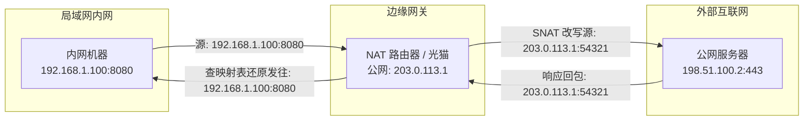
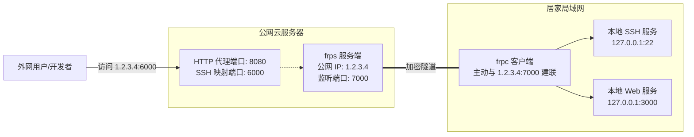
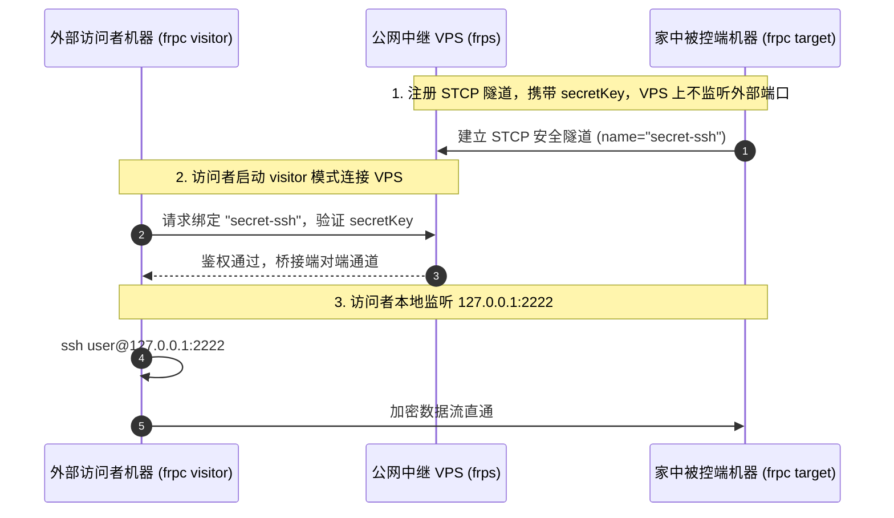

+++
title = '内网穿透完全指南：核心原理与 frp 实战精解'
date = '2026-11-04T12:55:00+08:00'
slug = 'nat-traversal-frp-guide'
draft = false
tags = ['frp', 'network', 'linux', 'tools']
+++

在日常开发与 Homelab 搭建中，我们经常遇到这样的场景：在家里的机器上跑着个人博客、NAS 存储、开发测试接口或本地 AI 大模型（如 Ollama、ComfyUI），想要在外网随时访问，却发现家庭宽带没有公网 IPv4，或者运营商层层做 NAT（网络地址转换），从外部网络根本无法直接发起连接。

内网穿透（NAT Traversal / Intranet Penetration）正是解决此类痛点的关键技术。本文将从网络底层机制剖析内网穿透的本质，横向对比主流穿透工具，并以目前业界最成熟、灵活的开源工具 **frp** 为核心，结合最新的 **TOML 配置体系**，详解如何安全、稳定地搭建生产级内网穿透方案。

<!-- more -->

## 一、为什么内网设备无法直接访问？

要理解内网穿透，首先要明白网络隔离与 NAT 的基本逻辑。

### 1.1 IPv4 枯竭与 NAT 机制

全球 IPv4 地址仅约 43 亿个。为了缓解地址短缺，绝大部分家庭宽带、企业局域网都部署在私网网段（如 `192.168.x.x`、`10.x.x.x`、运营商大内网 `100.64.x.x`）。

当内网设备向外网发起请求时，局域网网关（路由器或光猫）会执行 **SNAT（源地址转换）**，将数据包的源私网 IP 和端口替换为路由器的公网 IP 和动态分配的随机端口，并在内存中建立一条映射表项（NAT 映射会话）：



### 1.2 外部发起连接的困境

如果外部设备想要**主动**连接内网机器，由于路由器的 NAT 映射表中事先没有对应记录，外网发来的 SYN 握手包到达路由器后会被防火墙无条件丢弃或直接拒收。这就是我们无法直接从外网访问家中电脑或内网服务的根本原因。

### 1.3 NAT 类型分类

根据 RFC 3489 / RFC 4787 标准，常见 NAT 行为可划分为四大类型，其穿透难度逐级上升：

| NAT 类型 | 中文名称 | 特征描述 | 穿透/打洞难度 |
| :--- | :--- | :--- | :--- |
| **NAT 1** | 完全圆锥型 (Full Cone) | 只要内网建立了映射，任何外网 IP 和端口均可通过该映射端口发包给内网 | 极易打洞 |
| **NAT 2** | 受限圆锥型 (Address Restricted) | 仅允许内网机器主动发过包的外部 IP 地址向其发送数据 | 较易打洞 |
| **NAT 3** | 端口受限圆锥型 (Port Restricted) | 必须同时匹配外部 IP 与对应端口，才允许外部向内网发包 | 中等难度 |
| **NAT 4** | 对称型 (Symmetric NAT) | 针对每一个不同的目标外部地址，路由器都会分配一个全新的随机端口 | 极难打洞，通常必须依赖中继 |

家庭宽带通常为 NAT 3 或 NAT 4，公司企业级网络与移动蜂窝网络（4G/5G）更普遍是对称型 NAT。

---

## 二、内网穿透的两大核心技术路线

为了跨越 NAT 防火墙的单向阻隔，业界主要演化出两种解决思路：**中继反向代理模式** 与 **P2P 打洞模式**。

```mermaid
flowchart TD
    subgraph 路线一: 中继反向代理 (Relay Proxy)
        C1[内网客户端 Client] -->|1. 主动外联建立长连接| VPS1[公网中继服务器 VPS]
        User1[外网用户] -->|2. 请求公网端口| VPS1
        VPS1 -->|3. 转发流量至长连接通道| C1
    end

    subgraph 路线二: P2P 打洞直连 (Hole Punching)
        C2[内网客户端 A] -->|1. 协商注册| STUN[STUN / 协调服务器]
        C3[内网客户端 B] -->|2. 协商注册| STUN
        STUN -->|3. 交换双方外网映射 IP/端口| C2
        STUN -.->|3. 交换双方外网映射 IP/端口| C3
        C2 <===>|4. 互相发包刺穿 NAT 直连| C3
    end
```

### 2.1 路线一：反向代理中继（Relay Proxy）

- **代表方案**：frp、ngrok、Cloudflare Tunnel。
- **运行机制**：内网机器主动向具有固定公网 IP 的中继服务器发起长连接（TCP/KCP/WebSocket）。当外网用户访问中继服务器的指定端口时，中继服务器将流量通过既有的长连接“倒灌”给内网机器。
- **优缺点分析**：
  - **优势**：穿透成功率 **100%**，不受任何对称型 NAT 或企业级严格防火墙的影响；外网访问者无需安装任何专用客户端软件，直接使用浏览器、SSH 或 RDP 客户端即可访问。
  - **劣势**：所有流量都经过公网服务器中转，数据传输速率与延迟受限于中继 VPS 的公网带宽上限。

### 2.2 路线二：P2P 打洞直连（Peer-to-Peer）

- **代表方案**：Tailscale、ZeroTier、WireGuard、frp (XTCP 模式)。
- **运行机制**：两端设备借助公网 STUN 服务器获知各自在 NAT 网关上的临时公网 IP 与端口，然后两端向对方预测的端口同时发包，诱导各自的 NAT 路由器生成双向映射状态表，实现流量点对点直连。
- **优缺点分析**：
  - **优势**：一旦打洞成功，数据直连传输，延迟最低，完全不占用公网中继带宽。
  - **劣势**：如果两端有一方或双方是对称型 NAT（Symmetric NAT），打洞极易失败，此时系统仍必须回退（Fallback）到中继服务器中转；此外，通常要求通信双方都安装专用的客户端软件。

---

## 三、主流内网穿透方案对比选型

在实际技术选型中，应当根据业务场景选择最适宜的工具：

| 方案 | 核心技术类型 | 是否依赖公网 VPS | 访问端要求 | 适用典型场景 |
| :--- | :--- | :--- | :--- | :--- |
| **frp** | 反向代理 + P2P | 需自备 VPS | 普通模式免客户端；安全模式需客户端 | 暴露公共 Web/API、SSH 远程运维、自建服务公网共享 |
| **Tailscale** | 虚拟 Mesh 局域网 (WireGuard) | 无需 VPS（官方协调） | 所有设备必须安装客户端 | 个人全设备互联、跨地域 Homelab 统一局域网、私密访问 |
| **Cloudflare Tunnel** | CDN 边缘隧道 | 无需 VPS | 浏览器免客户端（仅限 HTTP/Web） | 个人博客、开发测试 Webhook、免公网 IP 的网站上线 |
| **ZeroTier** | 虚拟以太网 (SDN) | 无需 VPS | 所有设备必须安装客户端 | 局域网联机游戏、多设备二层广播网络打通 |
| **ngrok** | 反向代理商业 SaaS | 无需 VPS | 免客户端 | 临时调试第三方 Webhook（免费版域名每次变化） |

**总结建议**：
- 如果你需要**让任何人通过浏览器或标准协议（如 SSH/RDP）直接访问**你的内网服务，**frp** 是最成熟可控的方案。
- 如果是**自己名下的多台设备之间私密互通**，推荐首选 **Tailscale**。
- 如果只是为了**免备案发布静态或动态 Web 网站**，可结合 **Cloudflare Tunnel**。

---

## 四、基于 frp 的内网穿透实战

[frp (fast reverse proxy)](https://github.com/fatedier/frp) 是一款用 Go 语言编写的高性能反向代理应用。

> [!IMPORTANT]
> **配置文件语法说明**：
> 自 frp **v0.52.0** 起，官方已弃用旧版 `.ini` 格式，全面切换为 **`.toml`** 规范格式（同时支持 yaml 和 json）。网络上许多过往教程仍沿用 `[common]` 这种旧 ini 语法，在现代版本中运行会直接报错。本文全篇采用当前官方推荐的标准 **TOML** 语法。

### 4.1 部署架构

我们以一台拥有公网 IP 的 Linux 云服务器作为服务端（`frps`），以处于家庭局域网内的 Linux/Windows 开发机作为客户端（`frpc`）：



---

### 4.2 服务端配置（frps.toml）

在公网云服务器上下载对应架构的发布包并解压，编辑 `frps.toml`：

```toml
# frps.toml
# 服务监听基础配置
bindAddr = "0.0.0.0"
bindPort = 7000

# 通信安全鉴权：必须设置复杂的 token，客户端需完全一致
auth.method = "token"
auth.token = "YourSuperSecretToken_2026_ChangeMe!"

# 虚拟主机 HTTP/HTTPS 端口（针对网站穿透）
vhostHTTPPort = 8080
vhostHTTPSPort = 8443

# 控制台 Dashboard（用于查看连接状态与流量监控）
webServer.addr = "0.0.0.0"
webServer.port = 7500
webServer.user = "admin"
webServer.password = "Admin_Dashboard_Password_2026"

# 限制客户端可绑定的端口范围，防止误占用系统敏感端口
allowPorts = [
  { start = 6000, end = 6100 },
  { start = 8000, end = 9000 }
]

# 传输层加密：强化安全性
transport.tls.force = false
```

启动服务端：
```bash
./frps -c ./frps.toml
```

> [!TIP]
> 务必检查云厂商管理后台的**安全组（Security Group）**以及服务器本地防火墙（如 `ufw` 或 `firewalld`），放行相应的端口：`7000` (基础通信)、`7500` (Dashboard)、`8080` (Web) 以及映射端口范围 `6000-6100`。

---

### 4.3 场景一：TCP 端口映射（以远程 SSH 与 RDP 为例）

这是最常见的需求：将内网 Linux 主机的 SSH（22 端口）或 Windows 主机的远程桌面 RDP（3389 端口）暴露到公网。

在内网机器上编辑 `frpc.toml`：

```toml
# frpc.toml
# 连接服务端的公网地址与鉴权配置
serverAddr = "1.2.3.4"      # 替换为你的云服务器公网 IP
serverPort = 7000

auth.method = "token"
auth.token = "YourSuperSecretToken_2026_ChangeMe!"

# 映射本地 SSH
[[proxies]]
name = "home-linux-ssh"
type = "tcp"
localIP = "127.0.0.1"
localPort = 22
remotePort = 6000          # 映射到公网服务器的 6000 端口

# 映射 Windows 远程桌面 (如果当前是 Windows 设备)
# [[proxies]]
# name = "home-windows-rdp"
# type = "tcp"
# localIP = "127.0.0.1"
# localPort = 3389
# remotePort = 6001
```

启动客户端：
```bash
./frpc -c ./frpc.toml
```

**连接测试**：
在外网任意终端执行以下命令，即可穿透直连内网主机：
```bash
ssh -p 6000 user@1.2.3.4
```

---

### 4.4 场景二：HTTP/HTTPS 站点穿透（支持域名复用与路由）

假设你在内网机器上开发了一个 Web 应用或博客（运行在 `127.0.0.1:3000`），希望通过二级域名 `app.example.com` 对外访问。

frp 支持通过 HTTP 请求的 `Host` 头自动将流量分发给不同的内网客户端，因此**多个不同的内网 Web 服务可以共用公网服务器的同一个 80/8080 端口**。

#### 客户端配置示例：

```toml
# frpc.toml
serverAddr = "1.2.3.4"
serverPort = 7000
auth.method = "token"
auth.token = "YourSuperSecretToken_2026_ChangeMe!"

[[proxies]]
name = "web-portfolio"
type = "http"
localIP = "127.0.0.1"
localPort = 3000
customDomains = ["app.example.com"]

# 如果有简单的密码保护需求，可以在穿透层挂载 HTTP Basic 认证
# httpUser = "guest"
# httpPassword = "TemporaryPassword123"
```

#### DNS 解析与反向代理配合：
1. 将域名 `app.example.com` 解析（A 记录）到公网云服务器 IP `1.2.3.4`。
2. 外部直接访问 `http://app.example.com:8080` 即可进入本地服务。
3. **生产标准做法**：通常在云服务器上部署 Nginx，监听标准 `80` 和 `443` 端口并配置 SSL 证书，将 `app.example.com` 反代到 `127.0.0.1:8080`，实现标准 HTTPS 访问。

---

### 4.5 场景三：STCP 安全模式（不开放公网端口）

在普通的 TCP 穿透模式下，公网服务器会直接开放 `6000` 端口。全网扫描器会高频探测此类端口并尝试爆破 SSH 密码，存在严重的安全隐患。

**STCP（Secret TCP）** 模式彻底解决了这个问题：
- **公网服务器不开放任何业务端口**。
- 只有安装了 frpc 访问端并持有正确 `secretKey` 的受信设备，才能与内网机器打通隧道。



#### 1. 被访问端配置（家中主机 `frpc.toml`）：

```toml
# 被访问机器上的 frpc.toml
serverAddr = "1.2.3.4"
serverPort = 7000
auth.method = "token"
auth.token = "YourSuperSecretToken_2026_ChangeMe!"

[[proxies]]
name = "secret-ssh"
type = "stcp"
secretKey = "VeryComplex_SecretKey_998877"
localIP = "127.0.0.1"
localPort = 22
```

#### 2. 访问端配置（随身笔记本 `frpc.toml`）：

```toml
# 笔记本电脑上的 frpc.toml
serverAddr = "1.2.3.4"
serverPort = 7000
auth.method = "token"
auth.token = "YourSuperSecretToken_2026_ChangeMe!"

[[visitors]]
name = "secret-ssh-visitor"
type = "stcp"
serverName = "secret-ssh"                      # 对应被访问端代理的 name
secretKey = "VeryComplex_SecretKey_998877"      # 必须完全一致
bindAddr = "127.0.0.1"
bindPort = 2222                                # 在笔记本本地监听的端口
```

在笔记本上启动 visitor 客户端后，直接连接本地回路端口即可：
```bash
ssh -p 2222 user@127.0.0.1
```
在公网层面，任何未持有该 `secretKey` 的扫描器都无法感知到服务的存在。

---

## 五、生产级运维与安全加固

要让内网穿透长期稳定运行，还需要配置守护进程与安全防护策略。

### 5.1 使用 systemd 管理进程保活

在 Linux 系统中，使用 `systemd` 可以实现开机自启与异常退出自动重启。

#### 服务端配置 `/etc/systemd/system/frps.service`：
```ini
[Unit]
Description=frps server daemon
After=network.target syslog.target
Wants=network.target

[Service]
Type=simple
User=root
ExecStart=/usr/local/bin/frps -c /etc/frp/frps.toml
Restart=always
RestartSec=5s

[Install]
WantedBy=multi-user.target
```

#### 客户端配置 `/etc/systemd/system/frpc.service`：
```ini
[Unit]
Description=frpc client daemon
After=network.target syslog.target
Wants=network.target

[Service]
Type=simple
User=root
ExecStart=/usr/local/bin/frpc -c /etc/frp/frpc.toml
Restart=always
RestartSec=5s

[Install]
WantedBy=multi-user.target
```

常用运维命令：
```bash
# 重载系统服务
sudo systemctl daemon-reload

# 设置开机自启并立即启动
sudo systemctl enable --now frps    # 服务端
sudo systemctl enable --now frpc    # 客户端

# 查看运行状态
sudo systemctl status frpc
```

### 5.2 安全加固清单

1. **强 Token 鉴权**：
   禁止使用 `123456` 等弱口令作为 Token。Token 在网络建立初期用于防范非授权客户端连接。
2. **限制服务端暴露端口区间（`allowPorts`）**：
   在 `frps.toml` 中配置 `allowPorts`，严格限定客户端只能绑定指定端口段，避免恶意客户端尝试监听服务器的 `80`、`443` 或 `22` 端口造成服务劫持。
3. **开启 TLS 隧道加密**：
   在客户端配置中开启 `transport.tls.enable = true`，确保客户端与服务端之间的控制信令与传输数据全程加密，防止运营商或中间节点进行报文审查或劫持。
4. **内网敏感服务首选 STCP**：
   对于 SSH、远程桌面、数据库、NAS 管理后台等敏感服务，强烈建议使用 **STCP** 或配合 VPN，避免直接将原始 TCP 端口暴露给公网。

---

## 六、常见排查与避坑指南 (FAQ)

### Q1: 客户端显示 `connect to server error: dial tcp ... i/o timeout`
- **原因**：云服务器厂商控制台的**安全组**没有开放 `bindPort`（默认 7000）。
- **排查**：检查阿里云/腾讯云/AWS 等安全组入方向规则，放行对应 TCP 端口；并在 VPS 上使用 `sudo ss -tulnp | grep 7000` 确认 frps 正在监听。

### Q2: SSH 映射成功，但连接报错 `connection refused`
- **原因**：内网主机的 SSH 服务本身没有启动，或 `localPort` 填写错误。
- **排查**：在客户端本机执行 `ssh user@127.0.0.1` 确认本地 SSH 服务能否正常登入。

### Q3: 为什么 HTTP 穿透访问出现 `The page you visited was not found (404)`
- **原因**：frp 的 HTTP 代理是根据请求头的 `Host` 域名路由的。
- **排查**：确认访问时使用的域名是否完全匹配 `customDomains` 中的配置；若使用直接访问公网 IP 的方式，必须将 IP 加入到 `customDomains` 中。

---

## 七、总结

内网穿透技术是连接隔离网络与广阔互联网的坚实桥梁：
- 对于**对外公共交付**与**免安装访问**，以 **frp** 为代表的反向代理中继模式具备无可替代的灵活性与通用性；
- 对于**多节点私密组网**，以 **Tailscale / WireGuard** 为代表的虚拟网络能够带来更极致的直连性能；
- 在部署任何穿透方案时，**网络安全性**永远排在第一位——合理使用 STCP 隐藏端口、配置强密码、启用 TLS 加密，才能在享受便利的同时确保内网资产安然无忧。
