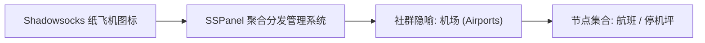
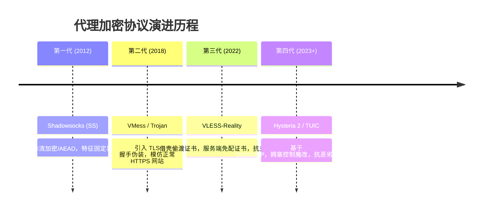
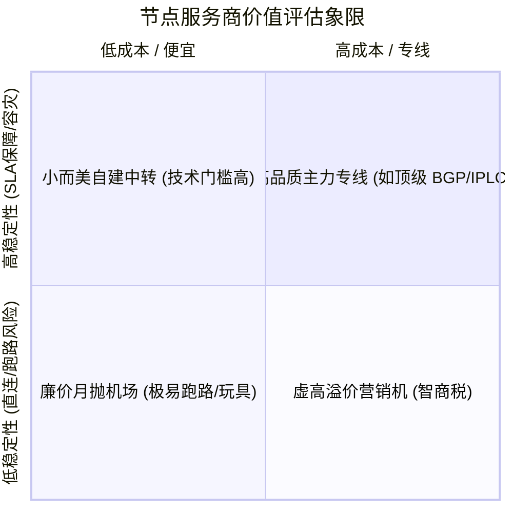

+++
title = '网络代理节点（机场）架构解析与选型避坑全指南'
date = '2026-11-04T13:00:00+08:00'
slug = 'proxy-airport-architecture-guide'
draft = false
tags = ['proxy', 'network', 'clash', 'sing-box', 'tools']
+++

在当代网络技术与分布式开发日常中，“机场”已经成为开发者群体、跨境从业者与科研人员耳熟能详的代名词。从早期的自建单节点 Shadowsocks，到如今拥有多线 BGP 中转、跨国 IPLC 专线以及自动化调度系统的集群化服务，节点服务的形态经历了翻天覆地的演进。

很多人每天都在使用各类客户端（如 FlClash、Clash Verge、Sing-box）导入订阅，但常常对背后的网络拓扑架构、线路类型差异、主流协议特点以及安全隐私风险知之甚少。本文将以中立、客观的技术视角，深度拆解“机场”节点服务的底层技术架构与演进脉络，并梳理出一套理性的评估与避坑指南。

<!-- more -->

## 一、溯源：“机场”一词的由来与本质

### 1.1 命名渊源

“机场”一词最早源于开源代理工具 **Shadowsocks**。由于其经典客户端图标是一架小巧的纸飞机，管理和分发批量 Shadowsocks 节点的后台面板系统（如早期的 SSPanel）便顺理成章地被戏称为“机场”，而一个个具体的代理节点服务器则对应为“停机坪”或“航班”。



### 1.2 技术本质

抛开俗称，从计算机网络架构角度审视：
> **“机场”的本质是一个分布式的跨国反向代理转发网络与节点订阅自动化分发系统。**

它通过集中式的用户鉴权面板与 API 网关，向客户端统一下发经过加密的节点连接参数（YAML / JSON / Base64 订阅链接），并在传输路径中利用自建或租用的公网 VPS、国内 BGP 中转服务器或国际商业专线，实现网络流量的低延迟定向转发。

---

## 二、底层网络传输架构：直连 vs 中转 vs 专线

节点服务体验的核心瓶颈从来不在客户端，而在**骨干传输链路**。根据数据包在网络中流转路径的不同，主流架构可划分为三大流派：

```mermaid
flowchart TD
    subgraph 架构一: 直连网络 (Direct)
        C1[客户端] -->|公网跨海长链路 / 晚高峰丢包高| S1[境外落地 VPS]
        S1 --> W1[目标网站]
    end

    subgraph 架构二: BGP 国内中转 (Relay Transit)
        C2[客户端] -->|就近接入| BGP[国内多线 BGP 服务器]
        BGP -->|优化公网隧道中继| S2[境外落地 VPS]
        S2 --> W2[目标网站]
    end

    subgraph 架构三: IPLC / IEPL 专线 (Private Leased Line)
        C3[客户端] -->|内网边缘接入| Edge[国内专线入口]
        Edge ===|物理光纤内网专线 / 零丢包不过公网| Border[境外专线出口]
        Border --> S3[境外落地集群]
        S3 --> W3[目标网站]
    end
```

### 2.1 直连架构（Direct Connection）

- **网络路径**：`客户端 -> 国内公网出口网关 -> 国际海底光缆 -> 境外落地机`。
- **技术特点**：
  - 架构极简，成本低廉，通常由服务商购买廉价海外 VPS（如搬瓦工、Linode、DigitalOcean）搭建单点服务。
  - **致命弱点**：数据包直接跨越公网国际出入口，极易受到运营商 QoS 限速影响，晚高峰（20:00 - 23:00）骨干网拥塞时，延迟骤增，丢包率可能高达 30% 以上。

### 2.2 BGP 国内中转（Relay Transit）

- **网络路径**：`客户端 -> 国内多线 BGP 中转机房 -> 跨境隧道 -> 境外落地机`。
- **技术特点**：
  - **就近接入**：中转服务器部署在上海、广州、深圳、北京等骨干网枢纽，移动、电信、联通多线接入，国内用户到中转机的延迟极低（通常在 10~30ms 内）。
  - **协议隧道封装**：国内中转机与境外落地机之间通过优化过的加密隧道协议（如 TLS、WireGuard、Gost 等）传输数据。
  - **体验提升**：极大抹平了不同运营商本地出口的性能差异，抗抖动能力远优于直连。

### 2.3 IPLC 与 IEPL 商业专线

- **概念解析**：
  - **IPLC（International Private Leased Circuit）**：国际私有租用线路，属于点对点的物理内网专线。
  - **IEPL（International Ethernet Private Line）**：国际以太网专线，基于二层以太网技术构建的私有跨国通道。
- **技术优势**：
  1. **完全不走公网出口**：数据在深圳入口进入专线，从内部光纤直达香港出口，完全绕过公网国际出入口网关。
  2. **超低延迟与零丢包**：专线 SLA 极高，即使在晚高峰或恶劣网络环境下，依然维持恒定的物理光速延迟（如深港专线端到端仅 3~5ms）。
  3. **成本昂贵**：专线带宽以 Gbps 计费每月成本数万至数十万元，因此提供真专线的服务商通常按流量倍率计费且单价较高。

### 线路架构横向对比：

| 维度 | 直连网络 | BGP 国内中转 | IPLC / IEPL 专线 |
| :--- | :--- | :--- | :--- |
| **网络延迟** | 波动剧烈（150~300ms） | 平稳（50~100ms） | 极致平稳（30~60ms） |
| **晚高峰丢包率** | 极高（10% ~ 40%） | 较低（1% ~ 5%） | 几乎为零（< 0.1%） |
| **抗封锁稳定性** | 极差，IP 容易不可用 | 较好，只需更换中转/隧道 | 极强，内网专线无外网阻断 |
| **带宽成本** | 极低 | 中等 | 极高（按兆月租昂贵） |

---

## 三、主流协议演进与安全技术架构

节点服务的通信协议随着对抗检测与性能需求的变化，经历了四代革新：



### 3.1 第一代：特征加密协议（Shadowsocks / SS-2022）
早期通过对称加密（AES-256-GCM、ChaCha20-IETF-Poly1305）将明文封装为看似随机的二进制高熵数据流。后来针对重放攻击和主动探测，社区推出了现代化的 **SS-2022** 规范，强化了基于预共享密钥的握手验证。

### 3.2 第二代：TLS 伪装协议（Trojan / VMess+TLS）
既然完全随机的二进制高熵流量容易被深度包检测（DPI）识别，第二代思路转向**全面伪装**：直接套用标准的 TLS 1.3 协议栈，服务端配置真实的域名证书并搭建合法的 Web 站点（如 Nginx），在行为特征上与正常的浏览器访问商业网站完全一致。

### 3.3 第三代：零证书伪装（VLESS + Reality）
在传统 TLS 方案中，自购域名和证书容易被反向追踪关联。Xray 团队推出的 **Reality** 技术实现了革命性创新：
- **借壳偷渡**：服务端无需购买域名和申请证书，直接借用境外大型合规站点（如 `www.apple.com`、`www.microsoft.com`）的公钥证书。
- **消除特征**：外部主动探测探针连接时，服务端直接回落（Fallback）转发给真实的大厂网站，探测者无法区分真实与虚假，彻底摆脱了证书溯源风险。

### 3.4 第四代：基于 QUIC/UDP 的暴力吞吐协议（Hysteria 2 / TUIC）
传统的 TCP 协议内建滑动窗口与拥塞退避算法，在遇到丢包时会自动降速。**Hysteria 2** 与 **TUIC** 基于 **QUIC (UDP)** 构建，重新实现了极致激进的拥塞控制算法：
- 即使在丢包率高达 20%~30% 的劣质恶劣网络中，依然能够强行拉满带宽。
- 非常适合应对移动网络、弱 Wi-Fi 信号以及跨大洋长距离高丢包场景。

---

## 四、服务商后端运营体系架构

一个成熟的中大型节点服务商（如 Flybit 等商业节点），其后台并非几台零散的 VPS，而是一套高度协同的微服务系统：

```mermaid
graph TD
    subgraph 用户层
        Client[客户端 FlClash / Sing-box / Surge]
    end

    subgraph 前端网关层
        WebUI[前端面板 SSPanel / V2board / Xboard]
        SubAPI[订阅转换与下发 API Subconverter]
        Payment[自动化支付与计费回调]
    end

    subgraph 核心控制与调度
        Controller[核心调度集群]
        DB[(用户额度/节点配置数据库)]
        Monitor[Prometheus + Grafana 链路拨测与负载监控]
    end

    subgraph 节点数据平面 (Data Plane)
        RelayNode[国内 BGP 中转节点]
        EgressCluster[境外落地机集群 (Xray / Sing-box Core)]
    end

    Client -->|1. 拉取订阅配置| SubAPI
    SubAPI --> WebUI
    WebUI --- DB
    Controller -->|动态下发路由规则| RelayNode
    Controller -->|分发鉴权 Token| EgressCluster
    RelayNode ==>|专线/隧道传输| EgressCluster
    Monitor -.->|探测节点健康度 & 自动摘除死节点| Controller
```

- **面板前端系统**：目前行业主流开源框架包括 `SSPanel-UIM`、`V2board`、`Xboard` 等，负责用户注册、套餐订阅、自动化账单、工单支持与订阅下发。
- **订阅转换引擎（Subconverter）**：根据客户端请求的 `User-Agent`，动态将服务端的原始节点配置实时转化为目标客户端（Clash YAML、Sing-box JSON、Loon、Surge）所需的格式。
- **数据转发核心**：后端节点广泛采用 Go/Rust 编写的高并发高性能代理内核（如 `Xray-core`、`Sing-box`、`Shadowsocks-rust`），并通过 API 与中央面板同步用户流量账单与在线连接数。
- **动态故障转移（Failover）**：高规格服务商会配置自动探针，每分钟对全球落地机执行连通性检测，一旦某个节点被阻断，数秒内自动在订阅中降级或切换备用 IP。

---

## 五、理性选型与全方位避坑指南

面对良莠不齐的节点服务市场，用户在选择与日常使用中应当掌握科学的评估逻辑：

### 5.1 选型评估六维指标



1. **链路类型透明度**：正规优质服务商通常会明确标注线路架构（是普通公网直连、普通中转，还是真 BGP / IPLC 专线）。
2. **晚高峰实际速率表现**：白天测速万兆毫无意义，真正的分水岭在 **20:30 ~ 22:30 的单线程真实吞吐量** 与 4K/8K 视频缓冲速率。
3. **原生 IP 与流媒体/AI 解锁能力**：
   - 是否支持 Netflix、Disney+ 等区域版权流媒体解锁；
   - 是否为高信誉住宅 IP（Residential IP），决定了使用 ChatGPT、Claude、Google Gemini 等严控 IP 风控的服务时是否频繁触发验证码或封号。
4. **在线客服与工单响应 SLA**：是否有持续的技术维护团队，节点故障时能否在数小时内快速修复。
5. **协议多样性**：是否同时支持 VLESS-Reality、Hysteria 2、SS-2022 等新协议，以应对复杂的运营商网络环境。
6. **退款政策与试用支持**：支持短周期购买（如月付或提供小额试用包）是检验服务商信誉的试金石。

### 5.2 核心避坑法则（切记！）

> [!WARNING]
> **避坑法则一：坚决避免“长期年付”**
> 任何节点服务商本质上都面临上游机房断约、线路被查或不可抗力的商业风险。永远优先选择**月付或季付**，切勿贪图所谓的“三年付打三折”促销，防止沉没成本过大。

> [!IMPORTANT]
> **避坑法则二：坚持“1 主 + 1 备”双通道冗余原则**
> 不要在同一个篮子里放所有鸡蛋。主力工作建议使用高稳定性的 BGP/IPLC 线路，同时随身备用一个轻量低廉的按量计费节点作为应急梯子，防止主力因链路维护而突然断网。

> [!CAUTION]
> **避坑法则三：高度警惕敏感信息泄露**
> 1. **审计规则风险**：许多服务商在节点后端配置了敏感关键词审计（过滤某些网站或访问记录），中转机理论上有能力分析未加密流量。
> 2. **数据安全规范**：在公共节点环境下，**严禁传输明文银行账号、敏感工作密钥与私有资产凭证**，访问高隐私场景务必叠加端到端加密（如全流程 HTTPS、SSH 或二次专用 VPN）。
> 3. **第三方订阅转换泄漏**：尽量使用客户端本地转换（如 FlClash、Clash Verge 内置内核直接解析），避免使用来路不明的公共在线订阅转换平台，以防订阅 Token 被人截留盗刷。

---

## 六、配合客户端的高效分流实践

选好节点后，充分发挥节点价值的关键在于客户端的精细化分流规则：

```mermaid
flowchart TD
    Req[客户端发起访问请求] --> DNS{Fake-IP / 域名嗅探}
    DNS --> Rules{命中分流规则？}
    
    Rules -->|国内域名 / IP (GEOIP, CN)| Direct[DIRECT: 直连直通, 满血低延迟]
    Rules -->|AI 平台 (OpenAI / Claude)| GroupAI[策略组: 限制高纯净度美日节点]
    Rules -->|流媒体 (Netflix / YouTube)| GroupMedia[策略组: 选择大带宽解锁节点]
    Rules -->|局域网 / 私有地址| Private[DIRECT: 本地局域网]
    Rules -->|其余未知境外流量| Proxy[MATCH: 自动优选或故障转移节点]
```

1. **分流策略划分**：
   - **国内流量（DIRECT）**：微信、淘宝、百度、Bilibili 等国内服务完全直连，不耗费代理流量，保证低延迟。
   - **AI 专项策略组**：将 ChatGPT、Claude 等域名固定路由到低风控、原生 IP 的节点（如美区、日区高信誉节点），避免节点频繁跳动导致账号风控封禁。
   - **流媒体专线**：配置自动测速 URL-Test，自动选择当前延迟最低、带宽充裕的香港/新加坡节点播放 4K 视频。
2. **Fake-IP 模式的应用**：
   在 FlClash 或 Sing-box 中开启 Fake-IP，不仅能彻底消灭客户端本地 DNS 污染，还能减少一次解析往返延迟（RTT），使网页秒开率大幅提高。

---

## 七、总结

“机场”节点服务在本质上是现代互联网基础设施的一种特殊衍生业态：
- 从**直连**到**国内 BGP 中转**，再到端到端 **IPLC 物理专线**，它展现了网络工程在对抗延迟、丢包与抖动上的极致优化；
- 从 **Shadowsocks** 到 **VLESS-Reality** 与 **Hysteria 2**，它凝结了传输层加密伪装与极速拥塞控制算法的演化智慧。

对于用户而言，褪去玄学滤镜，理解其背后的拓扑逻辑、保持理性消费习惯（月付与冗余备份），并在使用中牢记安全边界与隐私防线，才是长久稳定畅游无界网络的成熟之道。
