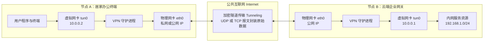
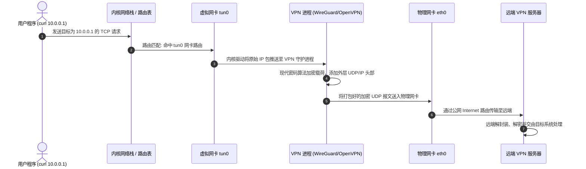
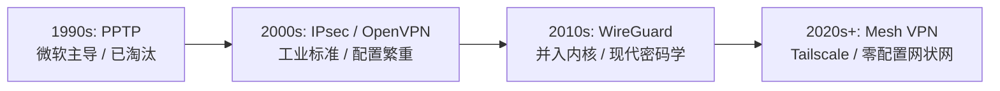
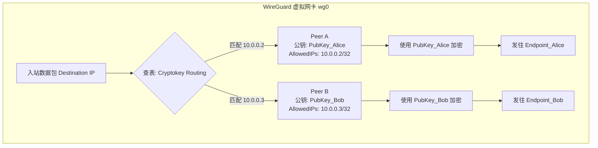
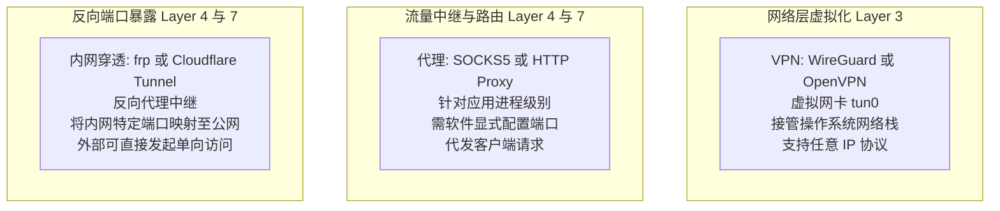

+++
title = 'VPN 技术全景与现代化实践：从底层隧道到 WireGuard 精解'
date = '2026-11-04T12:59:00+08:00'
slug = 'vpn-technology-wireguard-guide'
draft = false
tags = ['vpn', 'wireguard', 'network', 'linux', 'security']
+++

在分布式办公、多云协同与 Homelab 基础设施日趋普及的今天，网络互联的需求早已从单一的“端口映射”上升到“全网安全互联”。无论是企业分支机构与总部的安全互联，还是开发者在异地安全访问家庭内网的整套私有服务，VPN（Virtual Private Network，虚拟专用网络）始终是网络安全的基石技术。

然而，传统的 VPN 方案往往伴随着笨重庞杂的配置、缓慢的吞吐性能以及晦涩难懂的密码学参数。近年来，以 **WireGuard** 为代表的新一代现代 VPN 协议凭借极简的代码实现、卓越的性能表现与划时代的设计理念，迅速被并入 Linux 主线内核，并彻底改变了 VPN 生态。

本文将从操作系统网络栈底层拆解 VPN 的核心实现机制，梳理协议演进史，并以 WireGuard 为主角，深入剖析其运行哲学与生产级配置实战。

<!-- more -->

## 一、VPN 的本质与底层工作机制

在物理网络世界中，要将两个远隔千里的局域网连成一体，最直接的方式是拉一条独占的物理光纤专线（Leased Line），但这对于绝大多数组织和个人而言成本极其高昂。

**VPN 的本质，就是利用公共互联网（如 Internet）作为传输载体，通过软件手段在逻辑上构建一条专属于通信双方的、端到端加密的“虚拟专线”。**



### 1.1 VPN 的三大核心支柱

任何一套完整的 VPN 实现，都离不开以下三个技术基石：
1. **隧道技术（Tunneling）**：将一种协议的数据包（如内部私有 IP 包）整体打包塞入另一种协议（如公网通用的 UDP/TCP 包）的数据载荷（Payload）中进行跨网络中转。
2. **封装与解封装（Encapsulation & Decapsulation）**：在发送端给原始数据打上外层路由包头，在接收端剥去外层包头还原原始报文。
3. **加解密与身份认证（Encryption & Authentication）**：确保数据包在公网中穿行时，即使被嗅探、窃听或篡改，中间节点也无法获取明文，且只有持有合法身份凭证的节点能够建立信任。

### 1.2 操作系统核心秘密：TUN 与 TAP 虚拟网卡

VPN 能够在操作系统中“无感接管”网络流量，核心归功于操作系统内核提供的虚拟网卡技术——**TUN/TAP** 设备。

- **TUN（Network TUNnel）**：工作在 **OSI 第三层（网络层）**，处理纯粹的 **IP 数据包**。VPN 应用读取和写入的都是带 IP 头的数据包。绝大多数现代 VPN（如 WireGuard、OpenVPN 常见模式）都基于 TUN 设备。
- **TAP（Network TAP）**：工作在 **OSI 第二层（数据链路层）**，处理以太网帧（包含 MAC 地址），能像真实交换机端口一样传输 ARP 广播、IPX 等协议。常用于需要完整模拟局域网二层广播（如局域网联机游戏对战）的场景。

#### 一个数据包的完整穿越之旅：



---

## 二、主流 VPN 协议的演化脉络

几十年来，网络安全协议经历了多次重大变革与迭代淘汰：



### 2.1 协议深度对比

| 协议标准 | 工作层级 | 内核态集成 | 密码学方案 | 典型代码量 | 性能与资源消耗 | 配置复杂度 |
| :--- | :--- | :--- | :--- | :--- | :--- | :--- |
| **PPTP** | Layer 2/3 | 早期内置 | MS-CHAPv2（已破译） | 较小 | 差（不安全） | 极低 |
| **OpenVPN** | Layer 2/3 | 主要是用户态（近期引入 DCO 内核加速） | TLS/OpenSSL 协商套件 | ~100,000+ 行 | 中等（频繁上下文切换） | 繁复（证书链、多配置文件） |
| **IPsec (IKEv2)**| Layer 3 | 原生内核支持 | 模块化协商（AES-GCM 等） | 庞大沉重 | 高 | 极高（百行参数难以调试） |
| **WireGuard** | Layer 3 | **深度融入 Linux 内核** | 固化现代化密码学（Noise Protocol） | **~4,000 行** | **极高（线速转发、超低延迟）** | **极低（公私钥对）** |

---

## 三、WireGuard 核心设计哲学：划时代变革

WireGuard 之所以被称为“革命性的网络协议”，关键在于它摒弃了过往所有传统 VPN 的历史包袱，在架构理念上做到了极致克制与现代。

### 3.1 固化现代化密码学套件（Cipher Suite）

传统协议（如 IPsec 和 OpenVPN）设计了庞大复杂的“密码算法协商机制”，通信双方需在握手阶段协商加密算法、哈希算法和密钥交换方案。这不仅极大增加了握手往返延迟，还经常因配置疏漏导致降级攻击（Downgrade Attack）。

WireGuard 彻底取消了协商逻辑，直接钦定当前密码学界公认最强健、高效的黄金组合：
- **密钥交换**：Curve25519（ECDH）
- **数据加密与认证**：ChaCha20-Poly1305（AEAD）
- **哈希与键控哈希**：BLAKE2s（比 SHA-3 更快）
- **握手协议**：Noise Protocol Framework（极速 1-RTT 握手）

如果未来某种算法被数学攻破，WireGuard 的策略是整体发布升级版本协议（如 WireGuard v2），杜绝向下协商的后门风险。

### 3.2 极简的加密密钥路由（Cryptokey Routing）

这是 WireGuard 最优雅的设计概念：**它将公钥（Public Key）与 IP 地址（AllowedIPs）进行静态绑定，类似于网络交换机将 MAC 地址与物理端口绑定。**



- **发送时**：当操作系统把一个目标 IP 为 `10.0.0.2` 的数据包交给 `wg0` 时，WireGuard 查找配置表发现该 IP 属于 Peer A，便立即使用 Peer A 的公钥对数据进行加密，并打上外层 UDP 头发送给 Peer A 的外网终结点（Endpoint）。
- **接收时**：当从外网收到经过 Peer A 私钥加密的数据包时，解密后校验其内部的源 IP。若解出来的源 IP 不在 Peer A 配置的 `AllowedIPs` 清单中，系统会判定存在欺骗行为并**直接静默丢弃**。这一机制天然杜绝了 IP 伪造和中间人篡改。

### 3.3 完全静默与无感漫游（Roaming）

- **完全静默（Stealth Mode）**：如果扫描器向运行 WireGuard 的端口发送未经认证的 UDP 数据包，WireGuard **完全不作任何响应**（零回包）。从外部扫描看，该端口就像关闭了一样，攻击者甚至无法侦测到服务器上运行了 WireGuard。
- **无状态漫游**：WireGuard 底层纯走 UDP。当你的手机或笔记本从公司 Wi-Fi 切换到移动 5G 网络时，客户端外网 IP 发生了改变，它只需用私钥签名发出下一个数据包，服务端解密成功后便会自动将该 Peer 的 Endpoint 刷新为新的外网 IP/端口，整个过程**无需重新执行耗时的连接重连握手，网络无缝衔接**。

---

## 四、WireGuard 生产级组网实战

我们来演练一个最标准的网络拓扑：一台位于云上的公网 Linux 网关，连接两台处于内网环境的客户端设备。

### 4.1 网络环境规划

| 节点角色 | 主机名称 | 物理/外网地址 | WireGuard 内部虚拟 IP |
| :--- | :--- | :--- | :--- |
| **网关 / 服务端** | `wg-server` | 公网 IP: `1.2.3.4` (监听 UDP 51820) | `10.0.0.1/24` |
| **客户端 A** | `laptop-alice` | 位于家庭内网 (动态私网) | `10.0.0.2/24` |
| **客户端 B** | `nas-storage` | 位于办公市内网 (动态私网) | `10.0.0.3/24` |

---

### 4.2 第一步：生成公私钥对

在每台机器上安装 `wireguard-tools`，并分别生成各自的公私钥：

```bash
# 生成私钥并推导出对应的公钥
umask 077
wg genkey | tee privatekey | wg pubkey > publickey
```

记下各自的密钥字符串（Base64 编码）：
- 服务端：`Server_PrivateKey` / `Server_PublicKey`
- 客户端 A：`ClientA_PrivateKey` / `ClientA_PublicKey`

---

### 4.3 第二步：服务端配置 (`/etc/wireguard/wg0.conf`)

在公网云服务器上创建并编辑配置文件：

```ini
# /etc/wireguard/wg0.conf (服务端)

[Interface]
# 服务端在虚拟私网中的 IP
Address = 10.0.0.1/24
# 监听的公网 UDP 端口
ListenPort = 51820
# 服务端的私钥
PrivateKey = Server_PrivateKey_Here...

# 启动和停止时自动配置 iptables 转发与 NAT 伪装 (实现全流量代理或内网互通)
# 假设公网物理网卡名称为 eth0 (请使用 `ip route show default` 确认)
PostUp   = iptables -A FORWARD -i wg0 -j ACCEPT; iptables -A FORWARD -o wg0 -j ACCEPT; iptables -t nat -A POSTROUTING -o eth0 -j MASQUERADE
PostDown = iptables -D FORWARD -i wg0 -j ACCEPT; iptables -D FORWARD -o wg0 -j ACCEPT; iptables -t nat -D POSTROUTING -o eth0 -j MASQUERADE

# ----------------- 客户端 A (Alice) -----------------
[Peer]
PublicKey = ClientA_PublicKey_Here...
# 允许该客户端使用的虚拟私网 IP
AllowedIPs = 10.0.0.2/32

# ----------------- 客户端 B (NAS) -----------------
[Peer]
PublicKey = ClientB_PublicKey_Here...
AllowedIPs = 10.0.0.3/32
```

开启 Linux 系统内核 IPv4 转发能力：
```bash
sudo sysctl -w net.ipv4.ip_forward=1
echo "net.ipv4.ip_forward=1" | sudo tee -a /etc/sysctl.conf
```

---

### 4.4 第三步：客户端配置 (`/etc/wireguard/wg0.conf`)

在客户端 A（如笔记本）上编辑配置：

```ini
# /etc/wireguard/wg0.conf (客户端 A)

[Interface]
# 客户端分配的虚拟 IP
Address = 10.0.0.2/24
PrivateKey = ClientA_PrivateKey_Here...
# 可选：指定内网 DNS
DNS = 1.1.1.1

[Peer]
# 服务端的公钥
PublicKey = Server_PublicKey_Here...
# 服务端公网终结点 (IP + 端口)
Endpoint = 1.2.3.4:51820

# 路由控制：核心参数！
# 场景 1: 仅访问 VPN 内网资源 (分流模式)
AllowedIPs = 10.0.0.0/24

# 场景 2: 全局翻转默认网关 (所有上网流量均通过 VPS 出口)
# AllowedIPs = 0.0.0.0/0, ::/0

# 心跳保活 (非常重要！): 处于 NAT 或防火墙后的客户端必须开启，每 25 秒发一次心跳维持 NAT 表项
PersistentKeepalive = 25
```

> [!IMPORTANT]
> **深入理解 `AllowedIPs` 的双重角色**：
> 1. **在本地路由层面**：它定义了“哪些目标网段的数据包应当被压入 `wg0` 网卡”。例如填 `10.0.0.0/24` 时，只有访问 `10.0.0.x` 的流量才会走 VPN，平时上网直连；如果填 `0.0.0.0/0`，则代表所有外网流量全部走 VPN 网关。
> 2. **在入站过滤层面**：它充当访问控制列表（ACL）。解密后的数据包源 IP 必须落在 `AllowedIPs` 范围内，否则直接被丢弃。

---

### 4.5 第四步：服务启停与运行状态检验

使用 `wg-quick` 工具集管理服务：

```bash
# 启动 VPN 接口
sudo wg-quick up wg0

# 设置开机自启动
sudo systemctl enable --now wg-quick@wg0

# 查看当前连接握手状态、传输流量
sudo wg show
```

如果连接正常，在客户端运行 `sudo wg show` 可以看到如下输出：
```text
interface: wg0
  public key: ClientA_PublicKey_Here...
  private key: (hidden)
  listening port: 53218

peer: Server_PublicKey_Here...
  endpoint: 1.2.3.4:51820
  allowed ips: 10.0.0.0/24
  latest handshake: 14 seconds ago
  transfer: 12.45 KiB received, 8.92 KiB sent
```
此时互相 `ping 10.0.0.1`，即可实现毫秒级互通。

---

## 五、辨析：VPN vs 代理 (Proxy) vs 内网穿透 (NAT Traversal)

在网络开发中，初学者经常将这三类技术混淆。以下矩阵清晰界定了它们的技术边界：



| 维度 | VPN (如 WireGuard) | 代理 (如 SOCKS5 / Clash) | 内网穿透 (如 frp) |
| :--- | :--- | :--- | :--- |
| **工作层级** | **OSI Layer 3 (网络层)** | OSI Layer 4/7 (传输层/应用层) | OSI Layer 4/7 (传输层/应用层) |
| **系统侵入度** | 创建虚拟网卡，可全局无感接管 | 无需虚拟网卡（除非结合 TUN 模式），需应用配合 | 无需虚拟网卡，运行独立客户端 |
| **协议支持** | 完整支持 TCP、UDP、ICMP (Ping) 等所有协议 | 仅支持 TCP 及部分支持 UDP，不支持 ICMP | 映射指定端口的 TCP/UDP/HTTP 流量 |
| **核心目的** | 构建安全可信的**私有内部局域网** | 绕过网络限制、分流或内容审查 | 把内网特定服务**安全暴露给外部公网**访问 |
| **互通拓扑** | 典型多对多或点对网互联 | 单向客户端到目标服务器代理 | 外部单向请求被穿透映射至内网服务 |

---

## 六、生产级排错与关键调优技巧

### 6.1 MTU 封包调优：解决“能 Ping 通但网页打不开”

因为 WireGuard 必须在原始 IP 包外层额外封装一层 UDP 头（8 字节）以及 WireGuard 专有加密报头（32 字节），再加上外层 IPv4 包头（20 字节）或 IPv6 包头（40 字节），总体产生了 **60~80 字节的协议开销**。

标准以太网物理 MTU 为 1500 字节。如果 WireGuard 的虚拟网卡 MTU 设置为默认的 1500，大报文在穿越公网时就会超过物理链路承载，触发 IP 分片（Fragmentation）；若中间网络禁用了分片（`DF=1`），数据包就会被静默丢弃，表现为小包 Ping 畅通无阻，但发送大 HTTP 请求或 SSH 传输数据时连接立刻卡死挂起。

**最佳实践**：在 `[Interface]` 中显式指定：
```ini
MTU = 1420
```
对于经过复杂的 PPPoE 拨号或 IPv6 隧道的环境，甚至可以保守微调至 `1380`。

### 6.2 云服务器防火墙安全组

确保公网服务器的云控制台安全组入方向放行了 **UDP 协议** 的 `51820` 端口。
> [!WARNING]
> 切记 WireGuard 使用的是 **UDP**，不少开发者在安全组中只放行了 TCP 端口，导致握手永远超时失败。

---

## 七、总结与未来展望

从笨重复杂的 IPsec、成熟但显老态的 OpenVPN，到现代轻盈坚固的 **WireGuard**，VPN 技术的演进历程本质上是网络工程对**极简主义**与**现代化密码学**的胜利归途。

- 对于基础自建与私有网关穿透，原生的 **WireGuard** 提供了近乎裸机网速的极致体验与最高掌控力；
- 对于跨多设备、免公网 IP 的全网状拓扑组网，以 **Tailscale / Headscale** 为代表的 Overlay Mesh 网络进一步屏蔽了底层路由繁琐，将 WireGuard 的威力释放到了极致。

理解底层的虚拟网卡数据流转、精巧的加密密钥路由与封装逻辑，不仅能让我们在搭建混合云和 Homelab 时游刃有余，更是深入剖析现代计算机网络与分布式系统不可或缺的硬核基本功。
