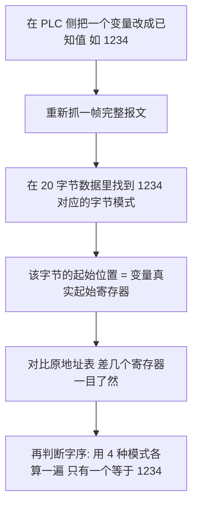

+++
title = 'Modbus TCP 报文逐字节解析：功能码、32 位寄存器字节序与变量溢出'
date = '2026-11-10T10:00:00+08:00'
slug = 'modbus-tcp-frame-byte-order'
draft = false
tags = ['Modbus', '工业通讯', 'PLC', '寄存器', '字节序', '储能']
+++

现场调试 PLC 时，最容易被三件事绊住：一条抓包报文该怎么读、同一个地址为什么调试助手读到 27904 而 PLC 画面显示 365、以及计时变量跑到最大值之后会发生什么。这篇把一次真实联调里的这三个疑问一次性讲清楚，所有结论都能用报文逐字节验证。

## 一、起点：一条 03 功能码报文

Modbus Master 抓到的收发各一帧（从站 1 号，读起始地址 0 起的 10 个保持寄存器）：

```text
发送 SEND: 00 05 00 00 00 06 01 03 00 00 00 0A
接收 RECV: 00 05 00 00 00 17 01 03 14 00 05 00 37 00 00 00 00
           00 01 6D 00 00 00 00 00 00 00 00
```

## 二、Modbus TCP 的报文骨架

Modbus TCP 帧 = **MBAP 头（7 字节）+ PDU**。MBAP 是 TCP 传输层加的外壳，RTU 里没有它。


### 发送帧逐字节

| 字节 | 内容 | 字段 | 含义 |
| --- | --- | --- | --- |
| 0-1 | `00 05` | 事务标识 Transaction ID | 请求/应答配对号，主站每发一帧自增 |
| 2-3 | `00 00` | 协议标识 Protocol ID | 固定 0000 = Modbus |
| 4-5 | `00 06` | 长度 Length | 其后字节数：单元标识 + PDU = 6 |
| 6 | `01` | 单元标识 Unit ID | 从站地址 1 |
| 7 | `03` | 功能码 | 03 = 读保持寄存器 |
| 8-9 | `00 00` | 起始地址 | 0x0000（对应手册里的 40001） |
| 10-11 | `00 0A` | 寄存器数量 | 十进制 10 |

> 一句话：**「向 1 号从站读 0 地址起 10 个保持寄存器」**，长度字段 6 正好等于 1（单元标识）+ 1（功能码）+ 2（起始地址）+ 2（数量）。

### 应答帧逐字节

| 字节 | 内容 | 字段 | 含义 |
| --- | --- | --- | --- |
| 0-1 | `00 05` | 事务标识 | 与请求一致，证明是这一问的回答 |
| 2-3 | `00 00` | 协议标识 | 固定 |
| 4-5 | `00 17` | 长度 | 0x17 = 23 = 1 + 1 + 1 + 20 |
| 6 | `01` | 单元标识 | 1 号从站 |
| 7 | `03` | 功能码 | 正常应答；异常应答会是 `83`（功能码最高位置 1） |
| 8 | `14` | 字节数 | 0x14 = 20，正好 10 个寄存器 × 2 字节 |
| 9-28 | 20 字节 | 寄存器数据 | 每个寄存器 2 字节，**默认高字节在前** |

### 把 20 字节切成 10 个寄存器

| 寄存器 | 原始字节 | 十进制 |
| --- | --- | --- |
| Reg0 | `00 05` | 5 |
| Reg1 | `00 37` | 55 |
| Reg2 | `00 00` | 0 |
| Reg3 | `00 00` | 0 |
| Reg4 | `00 01` | 1 |
| Reg5 | `6D 00` | 27904 |
| Reg6~Reg9 | `00 00` × 4 | 0 |

有两处容易被忽略的细节：

1. **长度字段是"自校验"的**。`00 17` 如果和实际字节数对不上，说明帧被截断或拼接错了。
2. **地址是从 0 数的**。报文里的 `00 00` 就是手册上的 `40001`，中间差 1，这是最常见的"读到的值差一个寄存器"的原因。

## 三、八个常用功能码

| 功能码 | 名称 | 数据区地址段 | 读写 | 典型用途 |
| --- | --- | --- | --- | --- |
| `01` | 读线圈 | 0xxxx | 读 | 读继电器、电磁阀、DO 输出状态 |
| `02` | 读离散输入 | 1xxxx | 只读 | 读限位开关、无源开关量输入 |
| `03` | 读保持寄存器 | 4xxxx | 读写 | **读 PLC 内部变量、参数、定时器** |
| `04` | 读输入寄存器 | 3xxxx | 只读 | 读模拟量采集值、变送器数据 |
| `05` | 写单个线圈 | 0xxxx | 写 | 单点开关控制（置 ON/OFF） |
| `06` | 写单个寄存器 | 4xxxx | 写 | 改单个 16 位参数、设定值 |
| `0F` | 写多个线圈 | 0xxxx | 写 | 批量控制多路 DO |
| `10` | 写多个寄存器 | 4xxxx | 写 | 批量下发参数、写 32 位变量（占 2 个寄存器） |

工程上记住四条就够：**数值读 03 / 模拟量只读 04 / 开关读 01、02 / 写入看单点还是批量**。

## 四、365 与 27904：问题到底出在哪

原始事实：Reg5 单看是 `6D 00`，按大端解读为 `0x6D00` = **27904**；而 PLC 画面上 T7 显示 **365**，十进制 365 的十六进制正是 `0x016D`。

$$
6 \times 16^3 + 13 \times 16^2 = 24576 + 3328 = 27904
$$

两者不相等，因为它们很可能**不是同一个量**。常见原因有三种，应按顺序排查。

### 原因一：32 位变量占了两个寄存器

Modbus 只定义 16 位寄存器，**32 位没有标准**。DINT/UDINT/REAL 都会横跨两个连续寄存器。只用 16 位视角去读，读到的永远只是其中一半——一半的值当然不等于整体。

### 原因二：字节序有四种，不是一种

32 位值 `365 = 0x0000_016D`，高字 `0000`、低字 `016D`，按四种主流排布落到字节流里完全不同：

| 模式 | 别名 | 字节流（寄存器 1 / 寄存器 2） | 说明 |
| --- | --- | --- | --- |
| ABCD | 大端 Big-Endian | `00 00` / `01 6D` | 高字在前，字内高字节在前（最常见） |
| CDAB | 小端字序 swap word | `01 6D` / `00 00` | 低字在前，字内大端（很多 PLC/仪表是这样） |
| BADC | 字内字节交换 | `00 00` / `6D 01` | 高字在前，字内高字节在后 |
| DCBA | 全小端 Little-Endian | `6D 01` / `00 00` | 整体倒序 |

所以正确做法是：**先在设备手册或组态软件里确认变量的字序，再决定调试助手里 32 位的字节序下拉框选哪一项**，不要用 16 位的读数去凑。

### 原因三（本例的真正嫌疑）：寄存器边界错位

把抓到的 4 字节 `00 01 6D 00` 按上面四种模式都算一遍：

| 模式 | 结果 |
| --- | --- |
| ABCD | `0x00016D00` = 93440 |
| CDAB | `0x6D000001` = 1828716545 |
| BADC | `0x0100006D` = 16777325 |
| DCBA | `0x006D0100` = 7140096 |

**没有一个等于 365。** 而 365 的字节对 `01 6D` 恰恰落在数据流的第 9~10 字节——**正好骑在 Reg4 和 Reg5 的边界上**。这是典型的"主站起始地址少算/多算了一个寄存器（或一个字节）"的症状：PLC 里的 T7 其实不是从 Reg5 起算的，上位软件按它自己的地址表取值，取到的 `01 6D` 就是 365。

这也解释了为什么在这种场景下，无论怎么调字节序都"差点意思"——真正错的是**地址映射**，不是字节顺序。

### 定位方法：改一个已知值，再抓一帧

这是最可靠、也最快的办法，比对着手册猜半小时有效得多。



用一个"好认"的值（1234、4321 这类不对称数字）比用 100、1 有效得多，后者在字节流里会撞车。

## 五、变量跑到最大值会怎样

这要分**有符号 / 无符号**，以及是不是 **PLC 定时器**，行为完全不同：

| 类型 | 位宽 | 取值范围 | 到最大值后 |
| --- | --- | --- | --- |
| INT | 16 位有符号 | -32768 ~ 32767 | 跳到 **-32768** |
| UINT/WORD | 16 位无符号 | 0 ~ 65535 | 回绕到 **0** |
| DINT | 32 位有符号 | -2147483648 ~ 2147483647 | 跳到 **-2147483648** |
| UDINT/DWORD | 32 位无符号 | 0 ~ 4294967295 | 回绕到 **0** |
| REAL | 32 位浮点 | 约 ±3.4e38 | 不是溢出，而是**精度丢失** |
| 老式三菱 FX 定时器 | 16 位计数 | 0 ~ 32767 | **停在 32767 不动**，触点导通 |
| IEC TON 的 ET | TIME（32 位毫秒） | 0 ~ 2147483647 ms | 约 **24.8 天**到达上限，之后按类型行为溢出 |

几个工程结论：

1. **要"满了从头开始"，必须用无符号**（UINT / UDINT）。有符号类型溢出会跳到负值，不是归零。
2. **有符号溢出的危害不是数值难看，而是逻辑失效**。`IF Tx >= 设定值` 这类比较在溢出瞬间变成"永远不成立"，超时保护、延时停机全部哑火，这类故障在储能、产线场景里属于安全项。
3. **累计运行时长这类量，首选 UDINT**（42 亿的上限，按秒算也有 136 年），基本不会碰到边界。
4. **不想依赖硬件溢出行为，就自己判**：`IF Tx >= 上限 THEN Tx := 0;` 主动清零，逻辑可控，比等它翻转安全。长周期定时（超过 24 天）尤其要注意 TIME 类型的毫秒上限，宁可拆成"天数 + 毫秒"两个变量。

回到本例，T7 = 365 距离任何上限都很远，属于正常值；真正需要盯的是那些会一直累加、且被拿去做比较判断的计时器。

## 六、调试面板上那行状态码

`Tx=1415: Err = 0: F = 03: SR = 1000ms (RTT: 0.6ms)` 这行标签是 Modbus Master 的通道健康度，逐项拆开：

| 字段 | 全称 | 含义 |
| --- | --- | --- |
| Tx | Transmit | 已发出的请求帧计数，每轮询一次 +1。它是**软件的计数器**，别和 PLC 里的定时器 T7 混为一谈 |
| Err | Error | 通讯错误计数（超时、校验错、异常应答），`0` 表示全程零错误 |
| F | Function | 当前使用的功能码，`03` = 读保持寄存器 |
| SR | Scan Rate | 轮询周期，`1000ms` 即每秒一问 |
| RTT | Round-Trip Time | 请求到应答的往返耗时，`0.6ms` 说明链路很健康（几十毫秒以上就该查网络或从站负载了） |

判断通道是否"真的活着"，看 **Tx 是否在增长** 比看显示值更有意义：值不变但 Tx 在涨，说明设备在正常应答；两者都不动，才是掉线。

## 七、一份现场排查清单

1. 长度字段与实际字节数是否自洽（`00 17` 对 23 字节）。
2. 应答功能码是否被置了最高位（`83`、`84` 就是异常应答，后面的异常码才是根因）。
3. 地址是 0 起还是 1 起，报文值与手册地址是否差 1。
4. 变量是 16 位还是 32 位，32 位必须占两个连续寄存器。
5. 字序（ABCD / CDAB / BADC / DCBA）是否与设备一致，用已知值验证而不是靠猜。
6. 计时/累计变量是有符号还是无符号，会不会在某天悄悄翻转成负数。

## 小结

Modbus 本身协议极简，坑几乎都不在协议里，而在**地址映射**和**数据解释**这两层：一帧 `00 05 00 00 00 06 01 03 00 00 00 0A` 一眼能读完，但"这 20 个字节里哪两个属于我要的变量、按哪种字序拼、拼完的数是正是负"才是真正花时间的部分。把上面的解析表和"改已知值再抓帧"的方法备在手边，绝大多数现场问题都能在一次抓包里定死。
