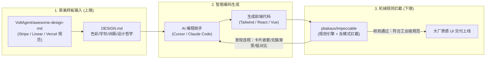

+++
title = '独立开发者用 AI 写前端总出雷同丑界面？搭两个开源项目搞定大厂级 UI：impeccable 规则拦截 + awesome-design-md 顶级样板'
date = '2026-11-21T19:35:00+08:00'
slug = 'ai-frontend-ui-impeccable-awesome-design-md'
draft = false
tags = ['独立开发', '前端开发', 'AI编码', 'UI设计', 'Cursor', 'Claude-Code', '开源项目', 'TailwindCSS']
+++

在 AI 辅助编程普及的今天，独立开发者的生产力被推到了前所未有的高度。用 Cursor、Claude Code、Windsurf 等工具，过去需要三天的后端 API、数据库 Schema 和业务逻辑，如今十几分钟就能飞速跑通。

然而，当兴奋地让 AI 写前端界面时，许多人瞬间跌入了另一个现实的泥潭：

**无论怎么调试 Prompt，AI 写出来的界面永远充斥着一股廉价的“AI 味”——全网雷同的蓝紫色渐变按钮、满屏无脑嵌套的毛玻璃白卡片、千篇一律的 Inter 字体、缺乏呼吸感的间距，以及刺眼又业余的高饱和度配色。**

这就是海外设计圈常说的 **“AI Slop”（AI 泔水风界面）**。

很多开发者以为这是“提示词不够精细”，于是不断在 Prompt 里追加诸如 *“请帮我设计一个类似苹果/Stripe 风格、高级、现代、极简、优雅的界面”* 的玄学形容词。然而现实很骨感：大模型对抽象审美形容词完全脱敏，吐出来的依然是千篇一律的模板化垃圾。

光调提示词根本没用。想要让 AI 稳定输出大厂水准的 UI，核心在于**用工程化手段确立“视觉上限”与“质量下限”**。今天就为大家介绍搭配使用即可见奇效的两个开源利器：

1. **`awesome-design-md`**：提供工业级顶级大厂设计样板（定义**审美上限**）；
2. **`impeccable`**：用机械规则与静态检查硬核拦截不合格 UI 反模式（守住**质量底线**）。

<!-- more -->

---

## 一、病灶剖析：为什么 AI 总写出雷同的“丑界面”？

在寻求解药之前，我们必须先看清大模型在前端视觉生成上的本质缺陷。

### 1. 概率中庸陷阱（Regression to the Mean）

大语言模型的本质是**下一个 Token 的概率预测器**。在数以亿计的训练语料中，出现频率最高的前端代码并不是来自 Linear、Stripe 或 Vercel 顶尖设计团队的精雕细琢之作，而是海量的：
- 博客开源主题脚手架；
- 入门级 Tailwind CSS 练习模板；
- 培训班千篇一律的后台管理 Demo。

当你输入“现代且美观的前端界面”时，AI 命中并综合的恰恰是这批**统计学概率最高的中庸套路**。

```
【标准 AI 泔水 UI 的典型八股套路】
1. 背景：纯黑 #000000 或 粗暴的径向紫光模糊 (bg-radial from-purple-900/20)
2. 按钮：from-indigo-500 via-purple-500 to-pink-500 荧光渐变
3. 容器：Cardception（卡片套卡片），bg-zinc-900/50 + border-white/10 + rounded-2xl
4. 间距：组件内 padding 永远是 p-4 或 p-6，缺乏信息亲密性节奏
5. 排版：单一字体 + 粗暴的 font-bold，字阶毫无比例尺可言
```

### 2. AI 没有“视网膜”，只有代码语义

人类设计师感知界面依靠的是视网膜上的**光学反馈**：字重与背景对比度是否刺眼？两行文字之间的基线呼吸感是否舒适？次级按钮是否抢了主 CTA（Call to Action）的风头？

而 AI 代码助手**在生成代码时根本“看不见”渲染后的画面**。它无法感知 `p-6` 和 `p-4` 组合在真实屏幕上的压迫感，除非你给它提供极其严密的 **Design Tokens（设计令牌）** 与 **Anti-pattern Rules（反模式拦截清单）**。

---

## 二、双剑合璧：构建全自动 AI 前端设计流水线

要彻底终结 AI Slop，独立开发者需要建立一套类似大厂设计走查（Design QA）的闭环工作流：



- **`awesome-design-md` 负责告诉 AI：“什么是正确的、顶级的”**。它将大厂的设计规范浓缩为清晰紧凑的 Markdown 语言，把模糊的“高级感”具象为色板十六进制码、字阶比率、表面高度与间距网格。
- **`impeccable` 负责告诉 AI：“什么是绝对禁止的、恶劣的”**。它充当全天候无休的设计总监，通过预检钩子和静态规则，在 AI 试图写下滥用渐变、低对比度文本、卡片嵌套等坏味道时立刻触发报警并责令重写。

---

## 三、第一件神器：awesome-design-md（注入大厂设计灵魂）

### 1. 什么是 `DESIGN.md`？

在过去，规范 AI 行为通常靠 `CLAUDE.md` 或 `.cursorrules`，但那些文件往往侧重于技术架构、代码风格与测试命令，视觉设计部分通常只有寥寥两句。

2024 年底，Google Labs 团队在探索智能设计代理时提出了 **`DESIGN.md` 规范**：一种专门用于将复杂 Design System 压缩并结构化喂给大模型的轻量 Markdown 格式。

随后开源社区发起了 **`VoltAgent/awesome-design-md`** 项目，迅速成为 GitHub 上炙手可热的资产库。该项目深入反编译并整理了全球最具审美声誉的数字产品设计系统，包含了：
- **Stripe**：极度细腻的微阴影、精密排版与无与伦比的支付级信任感；
- **Linear**：高密度、冷峻暗黑风、1px 精致边框与严谨的键盘交互质感；
- **Vercel / Next.js**：黑白单色极简主义、几何骨架感与极高内容清晰度；
- **Apple / iOS Human Interface**：大圆角、亲和力空间比例与自然光影；
- **Raycast**：现代 macOS 原生质感、亚克力磨砂与精致层级。

### 2. `DESIGN.md` 的核心解构（以 Linear 风格为例）

一个标准的 `DESIGN.md` 不写空话套话，而是将美学直接翻译为 AI 能精确理解的 Token 与约束法则。以下为一个精炼版的 Linear 风格 `DESIGN.md` 骨架：

```markdown
# Design System Specification (Linear Dark Theme)

## 1. Core Principles
- High Information Density: 紧凑高效，绝不为了留白而无度拉大间距。
- Subtle Depth: 杜绝大面积粗暴阴影，仅通过 1px 细微边框叠加实现层级分离。
- Restrained Palette: 界面 95% 为冷中性灰阶，强调色（Accent）绝不作为背景大面积滥用。

## 2. Color Tokens (Tailwind Mapping)
- Canvas (Level 0): `#08090a` (应用底层基板)
- Surface (Level 1): `#101114` (侧边栏、工具条)
- Elevated (Level 2): `#18191d` (下拉菜单、浮动面板、对话框)
- Border / Divider: 
  - Subtle: `rgba(255, 255, 255, 0.06)`
  - Strong: `rgba(255, 255, 255, 0.12)`
- Primary Accent: `#5e6ad2` (聚焦/激活/主操作，纯色，禁止彩虹渐变)

## 3. Typography Scale
- Font Stack: `Inter, -apple-system, BlinkMacSystemFont, "Segoe UI", sans-serif`
- Tracking (Letter-spacing):
  - Heading (18px+): `-0.02em` (紧凑有张力)
  - Body (13px-14px): `-0.01em`
  - Small / Code (11px-12px): `0em`
- Base Body Size: `13px` / Line-height: `1.4` (非标准 16px，呈现工业精密感)

## 4. Components & Surfaces
- Radius:
  - Button / Input: `6px` (`rounded-md`)
  - Container / Card: `8px` (`rounded-lg`)
  - Modal / Sheet: `12px` (`rounded-xl`)
  - 严禁全站使用 `rounded-3xl` 或 `rounded-full` 形状作为普通容器。
```

### 3. 如何在工程中引入？

1. 从 `VoltAgent/awesome-design-md` 中挑选你心仪的风格模版（如 `linear.md` 或 `stripe.md`）；
2. 将其重命名为 `DESIGN.md` 存放在你项目的根目录（或 `.cursor/rules/design.mdc` / `.rules/DESIGN.md`）；
3. 在系统级指令中追加一行唤醒词：
   ```markdown
   All frontend UI code must strictly adhere to the tokens and guidelines defined in `/DESIGN.md`.
   ```

从此，只要涉及 UI 组件编写，AI 都会自动以该设计文件为最高指导基准，彻底告别随机瞎编颜色与尺寸。

---

## 四、第二件神器：impeccable（全天候无休的设计纪检委员）

有了设计样板，AI 已经有了高标准参考。但在复杂业务迭代中，AI 极易“记吃不记打”：聊了十轮对话后，它又悄悄掏出一段 `from-pink-500 to-purple-600`。

这时就需要由知名 Web 专家 Paul Bakaus（前 Google 团队成员）主导的开源项目 **`impeccable`** 登场。

### 1. `impeccable` 做了什么？

`impeccable` 是一个专为 AI 辅助编程打造的**设计反模式拦截器与设计技能套件**。它支持 Cursor、Claude Code、GitHub Copilot、Windsurf 等各类 AI 编辑器。

它的三大杀手锏功能包括：

#### ① 自动化反模式拦截（Anti-pattern Detector）
`impeccable` 内置了数百条针对前端界面通病的机械检测规则。当 AI 企图生成下列违规代码时，会直接被拦截或报出警告：
- **Cardception 拦截**：在一个带有 Border 的容器内嵌套第二层甚至第三层带 Border 的 Card；
- **Contrast Failure 拦截**：深色背景下使用 `#71717a`（中灰）小字导致 WCAG 对比度低于 4.5:1；
- **Cliché Gradient 拦截**：检测到无意义的蓝紫、粉紫多段渐变；
- **Over-rounded 拦截**：在数据密集型表格中出现 `rounded-2xl`；
- **Missing Interaction 拦截**：交互按钮缺少 `:hover`、`:focus-visible`、`:active` 或 `disabled` 状态。

#### ② 项目 Context 提取与同步（`/impeccable init`）
在项目初次配置时运行 `npx impeccable install`，它会自动嗅探你的工程环境（Tailwind Config、CSS 变量、组件库如 Radix / shadcn/ui），将工程现有的色彩与排版 Tokens 自动补齐为统一的上下文。

#### ③ 专业的交互式设计指令（Design Commands）
`impeccable` 提供了一整套标准化自然语言指令，彻底替代“请帮我改好看点”的废话沟通：
- `/impeccable craft [需求]`：以极高严谨度从零构建满足无障碍和比例尺的新组件；
- `/impeccable polish`：全面排查当前界面的边缘微光、对齐像素与状态动效；
- `/impeccable bolder`：当界面显得平淡枯燥时，在保持大厂质感的前提下增强主次视觉冲突；
- `/impeccable audit`：对当前选中的组件或页面输出设计走查报告。

---

## 五、实战演示：从“AI 泔水风”到“大厂级 UI”的蜕变

我们来看一个实际案例：让 AI 写一个 SaaS 产品的 **API Key 管理卡片**。

### 1. 裸调 Prompt 的车祸现场

**开发者 Prompt**：
> “帮我用 React + Tailwind 写一个 API Key 管理卡片，包含 Key 预览、复制按钮、用量进度条，要现代美观大厂风格。”

**AI 默认输出（纯纯的 AI 泔水）**：
```html
<!-- 典型 AI Slop 产物：滥用渐变、无度圆角、卡片嵌套 -->
<div class="p-8 bg-gradient-to-br from-indigo-900/30 via-black to-purple-900/30 border border-purple-500/20 rounded-3xl shadow-2xl backdrop-blur-md max-w-xl mx-auto">
  <div class="flex items-center justify-between mb-6">
    <h3 class="text-xl font-extrabold text-transparent bg-clip-text bg-gradient-to-r from-purple-400 to-pink-500">
      Production API Key
    </h3>
    <span class="px-3 py-1 bg-purple-500/10 text-purple-400 border border-purple-500/20 rounded-full text-xs">
      Active
    </span>
  </div>

  <!-- Card 里面再套一层 Card -->
  <div class="bg-zinc-900/80 p-4 rounded-2xl border border-zinc-800 flex items-center justify-between mb-6">
    <code class="text-indigo-300 font-mono text-sm">sk_live_98a7sd8f7a...3b21</code>
    <button class="bg-gradient-to-r from-purple-600 to-indigo-600 text-white font-semibold px-4 py-2 rounded-xl shadow-lg hover:opacity-90">
      Copy
    </button>
  </div>

  <div class="space-y-2">
    <div class="flex justify-between text-xs text-gray-400">
      <span>Monthly Usage</span>
      <span>74,210 / 100,000 reqs</span>
    </div>
    <div class="w-full bg-zinc-800 h-3 rounded-full overflow-hidden p-0.5">
      <div class="bg-gradient-to-r from-purple-500 to-pink-500 h-full rounded-full w-[74%]"></div>
    </div>
  </div>
</div>
```

**问题诊断**：
- 满屏紫粉渐变，浓重的假 Web3 廉价山寨感；
- 嵌套了莫名其妙的内层黑卡片（Cardception）；
- 普通功能性卡片使用了 `rounded-3xl`，仿佛儿童平板玩具；
- “Copy” 按钮作为一个辅助工具，视觉权重甚至超越了卡片标题。

---

### 2. 引入 `DESIGN.md` + `impeccable` 后的质感蜕变

在工程中放置 Linear 规范的 `DESIGN.md`，并在 Cursor 规则中集成 `impeccable` 后再次生成：

**`impeccable` 拦截日志**：
```text
[impeccable] Anti-Pattern Warning:
- ❌ Detected nested cards with borders. Flatten hierarchy or use subtle surface tint.
- ❌ Cliché gradient detected in header and CTA button. Use solid brand token.
- ❌ Excessive border-radius (rounded-3xl). Restricted to max 8px for containers.
- 🔄 Applying corrections according to /DESIGN.md...
```

**自动重构输出的代码**：
```html
<!-- 大厂级工业精密质感：微边框、分明层级、紧凑间距、克制用色 -->
<div class="bg-[#101114] border border-white/[0.08] rounded-lg p-5 max-w-lg mx-auto shadow-sm">
  <div class="flex items-center justify-between pb-4 border-b border-white/[0.06]">
    <div class="flex items-center gap-2.5">
      <div class="w-2 h-2 rounded-full bg-emerald-500 ring-4 ring-emerald-500/10"></div>
      <h3 class="text-[13px] font-medium text-white tracking-[-0.01em]">
        Production Secret Key
      </h3>
    </div>
    <span class="text-[11px] font-mono text-zinc-400 px-2 py-0.5 rounded bg-white/[0.04] border border-white/[0.06]">
      Created Nov 21
    </span>
  </div>

  <div class="my-4 flex items-center justify-between gap-3 bg-[#08090a] border border-white/[0.06] rounded px-3 py-2">
    <span class="font-mono text-[12px] text-zinc-300 tracking-tight">
      sk_live_••••••••••••••••3b21
    </span>
    <button class="inline-flex items-center gap-1.5 px-2.5 py-1 text-[12px] font-medium text-zinc-300 hover:text-white bg-white/[0.05] hover:bg-white/[0.09] active:bg-white/[0.03] border border-white/[0.08] rounded transition-colors duration-150">
      <svg class="w-3.5 h-3.5" viewBox="0 0 24 24" fill="none" stroke="currentColor" stroke-width="2"><rect width="14" height="14" x="8" y="8" rx="2" ry="2"/><path d="M4 16c-1.1 0-2-.9-2-2V4c0-1.1.9-2 2-2h10c1.1 0 2 .9 2 2"/></svg>
      <span>Copy</span>
    </button>
  </div>

  <div class="space-y-1.5">
    <div class="flex justify-between text-[11px] text-zinc-400">
      <span>API Requests</span>
      <span class="font-mono text-zinc-300">74,210 <span class="text-zinc-600">/</span> 100,000 (74%)</span>
    </div>
    <div class="w-full bg-white/[0.06] h-1.5 rounded-full overflow-hidden">
      <div class="bg-[#5e6ad2] h-full rounded-full w-[74%] transition-all duration-300"></div>
    </div>
  </div>
</div>
```

### 3. 核心维度对比一览

| 视觉与设计维度 | 原始 AI 裸写（AI Slop） | 双开源加持（大厂水准） |
| :--- | :--- | :--- |
| **色彩策略** | 刺眼的紫粉荧光渐变，喧宾夺主 | 95% 冷灰阶 + 1 处精致强调色（Accent），高级克制 |
| **层级与表面** | 粗暴的毛玻璃投影 + 卡片套卡片 | 基板（#08090a）与表面（#101114）分明，依靠 1px 细边框区分 |
| **圆角控制** | 滥用 `rounded-3xl`，边缘空旷笨重 | 严控 `rounded-lg` (8px) 与 `rounded` (4px)，工业精密感 |
| **排版质感** | 粗体大字，字体未调 tracking | 13px 标准工作台字阶，负微间距（-0.01em），专业干练 |
| **交互与状态** | 按钮只有单一粗暴的悬浮效果 | 具备 hover、active、focus-visible、transition 完整生命周期 |
| **商业信赖度** | 像大学生的课程设计或玩具 Demo | 像每月收费 $49 的专业商业级 SaaS 平台 |

---

## 六、独立开发者 5 分钟上手指南

想要立刻将这套方案落地到你现有的项目中？只需以下简单四步：

### 第一步：安装并初始化 impeccable
在前端项目根目录打开终端：

```bash
# 全局或当前项目运行安装向导
npx impeccable install
```
向导会自动检测你正在使用的 IDE（Cursor、Claude Code、VSCode 或 Windsurf），并在根目录配置好反模式拦截钩子。

### 第二步：下载顶级设计样板
克隆或直接复制 [VoltAgent/awesome-design-md](https://github.com/VoltAgent/awesome-design-md) 中你心仪的主题文件。
例如，将 `linear.md` 复制到工程根目录命名为 `DESIGN.md`。

### 第三步：配置 Editor 规则文件
如果你使用的是 **Cursor**，创建 `.cursor/rules/ui-rules.mdc`：

```markdown
---
description: Frontend UI generation and component styling rules
globs: **/*.{tsx,jsx,vue,svelte,html,css}
---

# UI Design Instructions
1. Always parse and strictly obey all Design Tokens, Spacing, and Elevation rules from `/DESIGN.md`.
2. Adhere to `/impeccable` guidelines:
   - NEVER use purple-to-pink gradient text or buttons unless explicitly requested.
   - NEVER nest cards with heavy borders inside other bordered cards.
   - Maintain high contrast ratios (WCAG AA compliant).
   - Ensure all interactive elements include hover, active, and focus states.
```

如果你使用的是 **Claude Code**，直接在项目根目录的 `CLAUDE.md` 中追加上述指示即可。

### 第四步：像专业设计师一样指挥 AI
开始编写前端组件时，丢掉那些空洞的形容词，直接用具有专业设计语境的话术交流：

> *"按照 `@DESIGN.md` 的色彩与字阶规范，帮我实现一个团队成员权限设置列表。使用 `/impeccable craft` 模式，确保包含 Hover 展开操作项，并提供键盘可访问性支持。"*

---

## 七、写在最后

独立开发者（Indie Hacker）最大的优势是全栈作战的敏捷性，但最致命的短板往往是视觉设计上的**“粗糙感”**与**“廉价感”**。

在 SaaS 商业化中，界面的设计质感直接决定了客户是否信任你的产品安全性，更直接决定了他们愿不愿意掏出信用卡每月为你支付 \$20、\$50 甚至更多。

**与其耗费数小时在聊天框里跟 AI 玩“猜猜我喜欢什么颜色”的提示词玄学，不如用工程化的规则把优秀的审美固化成代码纪律。**

让 `awesome-design-md` 为你的产品立住审美的天花板，让 `impeccable` 在门前替你挡住每一个劣质的像素。两个开源项目搭好之后，你一个人，就能拥有比肩顶级科技大厂的前端设计战斗力。

---

### 相关开源项目速查
- **awesome-design-md**：`https://github.com/VoltAgent/awesome-design-md`
- **impeccable**：`https://github.com/pbakaus/impeccable`
- **design.md Specification**：`https://github.com/google-labs-code/design.md`
