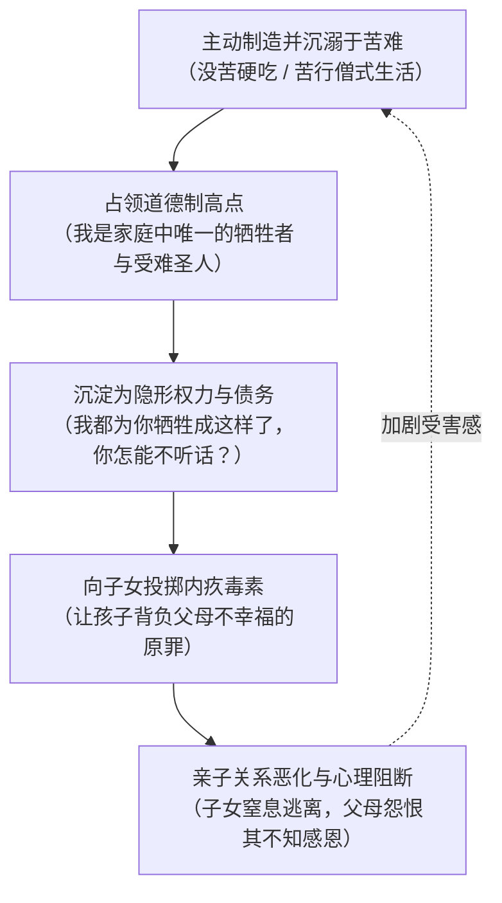

+++
title = '平等的爱：为什么“没苦硬吃”换不来感恩，只会成为孩子的精神枷锁？'
date = '2026-11-21T21:10:00+08:00'
slug = 'equal-love-and-the-burden-of-sacrifice'
draft = false
tags = ['家庭教育', '亲子关系', '托尔斯泰', '心理学', '认知重塑', '平等的爱']
+++

在东亚家庭的餐桌与日常里，我们经常目睹一种奇异而普遍的“受难剧”：

明明家里物质条件早已温饱无虞，父母却偏偏要吃剩菜冷饭，把好菜留给孩子；明明有洗衣机、吸尘器，却偏要在大冬天用刺骨的凉水手洗衣服；明明可以开空调驱散热浪，却为了“省电”守着嘎吱作响的风扇大汗淋漓，并反复向孩子叹息生活的多艰。

这种现象被当下的年轻人戏称为“**没苦硬吃**”。

许多长辈在潜意识里认为：唯有通过展示自身的匮乏、克制与苦难，才能让子女深刻体会父母的“伟大付出”，从而铭记这天高地厚的恩情。然而现实却往往滑向相反的极端——子女不仅没有生出由衷的温情与敬爱，反而在日复一日的愧疚与重压之下，变得沉默、烦躁，甚至想要逃离家庭。

为什么倾尽心血的牺牲，换来的不是感恩，而是窒息？

俄国思想家、文学巨匠列夫·托尔斯泰曾一针见血地指出：**“人类的爱，往往是带着目标的。我们爱他人的方式，往往是想让对方变成我们希望的样子。”**

当爱演变为一场带着期许与账簿的苦难展演，它就已经背离了“平等的爱”，沦为一场隐秘而沉重的精神勒索。

<!-- more -->

---

## 一、苦难的资本化：“没苦硬吃”背后的心理代偿

“没苦硬吃”并不是简单的生活习惯使然，而是一种深层的心理防御与权力机制。

在心理学上，这种行为通常运作在三个隐秘的维度：



### 1. 苦难资本化：将受苦兑换为道德特权
在平等的沟通能力匮乏的家庭中，痛苦是最廉价、却也最具压制力的硬通货。一旦父母将自己塑造成“全心全意的受难者”，他们便在伦理上占领了不可撼动的道德高地。

“我省吃俭用全是为了你”、“妈妈这辈子受尽委屈，希望全寄托在你身上了”——苦难在此刻不再是现实的困境，而是被加工成了一张不可拒绝的**情感欠条**。每一次主动咽下的苦，都在无形中增加了向子女索取服从、敬畏与顺从的筹码。

### 2. 愧疚感投毒：让孩子背负父母不幸福的原罪
发展心理学表明，儿童天生具有将周围的一切归因于自身的倾向。当孩子目睹父母终日眉头紧锁、忍辱负重、过着苦行僧般的生活时，他们无法建立起健康的自我认同，反而会衍生出极其强烈的**生存原罪感**：
- *“因为我的存在，父母才过得这么痛苦。”*
- *“我享受快乐是可耻的，因为我父母还在吃苦。”*
- *“我不配拥有轻松无忧的人生。”*

一个被内疚感浸泡长大的孩子，灵魂是佝偻的。他们在成年后往往形成讨好型人格、极度配得感低下（Imposter Syndrome），即使取得了优异的世俗成就，内心深处依然被无休止的自责与焦虑吞噬。

---

## 二、托尔斯泰的冷峻剖析：爱为何总是带着目标？

很多人至死都不愿承认：**世上许多自诩“无私”的爱，内核其实极其自私。**

列夫·托尔斯泰在晚年的一系列哲学日记与思考中，对人性的盲目自负与所谓的“爱”做出了极其冷峻的解构。在他看来，世俗的大多数爱，并非源于灵性的丰盈与对生命平等的敬畏，而是源于自我的扩张欲：

| 爱的维度 | 目标导向的占有型爱 | 尊重自主的平等之爱 |
| :--- | :--- | :--- |
| **出发点** | 匮乏感、补偿心理与改造欲 | 丰盈的自爱、接纳与生命共振 |
| **核心动力** | **“我想让你变成我希望的样子”** | **“我尊重并支持你成为你自己的样子”** |
| **表达媒介** | 苦难表演、道德绑架、过度牺牲 | 边界清晰、温和坚定、各自独立 |
| **情感代价** | 债务感、内疚窒息、亲密阻断 | 轻松自在、彼此滋养、由衷亲近 |
| **终极结局** | 控制幻灭带来的怨恨与反叛 | 两个完整独立灵魂的守望与并肩 |

托尔斯泰指出，**人类爱他人的方式，往往带有不可遏制的塑造欲（Shaping desire）**。

我们习惯于在脑海中勾勒一个关于“完美孩子”、“理想伴侣”的画像，然后打着“我都是为你好”的崇高旗号，挥舞手术刀试图削去对方身上的棱角，强行把一个活生生的、拥有独立意志的生命，塞进我们狭隘的预期容器中。

在很多中国式家庭中，父母之所以执着于让孩子“记住恩情”，正是因为这种爱带有极其明确的**投资与改造目标**：
1. **人生重来的代偿品**：把自己未能实现的社会阶层跃迁、未曾体验的荣耀，强加在孩子身上；
2. **老年孤寂的保障券**：通过制造依赖与负罪感，确保孩子哪怕远走高飞，脖子上依然拴着无形的情感缰绳；
3. **家族面子的装饰品**：用孩子的听话、体面与出人头地，来支撑父母脆弱的自尊与社交资本。

一旦目标出现偏差——比如孩子选了不合长辈心意的专业、选择了不同的人生路径，父母的爱立刻就会转变为愤怒、委屈与控诉。这种剧变恰恰证明：**他们爱的不是真实的孩子，而是孩子顺从时的投射投影。**

---

## 三、牺牲的诅咒：没有自爱的人，给不出健康的爱

家庭系统理论大师海灵格曾说过：“牺牲并不带来真正的幸福。当一个人过度牺牲自己去成全他人时，他在潜意识里是在要求对方拿一辈子来偿还。”

一个不懂得善待自己、不敢让自己过得体面从容的父母，绝不可能给孩子提供健康的心理土壤。

```mermaid
graph LR
    subgraph 病态循环：苦涩母体的毒素传导
        P1["父母自我厌恶 / 苛待自身"] --> P2["积累受害者怨气"]
        P2 --> P3["以受难者姿态强加予人"]
        P3 --> C1["孩子被迫背负道德重轭"]
    end

    subgraph 健康循环：丰盈个体的自由滋养
        Q1["父母接纳自我 / 充盈快乐"] --> Q2["拥有健康的心理边界"]
        Q2 --> Q3["以平等姿态尊重孩子"]
        Q3 --> C2["孩子获得独立绽放的勇气"]
    end
```

### 1. 苦涩的泉眼流不出甘甜的水
一个人如果在漫长的岁月里浸泡在自我虐待、没苦硬吃的怨气中，他的精神早已千疮百孔。当他伸出双手去拥抱孩子时，身上散发出的不是爱意，而是浓烈刺鼻的酸楚与索求。

他会不自觉地嫉妒孩子的轻松，愤怒于孩子的欢笑，甚至潜意识里希望孩子也必须“吃尽苦头”才能成熟。这种暗流涌动的敌意，正是许多两代人无法交流的真正死结。

### 2. 真正的榜样是示范如何热爱生活
孩子是通过观察父母对待自身的方式，来学会如何对待自己与世界的。

如果父母终其一生都紧绷神经、视享受为罪过、把受难当功绩，孩子习得的将是终生的匮乏感与不安全感。反之，一个敢于享受美好生活、懂得善待自身、有独立喜怒哀乐与爱好的父母，才是孩子身后最温厚的避风港。

正如心理学家温尼科特所言：**父母最伟大的责任，就是做一个“足够好（Good enough）”的普通人，并且好好享受你自己的生活。**

---

## 四、走向“平等的爱”：如何击碎代际的情感枷锁？

如果说“没苦硬吃”与“带着目标的改造”是病态的代际锁链，那么破解这套枷锁的唯一解药，就是重建**平等的爱（Equal Love）**。

平等的爱绝非无底线的纵容，而是一种基于人格平等的深刻觉醒。它包含三个至关重要的原则：

### 原则一：剥离债权债务关系，承认彼此生命的主体性
纪伯伦在《先知》中留下了人类亲子关系最深刻的注脚：

> “你的儿女，其实不是你的儿女。他们是生命对于自身渴望而诞生的孩子。他们借助你来到这世界，却非因你而来；他们在你身旁，却并不属于你。你可以给予他们的是你的爱，却不是你的思想，因为他们有自己的思想。”

生养子女，是父母在特定生命阶段的主动选择，绝非向另一个懵懂无知的灵魂发放的高利贷。父母与孩子在法律上抚养成年，在人格上自始至终都是平等的两个灵魂。

放下“报恩”与“偿债”的念头，爱才能从沉重的沉没成本中解脱，还原为纯净的欢喜。

### 原则二：放弃塑造对方的妄念，爱其所是，而非爱己所愿
托尔斯泰晚年在《生活之路》中反复提醒世人：**爱的第一准则，是克服虚妄的自我。**

爱孩子，就必须有勇气接纳他可能只是一个普通人，接纳他可能拥有完全不同于你的审美、职业观和人生轨迹。
- 爱他，不是为了让他完成你未竟的梦；
- 爱他，是为了让他拥有在这个世界上独立站立、探索未知、体验悲欢的自由。

当我们放弃用自己的理想模板去硬套对方时，我们才真正睁开双眼，看见了眼前这个具体、生动、唯一的生命。

### 原则三：父母先卸下受难者长袍，做真实而快乐的自己
打破“没苦硬吃”怪圈的第一步，是父母学会宽待自己：
- 渴了就喝水，累了就休息；
- 天热开空调，好菜大家分；
- 不再把“为了你吃尽人间苦”挂在嘴边，学会把注意力拉回到自己未曾被滋养的人生上。

当父母开始为自己的幸福负起全责，不再将自我价值绑架在孩子的顺从与感恩上，孩子心头那块无形的重石才会真正落地。他们才能真正挺直脊梁，毫无负疚地奔向属于自己的星辰大海。

---

## 五、结语：唯有松开绞索，爱才真正开始流淌

世间最悲哀的亲情，莫过于父母用一生的苦难铸造了一座名为“恩情”的丰碑，却发现孩子在碑前除了窒息与恐惧，感受不到半分暖意。

没苦硬吃，换不来由衷的爱，只会酿造无尽的愧疚；带着目标的塑造，换不来真挚的亲密，只会逼出决绝的逃离。

生命生生不息的意义，从来不是一代人以苦修为代价去赎买下一代人的服从，而是生命对生命的照亮，是灵魂与灵魂的相遇。

愿为人父母者，有勇气卸下沉重的苦难剧本，做从容自爱的凡人；
愿为人子女者，有底气放下内疚的精神包袱，去爱那个真实、独立、并不完美的自己。

**当爱不再试图改造对方，当付出不再渴求回响，爱才从枷锁化作了翅膀。**
