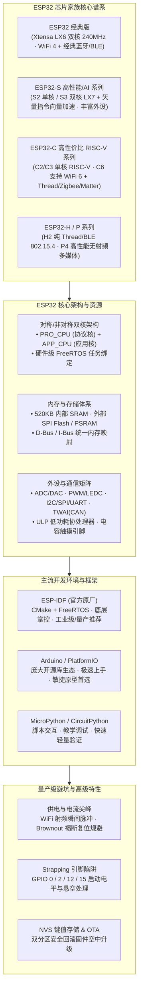
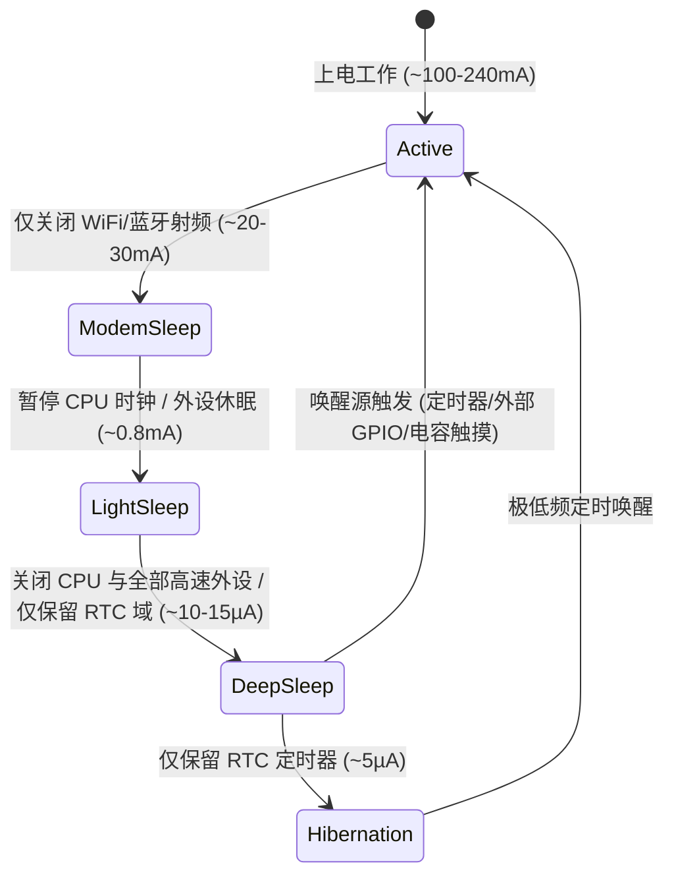
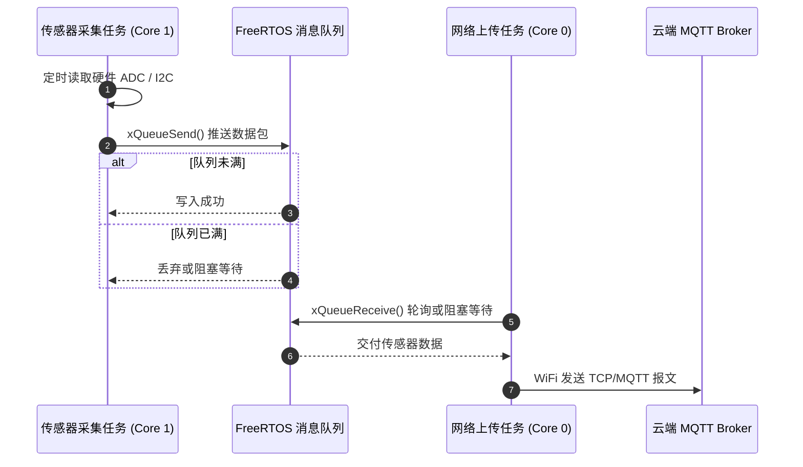
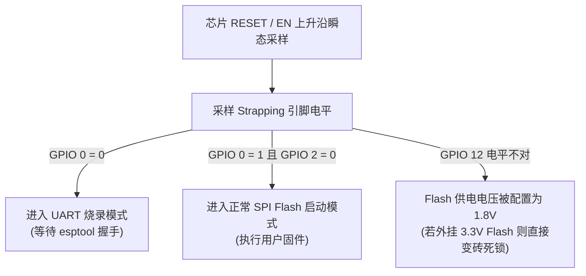

+++
title = 'ESP32 开发板全景实战指南：从芯片选型、双核架构到物联网全栈实战'
date = '2026-11-21T19:50:00+08:00'
slug = 'esp32-development-guide'
draft = false
tags = ['ESP32', '嵌入式', 'IoT', '物联网', '单片机', 'FreeRTOS']
+++

在当今万物互联（IoT）与边缘计算的浪潮中，如果要评选一款对硬件创客、电子工程师乃至全栈开发者影响最深远的微控制器芯片，由中国本土芯片企业**乐鑫科技（Espressif Systems）**推出的 **ESP32** 毫无疑问位列榜首。

从早年以“几美元即可让单片机连上 WiFi”而名声大噪的 ESP8266，到性能爆发、双核双模、外设矩阵强悍的 ESP32，再到全面拥抱开源 RISC-V 架构与端侧 AI 加速的 ESP32-S3 / ESP32-C6，ESP32 家族已经构建起了一个横跨消费级电子、工业测控、智能家居中枢与穿戴设备的庞大生态帝国。

然而，面对琳琅满目的型号命名（ESP32-WROOM、ESP32-S3、ESP32-C3、ESP32-C6、ESP32-CAM……）、复杂的双核并发机制、多级低功耗模式以及五花八门的开发框架（ESP-IDF、Arduino、PlatformIO、MicroPython），很多初学者乃至有一定嵌入式基础的工程师常常陷入选型混乱与踩坑泥潭。

本文将以“系统级工程实战”为导向，为你奉上一份全景式的 ESP32 开发指南：从芯片家族选型、底层硬件与双核架构、主流工具链对比，到基于 FreeRTOS 的实战开发与工业级避坑经验。

<!-- more -->



---

## 一、ESP32 家族谱系与精准选型指南

初入 ESP32 世界时，最容易让人迷惑的就是其繁杂的芯片前缀与模组型号。乐鑫目前已经形成了非常清晰的三大主流序列：**Xtensa 经典与增强系列（ESP32 / S 系列）**、**RISC-V 开源架构系列（C 系列）** 以及 **全连接与协处理系列（H / P 系列）**。

### 1. 核心芯片型号对比矩阵

| 芯片型号 | CPU 架构与主频 | 内部 SRAM | 典型无线连接 | 特色硬件能力 | 典型应用与选型建议 |
| :--- | :--- | :--- | :--- | :--- | :--- |
| **ESP32 (经典版)** | 双核 32 位 Xtensa LX6 @ 240MHz | 520 KB | Wi-Fi 4 (802.11 b/g/n) + 经典蓝牙 4.2 / BLE | 经典蓝牙音频（A2DP）、电容触摸、DAC、以太网 MAC | **性价比常青树**。需要播放经典蓝牙音频、传统物联网网关、或已有海量成熟案例的通用项目。 |
| **ESP32-S2** | 单核 32 位 Xtensa LX7 @ 240MHz | 320 KB | Wi-Fi 4 (仅 WiFi，**无蓝牙**) | 原生 USB OTG (全速)、丰富 GPIO、高安全性加密加速 | 纯 WiFi 终端、需要模拟 USB 键盘/鼠标/U 盘（HID）的设备。 |
| **ESP32-S3** | 双核 32 位 Xtensa LX7 @ 240MHz | 512 KB | Wi-Fi 4 + BLE 5.0 (支持 Mesh / 长距离) | **AI 向量扩展指令集**、原生 USB OTG、RGB LCD 屏驱接口、最大 45 个 GPIO | **当前开发板旗舰王者**。智能中控带屏设备（LVGL）、离线语音唤醒识别（ESP-SR）、轻量人脸检测与端侧 TinyML。 |
| **ESP32-C3** | 单核 32 位 RISC-V @ 160MHz | 400 KB | Wi-Fi 4 + BLE 5.0 | 极小封装、引脚与 ESP8266 兼容度高、低功耗 | **ESP8266 的终极平替者**。智能插座、智能灯泡、传感器节点等追求极致成本与体积的基础传感器项目。 |
| **ESP32-C6** | 单核 32 位 RISC-V @ 160MHz + LP RISC-V @ 20MHz | 512 KB | **Wi-Fi 6 (2.4GHz) + BLE 5.3 + 802.15.4 (Thread / Zigbee)** | 硬件级 **Matter** 协议全协议栈支持、超低功耗监听 | **下一代智能家居中枢首选**。原生支持 Matter 协议、Thread 路由中继节点、电池供电长续航传感节点。 |
| **ESP32-P4** | 双核 RISC-V @ 400MHz + LP 单核 | 768 KB | **无板载射频无线**（纯计算芯片） | MIPI-CSI/DSI 接口、H.264 硬件编解码、JPEG 硬件加速 | 高性能边缘多媒体屏显、机器视觉工业控制终端。 |

### 2. 芯片（Chip）、模组（Module）与开发板（DevKit）的区别

购买与开发时，必须分清三者的层级关系：
- **芯片（SoC）**：如 `ESP32-D0WD-V3`，裸芯片，需要自行布线晶振、天线射频匹配电路与 Flash，适合规模化量产抄板。
- **模组（Module）**：如 `ESP32-WROOM-32E` 或 `ESP32-WROVER-E`。将 SoC、SPI Flash、外部 PSRAM、晶振及板载 PCB 天线封装在金属屏蔽罩内，通过了 FCC/CE 等电磁认证，是工程开发中最常用的标准组件。
  > **区别要点**：`WROOM` 系列通常只带 Flash；而 `WROVER` 系列额外板载了 **4MB 或 8MB PSRAM（伪静态随机存储器）**，对于跑摄像头（ESP32-CAM）、复杂 UI 界面（LVGL）或离线语音，**必须选带 PSRAM 的 WROVER / S3-WROOM 系列**。
- **开发板（DevKit）**：在模组基础上集成了 **USB 转串口芯片（CP2102、CH340 或 CH9102）**、3.3V LDO 稳压电路、BOOT/RESET 按键以及 2.54mm 排针，只需一根 USB 线插上电脑即可烧录调试。

---

## 二、ESP32 硬件架构与核心机制深究

ESP32 之所以性能彪悍，核心在于其微架构设计打破了传统单片机单核串行的桎梏。

### 1. 对称/非对称双核架构与 FreeRTOS

经典的 ESP32 与 ESP32-S3 配备了两个物理核心：
- **PRO_CPU (Protocol CPU，核心 0)**：默认负责底层繁重的无线协议栈任务（WiFi MAC/PHY 驱动、TCP/IP LwIP 协议栈、蓝牙协议栈）。
- **APP_CPU (Application CPU，核心 1)**：默认跑用户的应用程序主逻辑。


在乐鑫修改后的 **SMP（对称多处理）FreeRTOS** 下，两个核心共享同一个调度器。开发者可以通过 API 将对时序要求极高或耗时巨大的任务固定在指定核心运行：

```c
// 将耗时的图像识别算法绑定在 Core 1，确保 Core 0 的无线通讯不掉线
xTaskCreatePinnedToCore(
    ai_vision_task,     /* 任务函数指针 */
    "ai_vision",        /* 任务描述名称 */
    8192,               /* 栈深度 (字节/字) */
    NULL,               /* 参数指针 */
    2,                  /* 优先级 (数字越大越优先) */
    &xVisionTaskHandle, /* 任务句柄 */
    1                   /* 绑定到 Core 1 (APP_CPU) */
);
```

### 2. 统一内存映射与外挂 Flash / PSRAM

ESP32 片上集成了 **520 KB 的 SRAM**（其中约 328 KB 可供开发者动态分配堆内存）。当运行微型 Web 服务器、大屏帧缓冲区（FrameBuffer）或人脸识别算法时，几百 KB 的内存很快捉襟见肘。

为此，ESP32 采用了硬件 **MMU（内存管理单元）** 架构，将外部的 SPI Flash 和 SPI PSRAM 映射到 CPU 的全局数据总线（D-Bus）和指令总线（I-Bus）上。
- **内部 SRAM**：零延迟，读写速度极快，用于关键中断服务函数（`IRAM_ATTR`）与高频访问变量。
- **外部 PSRAM**：通过 QSPI / OPI 高速总线访问，虽然速度比片上 SRAM 慢 2~3 倍，但容量可扩展至 4MB~16MB，支持直接调用 `heap_caps_malloc(size, MALLOC_CAP_SPIRAM)` 分配超大内存块。

### 3. 多级低功耗模式与 ULP 协处理器

对于电池供电的 IoT 设备（如农田温湿度采集节点、门磁传感器），功耗直接决定产品生死：



- **Deep-sleep 模式**：芯片主 CPU、全部高速外设及数字内部时钟全部下电，仅保留 **RTC 域控制器、RTC 慢速内存与 ULP（超低功耗）协处理器**。
- **ULP（Ultra Low Power）协处理器**：这是一个独立于主 CPU 的超微型处理器（经典版为 FSM 有限状态机，S2/S3/C3 升级为 RISC-V 单核）。当主 CPU 进入深度睡眠（电流仅 $10 \mu\text{A}$ 左右）时，ULP 可以保持周期性苏醒，读取 $I^2C$ 传感器或 ADC 读数，**只有当数值超出设定的危险阈值时，才唤醒主 CPU**，从而实现纽扣电池运行数年之久的超长续航。

---

## 三、三大开发生态与工具链选型

| 维度 | ESP-IDF (官方原厂) | PlatformIO + Arduino 框架 | 原生 Arduino IDE | MicroPython / CircuitPython |
| :--- | :--- | :--- | :--- | :--- |
| **底层掌控力** | **极高**（完全暴露底层寄存器、SDK 配置与 FreeRTOS） | **较高**（兼容 Arduino 抽象层，可直接内嵌 ESP-IDF API） | **中等**（大量硬件细节被上层库封装） | **较低**（由虚拟机解释执行） |
| **学习曲线** | 较陡峭（需掌握 CMake、FreeRTOS、Kconfig 机制） | 平缓到中等（现代 VS Code 体验，自动化依赖管理） | 最平缓（一键编译烧录，新手友好） | 最平缓（Python 语法，REPL 即时反馈） |
| **运行效率** | **最高**（GCC 优化，原生 C/C++，内存占用最小） | **极高**（等同原生 C++，额外开销微乎其微） | **高** | 较低（内存占用高，GC 存在停顿） |
| **组件生态** | 乐鑫官方组件库（ESP-Registry）质量极高，与量产对齐 | 汇聚 GitHub 海量开源外设库，兼备包管理与版本锁定 | 库管理器支持海量开源传感器驱动 | Python 常用算法与轻量驱动库 |
| **推荐适用场景**| **商业化量产产品、严苛性能要求、深度定制外设** | **专业创客、中大型竞赛项目、工程敏捷验证** | **中小学创客教学、硬件快速点灯实验** | **物联网数据流轻量中继、快速原型验证** |

### 建议路径：
1. **零基础 / 快速体验**：从 **Arduino IDE** 或 **PlatformIO** 入手，利用现成的 `WiFi.h` 和第三方传感器库，一小时内完成温湿度联网上报。
2. **进阶工程 / 团队研发**：果断切换到 **ESP-IDF**（可在 VS Code 中安装官方 ESP-IDF 插件），利用 `idf.py menuconfig` 精细化配置任务栈大小、Flash 模式与低功耗参数，编写具备工业级健壮性的固件。

---

## 四、核心实战：双核协同、WiFi 联网与 FreeRTOS 队列

下面我们通过一个工业级物联网核心模式的完整代码范例，展示如何在 ESP-IDF / Arduino 混合模式下，利用 **FreeRTOS 双核特性与队列（Queue）** 实现“传感器采集”与“网络上报”完全解耦，互不阻塞。

### 1. 架构逻辑设计
- **Core 1 运行 Sensor_Task**：每 500ms 采集一次模拟量/温湿度数据，打包为结构体压入 FreeRTOS 队列；
- **Core 0 运行 Network_Task**：负责维护 WiFi 连接，从队列中非阻塞提取数据，模拟通过 MQTT 或 HTTP 上传云端。



### 2. 经典双核异步协同源码实现

```cpp
#include <Arduino.h>
#include <WiFi.h>

// 1. 定义传输数据结构体
typedef struct {
    uint32_t timestamp;
    float temperature;
    float humidity;
    uint32_t reading_id;
} sensor_data_t;

// 2. 声明 FreeRTOS 队列句柄
QueueHandle_t sensorQueue;
const int QUEUE_LENGTH = 10;

// ==========================================
// 任务 1：运行于 Core 1，专职硬件数据采集
// ==========================================
void Task_SensorAcquisition(void *pvParameters) {
    sensor_data_t data;
    uint32_t count = 0;

    for (;;) {
        // 模拟传感器采集过程
        data.timestamp = millis();
        data.temperature = 24.0 + (float)(random(0, 100)) / 10.0;
        data.humidity = 50.0 + (float)(random(0, 100)) / 10.0;
        data.reading_id = ++count;

        // 发送数据到队列，若队列已满等待 10 个时钟周期
        if (xQueueSend(sensorQueue, &data, (TickType_t)10) != pdPASS) {
            Serial.printf("[Core %d] 警告: 队列已满，数据丢弃 ID: %u\n", xPortGetCoreID(), count);
        } else {
            Serial.printf("[Core %d] 采集成功: Temp=%.1fC, ID=%u\n", xPortGetCoreID(), data.temperature, count);
        }

        // 任务休眠 1000 毫秒 (释放 CPU 给同核其它任务)
        vTaskDelay(pdMS_TO_TICKS(1000));
    }
}

// ==========================================
// 任务 2：运行于 Core 0，专职网络通信与协议上报
// ==========================================
void Task_NetworkUploader(void *pvParameters) {
    sensor_data_t receivedData;

    for (;;) {
        // 从队列阻塞接收数据，最大等待 500 毫秒
        if (xQueueReceive(sensorQueue, &receivedData, pdMS_TO_TICKS(500)) == pdPASS) {
            Serial.printf("  --> [Core %d] 准备上报云端: ID=%u, Temp=%.1fC, Time=%u\n", 
                          xPortGetCoreID(), 
                          receivedData.reading_id, 
                          receivedData.temperature, 
                          receivedData.timestamp);
            
            // 此处可调用 PubSubClient 发送 MQTT 报文或执行 HTTP POST
            // 即使网络发送遇到 2000ms 延迟，也不会阻塞 Core 1 的精确数据采集
        }
    }
}

void setup() {
    Serial.begin(115200);
    delay(500);

    Serial.println("=== ESP32 双核并发 FreeRTOS 实战启动 ===");

    // 创建深度为 10 的结构体消息队列
    sensorQueue = xQueueCreate(QUEUE_LENGTH, sizeof(sensor_data_t));
    if (sensorQueue == NULL) {
        Serial.println("严重错误: 无法创建消息队列!");
        while (1);
    }

    // 绑定采集任务至 Core 1 (APP_CPU)
    xTaskCreatePinnedToCore(
        Task_SensorAcquisition,
        "SensorTask",
        4096,               // 栈空间
        NULL,
        1,                  // 优先级
        NULL,
        1                   // 固定在 Core 1
    );

    // 绑定网络上传任务至 Core 0 (PRO_CPU)
    xTaskCreatePinnedToCore(
        Task_NetworkUploader,
        "NetworkTask",
        4096,               // 栈空间
        NULL,
        2,                  // 优先级较高
        NULL,
        0                   // 固定在 Core 0
    );
}

void loop() {
    // 释放 Arduino 默认主循环线程，所有业务交由 FreeRTOS 任务处理
    vTaskDelete(NULL);
}
```

---

## 五、硬件开发与量产级避坑指南（血泪踩坑实录）

在实际硬件画板、打样和调试过程中，ESP32 有几个非常著名的“天坑”，若不了解其底层机理，往往会导致板子莫名重启、无法烧录或读数异常。

### 1. 供电陷阱与 Brownout（褐断复位）

很多初学者用杜邦线将 ESP32 开发板插在面包板上，或者直接使用电脑劣质 USB 口/长线供电，常在调用 `WiFi.begin()` 的瞬间，板子触发反复重启，串口疯狂打印：
```text
Brownout detector was triggered
```

**根本机理**：
Wi-Fi 射频功放（PA）启动与数据包校准发射瞬间，会在微秒级产生高达 **$500\text{mA} \sim 800\text{mA}$ 的脉冲冲击电流**。如果电源线内阻过大、或板载 3.3V LDO 稳压器（如廉价的 AMS1117）瞬态响应能力差，会导致芯片 VDD 供电电压瞬间被拉低跌破内部褐断保护阈值（约 2.43V - 2.8V），触发硬件保护强制复位。

> **量产硬件解决方案**：
> - 供电芯片请选瞬态响应优良、额定输出至少 **1A 以上的 DC-DC 或 LDO**（如 SGM2205、ME6211、TLV757P）；
> - 紧靠 ESP32 模组的 3V3 供电引脚处，必须并联一个 **$10\mu\text{F}$ 陶瓷电容（MLCC）** 与一个 **$100\text{nF}$ 高频去耦电容**；若电源线较长，建议在板端追加一颗 **$100\mu\text{F}$ 固态钽电容或电解电容**吸收电流脉冲。

### 2. Strapping 引脚陷阱：启动电平配置

ESP32 的部分 GPIO 在芯片复位（Reset）释放的几个微秒内，具有特殊硬件配置功能（称为 **Strapping Pins**），决定了芯片是从 SPI Flash 正常启动，还是进入串口下载模式（UART Bootloader）。



#### 经典避坑管脚清单：
- **GPIO 0**：内部弱上拉。启动时为 **高电平** 则进入正常启动模式；为 **低电平** 则进入烧录模式。**切勿在外围电路中将 GPIO 0 随意直接下拉到地**，否则设备永远无法正常启动。
- **GPIO 2**：在经典 ESP32 上必须在烧录模式下拉低（或悬空），很多开发板板载的蓝色 LED 接在 GPIO 2 上，如果外接阻抗改变了启动电平，会导致烧录失败。
- **GPIO 12 (MTDI)**：**最危险的引脚！** 内部用于配置 SPI Flash 的工作电压（高电平为 1.8V，低电平为 3.3V）。如果你的外围电路在开机瞬间将 GPIO 12 强制拉高，会导致 3.3V 的 Flash 芯片被置于 1.8V 供电下，产生反复读取错误的死循环。**建议该引脚尽量留空或仅作普通输入，杜绝外加上拉电阻！**
- **GPIO 15**：启动时必须保持高电平以使能串口打印。
- **GPIO 6 ~ 11**：模组内部已用于连接 SPI Flash 存储器，**绝对不可在外部作为普通 GPIO 引出或占用！**

### 3. ADC（模数转换器）非线性与校准陷阱

ESP32 内置了 12 位 SAR ADC（分辨率 $0 \sim 4095$），但许多开发者发现用它采集电压极其不准，尤其在接近 0V 和接近 3.3V 的两端，读数出现大片死区：

$$V_{\text{in}} \approx 0 \sim 0.1\text{V} \implies \text{读数恒为 0}$$
$$V_{\text{in}} \approx 3.15 \sim 3.3\text{V} \implies \text{读数恒为 4095}$$

**原因分析**：
ESP32 的内部参考基准电压源存在离散性（标称 1100mV，实际每颗芯片偏差可能在 1000mV 到 1200mV 之间），且模拟前端输入级非线性严重。

**精准测量方案**：
1. **查表与衰减配置**：根据测量范围合理配置衰减（如 `ADC_ATTEN_DB_11` 对应大约 $0 \sim 2.6\text{V}$ 有效线性量程，超过 2.6V 必须外接电阻分压电路）。
2. **启用 eFuse 硬件校准**：新批次的 ESP32 芯片在出厂时均已在 eFuse 中烧录了双点校准值（Two Point Values）或参考电压曲线。在代码中必须调用 `esp_adc_cal_characterize` 加载校准曲线，利用拟合多项式转换电压，绝不可简单套用线性公式 $\frac{\text{ADC}}{4095} \times 3.3\text{V}$。

### 4. 稳健的 OTA 固件空中升级与双分区容灾机制

量产设备部署在野外或客户家中后，物理烧录固件不再现实。ESP32 提供了极度稳健的 **OTA（Over-The-Air）双分区机制**。

```
Flash 分区布局示例 (Partition Table):
+-----------------------------------------------------------+
| nvs (20KB) | otadata (8KB) | ota_0 (1.5MB) | ota_1 (1.5MB)|
+-----------------------------------------------------------+
```

- 系统固件分为两个相互独立的 Slot：`ota_0` 与 `ota_1`；
- 当设备正在运行 `ota_0` 时，新固件被流式下载并校验写入到 `ota_1`；
- 写入完毕并经 CRC 完整性校验后，更新 `otadata` 指针；
- 重启后，Bootloader 尝试从 `ota_1` 启动。**若启动失败触发看门狗复位，Bootloader 会自动回滚（Rollback）切回原始的 `ota_0`**，确保设备永不变成“砖头”。

---

## 六、总结与前沿技术展望

经过十余年的迭代演进，ESP32 已经成功完成了从“外挂式无线透传模块”向“高集成度智能物联计算中枢”的蜕变。

站在当下的技术交汇点，ESP32 展现出了令人兴奋的演进趋势：

1. **全面倒向 RISC-V 架构**：从 ESP32-C3、C6 到工业级 P4，乐鑫正逐步以开源开放的 RISC-V 指令集替代原有的 Xtensa 架构，不仅打破了底层编译器技术壁垒，也带来了更优秀的能效比与自定义指令集扩展空间。
2. **Matter 与全屋智能大一统**：借助 ESP32-C6 与 ESP32-H2 对 802.15.4（Thread）与 BLE 5.3 的硬件级支持，ESP32 成为了落地跨平台智能家居通信标准 **Matter** 协议性价比最高的载体，彻底打破苹果 HomeKit、Google Home 与米家的生态孤岛。
3. **端侧轻量 AI 与边缘多媒体（TinyML）**：以 ESP32-S3 / P4 为代表的高性能芯片，通过矢量加速指令与高达数百兆的外部 PSRAM，正在让离线语音指令识别、轻量人脸检测与手势控制在百元以内的微型硬件上稳定落地。

无论是打造一个业余的自动化桌面时钟，还是构筑万级节点的工业传感器物联网系统，ESP32 都能以其兼具极致成本与强劲性能的平衡美学，成为你嵌入式工具箱中最值得信赖的趁手利器。
