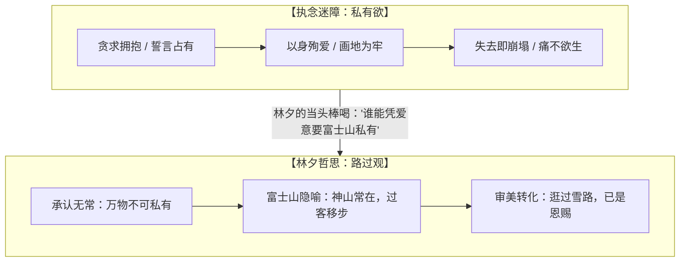
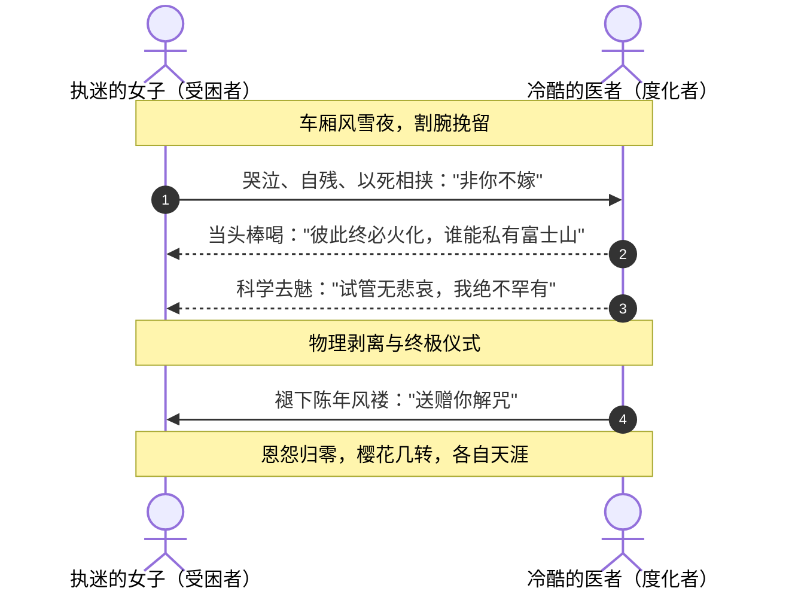

+++
title = '谁能凭爱意要富士山私有：细品《富士山下》的执念、去魅与解咒'
date = '2026-11-21T21:24:00+08:00'
slug = 'fujisanxia-lyrics'
draft = false
tags = ['音乐', '林夕', '陈奕迅', '富士山下', '歌词赏析']
+++

在华语流行乐坛的词作长河中，如果评选一首将“劝慰失恋”写到登峰造极、哲思透骨的作品，陈奕迅演唱、林夕作词、泽日生作曲的《富士山下》（2006）必列其首。

这首歌常常被人们用最世俗的框架归类为“渣男残忍分手的辩解”，抑或“备胎苦恋无果的挽歌”。然而，当你真正置身于泽日生那如绵延山道般迂回的长句旋律中，逐字拆解林夕在风雪车厢里布下的意象与机锋，便会发现：**这绝非一场俗套的男女推拉，而是一场以残忍为表、以菩萨心肠为里的精神度化。** 词人借由一场在风雪之夜的车厢长谈，完成了一次从执念占有、情绪去魅到终极解脱的心灵手术。

<!-- more -->

---

## 一、车厢长镜头：极度逼仄的绝望修罗场

《富士山下》的开篇，林夕没有采用宏大的抒情铺陈，而是直接用电影长镜头的白描手法，将听众拽入一个窒息而冰冷的密闭空间：

> 拦路雨偏似雪花 饮泣的你冻吗  
> 这风褛我给你磨到有襟花  
> 连调了职也不怕 怎么始终牵挂  
> 苦心选中今天想车你回家  

车外是“拦路雨偏似雪花”的湿冷长夜，车内是饮泣发抖的女子与手握方向盘的旧爱。“苦心选中今天想车你回家”，短短十个字，暗藏了多少经过深思熟虑的预谋与决绝。这一天，不是心血来潮，而是男主角精心挑选的“终结点”——他要用一次送她回家的车程，彻底斩断这段纠缠。

紧接着，“这风褛我给你磨到有襟花”更是林夕标志性的微观意象暴击：

旧大衣因为两人的长期依偎摩擦，边缘泛起了毛球，在男人的眼里，它被戏谑而凄凉地称作“襟花”。这件风褛是过往岁月温柔的裹尸布，也是关系走向疲态与陈旧的铁证。女子为了他甚至“连调了职也不怕”，不惜牺牲前途也要守在身旁，然而换来的却是对方冷静得近乎冷酷的摊牌。

---

## 二、当头棒喝：撕下自戕殉情的伪浪漫

如果说第一段是环境的铺垫，那么副歌前的情绪推进，则直接将戏剧冲突拉到了生死边缘：

> 原谅我不再送花 伤口应要结疤  
> 花瓣铺满心里坟场才害怕  
> 如若你非我不嫁 彼此终必火化  
> 一生一世等一天需要代价  
> ……  
> 留在汽车里取暖 应该怎么规劝  
> 怎么可以将手腕忍痛划损  

在无数言情范式中，“非你不嫁”、“为爱割腕”、“以死相逼”往往被渲染成至死不渝的崇高浪漫。但在林夕笔下，这种自毁式的执念被剥得一丝不挂：

1. **“花瓣铺满心里坟场才害怕”**：不再送花，是不愿让虚幻的安慰变成未来的苦果。如果你心里早就成了一座埋葬希望的坟场，任由落红堆积腐烂，那才是最可怕的绝境。
2. **“彼此终必火化”的终极虚无**：哪怕你今天真的非我不嫁，百年之后肉身亦不过是一捧灰烬。你用“一生一世”的宏大誓言去赌一个渺茫的人，付出的代价是无法承受的虚耗。
3. **直面自残的荒诞**：“怎么可以将手腕忍痛划损”——男主挑明了女子的割腕挽留。在成人的情感博弈里，以肉体受创来要挟对方的内疚，看似烈女断腕，实则是最无助也最卑微的囚笼。

男主角的语调没有怜香惜玉的迟疑，反而像一位手持戒尺的禅师，以金刚怒目的清醒，硬生生砸碎女子的殉道幻想。**不给一丝回光返照的希望，才是对沉溺者最大的慈悲。**

---

## 三、富士山爱情论：从“私有占有”到“路过审美”

全词的核心灵魂，毫无疑问落在副歌那句惊艳华语词坛二十年的绝唱：

> 谁都只得那双手 靠拥抱亦难任你拥有  
> 要拥有必先懂失去怎接受  
> 曾沿着雪路浪游 为何为好事泪流  
> **谁能凭爱意要富士山私有**  

林夕曾在散文中详细阐述过他的“富士山论”：
> “其实，你喜欢一个人，就像喜欢富士山。你可以看到它，但是不能搬走它。你有什么方法可以移动一座富士山？回答是：你自己走过去。对于爱情也是如此，逛过富士山，但不能拥有富士山。”

富士山雄踞东瀛，白雪皑皑，静穆庄严。它是大自然造化的神迹，任凭天下游人如何为之倾倒、如何神魂颠倒，谁又能将一座八合目覆雪的巍峨火山塞进私人行囊？

人类痛苦的根源，往往在于**把“审美体验”误当成了“产权所属”**。
- 你曾与他在雪路上浪游漫步，那是客观发生过的美好；
- 但“拥有”本身就是一个伪命题——“谁都只得那双手，靠拥抱亦难任你拥有”。两只手臂张开，能环抱的肉身不过方寸之间，连灵魂的一角都拘禁不住，又何谈拥有一个独立的人？
- **“要拥有必先懂失去怎接受”**，这是深谙佛理的逆向真理：只有做好了随时归还一切的觉悟，你才配在这无常的世间体会片刻的相依。

---

## 四、去魅与拆解：情绪在试管里找不到残渣

为了进一步摧毁对方的心魔，林夕在后半段运用了极具现代科学与唯识宗思辨的修辞：

> 何不把悲哀感觉 假设是来自你虚构  
> 试管里找不到它染污眼眸  
> 前尘硬化像石头 随缘地抛下便逃走  
> 我绝不罕有 往街里绕过一周 我便化乌有  

这段词的解构力度达到了全篇的峰值：

### 1. 悲伤的“物理虚构性”
悲伤是真实的吗？它沉重得让人想割腕、想自杀，但如果你把眼泪拿去现代化学实验室的“试管”里化验，分析出的不过是水、无机盐、蛋白质与溶菌酶，**试管里根本检测不出哪怕一毫克名为“悲哀”的实体分子**。悲哀不是客观存在的物质，它是你大脑神经元与心识妄念合谋编织出的全息幻象。既然是幻象，你为什么要把命赔给一段虚构？

### 2. 彻底的“神坛去魅”
很多时候，失恋者走不出来，是因为将对方进行了神圣化塑像，把对方视作生命中独一无二的光芒。而男主却亲手将自己这尊神像砸得粉碎：
> “我绝不罕有，往街里绕过一周，我便化乌有。”

他极其决绝地自贬、自轻：“我算什么珍禽异兽？走下这辆车，到外面的弥敦道、旺角街头绕一圈，满大街都是穿风衣的平庸男人，我瞬间就淹没在人海里了。你何苦为这样一个随处可见的凡夫俗子寻死觅活？”  
**以自轻之言，破狂痴之境。** 男人将自己的光环剥夺得干干净净，逼她承认这不过是一场寻常不过的痴狂。

---

## 五、时间相对论与终极“解咒”

在全曲的尾声，空间与时间的尺度被无限拉长：

> 人活到几岁算短 失恋只有更短  
> 归家需要几里路谁能预算  
> 忘掉我跟你恩怨 樱花开了几转  
> 东京之旅一早比一世遥远  
> ……  
> 你还嫌不够 我把这陈年风褛 送赠你解咒  

### 1. 时间的量尺
“人活到几岁算短，失恋只有更短”。人生七八十年尚且白驹过隙，失恋所激起的那点痛楚，在时间的苍茫长河中又算得了什么？忘掉恩怨，车外的樱花谢了又开，开过几转，那段曾经刻骨铭心的东京雪景，早已被滚滚前行的生活抛在了光年之外。

### 2. 最后的仪式：风衣解咒
全曲的落幕，定格在那个令人心悸的动作上：  
**“你还嫌不够，我把这陈年风褛，送赠你解咒。”**

为什么是“解咒”？  
因为林夕看透了执念的本质——**深情若到了丧失自尊与理智的地步，便不再是爱，而是一种自己给自己施加的心魔降头（巫咒）。**  
这件从开头就磨出了“襟花”、见证了数载体温与缠绵的风褛，是这场降头唯一的媒介（Token）。男人把它脱下来，披在女人的肩上：
- 给你御寒，是旧日伴侣最后的体面与道义；
- 赠衣了断，则是一场彻底斩断羁绊的法事。

当法器归还，咒语便应声而破。风褛给你，你不用再记着我，走出这辆车，漫天风雪里，你终于自由了。

---

## 六、结语：最高明的残忍，是菩萨低眉

很多人年少听《富士山下》，总觉得歌里的男人冷静得近乎无情：车外的雨雪下得那么大，身边的女孩哭得那么惨，手腕上的伤痕还在渗血，他却在旁边慢条斯理地讲大道理、讲试管、讲富士山、讲人生苦短。

可人到中年、经历过几次生离死别与爱恨沉浮之后，才恍然明白：**唯有经历过大痛大悟的人，才能写出如此锋利又厚重的药方。**

若他温言软语，若他伸手替她拭去眼泪，若他在车里重新将她拥入怀中，女子只会觉得尚有一丝余地，继续在那座名存实亡的坟场里苟延残喘。真正的救赎，从来不是递上一张麻醉的止痛贴，而是用手术刀狠心割开溃烂的脓疮。

爱不是占有，亦非私产。神山巍然伫立，你曾顶着风雪在山脚下走过一程，看清了它的峰顶白雪，这就已经足够。把那件风衣穿好，推开车门，往人海里走去吧。
