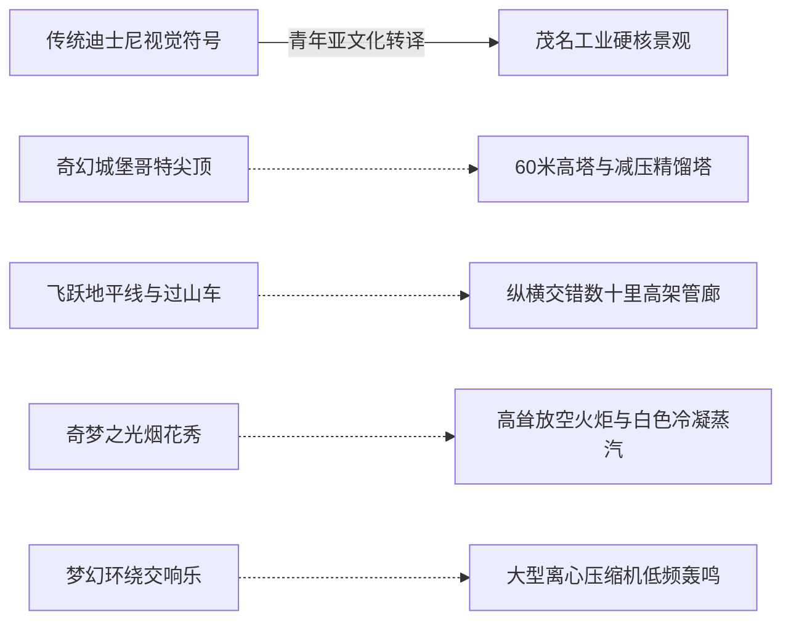
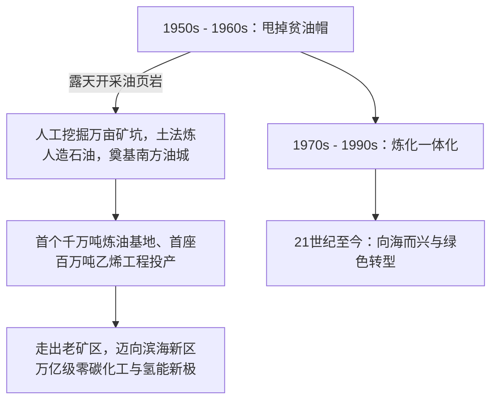
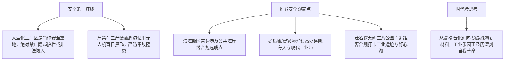

+++
title = '解构“茂名迪士尼”：从南方油城的硬核工业，到赛博朋克的现实浪漫'
date = '2026-11-21T18:35:00+08:00'
slug = 'maoming-industrial-disneyland'
draft = false
tags = ['茂名', '工业美学', '城市纪实', '赛博朋克', '文化观察']
+++

在当代互联网的调侃语境中，“迪士尼”早已脱离了单纯的主题公园范畴，演变成一种充满戏谑与隐喻的文化符号。当人们提起上海迪士尼，脑海中浮现的是粉色城堡与绚烂烟火；当人们提起成都迪士尼，会心一笑的是玉林七巷老小区里因说唱而爆火的健身器材。而在粤西沿海、因油而生的“南方油城”——广东茂名，网友与年轻摄影师口中的“茂名迪士尼”，却是一座座占地数十平方公里、入夜后如银河倒泻般璀璨的现代化重工业基地。

没有米奇老鼠，也没有达菲熊，这里只有数十米高的精馏塔群、如银色游龙般穿梭的金属管网、夜空中摇曳的火炬塔与低沉轰鸣的压缩机。这种强烈的反差与魔幻感，构成了南中国海岸线上一道极为独特的景观：人们在戏谑的词壳里，重新发现了属于重工业时代的史诗感与赛博朋克浪漫。

<!-- more -->

---

## 一、 何为“茂名迪士尼”？一场解构主义的视觉共谋

所谓“茂名迪士尼”，并不是官方建设的主题公园，而是近年来在社交媒体（小红书、抖音、Bilibili等）和摄影圈中，年轻人对**茂名石化装置区**及**茂名滨海新区绿色化工基地**夜景的戏称与二创。



### 1. 元素戏仿：从童话梦境到钢铁丛林

如果将传统主题乐园的视觉符号与茂名的工业装置进行像素级对比，会发现一种令人拍案叫绝的“神似”：

| 乐园元素 | 传统迪士尼乐园 | 茂名“工业迪士尼” |
| :--- | :--- | :--- |
| **地标建筑** | 奇幻童话城堡（睡美人/灰姑娘） | 数十米高立的加氢裂化反应塔、减压蒸馏塔 |
| **游乐设施** | 极速光轮、飞越太空山过山车 | 绵延数十公里、架空跨越道路的复杂管廊系统 |
| **夜间演艺** | 城堡夜光投影与大型烟花秀 | 24小时不熄的放空火炬橙蓝焰火、冷却塔蒸腾的白色巨浪 |
| **声光效果** | 欢快童话配乐、全息投影 | 工业高压钠灯/防爆LED阵列、巨型机组的重金属工业交响 |
| **入场门票** | 数百元全票、早起排队预约 | **公共外围远眺免费**（核心厂区为特种安全禁区） |

### 2. 空间坐标：两处截然不同的工业画卷

在茂名的地理版图中，能被称为“工业迪士尼”的景观主要分布在两个片区：
- **老牌工业核心区（茂南区/乙烯片区）**：新中国石化工业的代表作，装置密集排布，老油城的生活街区与巨大的球形储罐、裂解装置犬牙交错，充满浓郁的80-90年代工业复古质感。
- **向海而兴新极核（茂名滨海新区）**：吉达港区与绿色化工园区，以千亿级烷烃资源综合利用、高端新材料产业为代表。这里的装置更加现代化、规模更加浩大，整齐划一的钢铁森林与茫茫大海连成一片，在暮色四合时展现出极其震撼的科幻未来感。

---

## 二、 城市底色：“南方油城”的硬核拓荒纪

要理解茂名人对这片钢铁森林的复杂情感，不能脱离这座城市由油而生、由油而兴的厚重历史。



### 1. 甩掉“贫油国”帽子的拓荒之役
新中国成立初期，石油资源极度匮乏。1950年代初，地质勘探队在茂名盆地探明了储量高达数十亿吨的油页岩资源。在周恩来总理“从油页岩中提炼石油”的指示下，成千上万名来自天南海北的技术干部、复员军人和青年工人，背着行囊奔赴这片荒凉的罗江之滨。

他们战严寒、斗酷暑，在没有大型现代化起重设备的年代，用铁锹、扁担和简易机械开凿出了纵横数公里的特大露天矿坑，建起了油页岩干馏装置，成功提炼出合格的人造石油，为年轻的共和国工业注入了宝贵的血液。

### 2. 两次产业跨越：从千万吨炼油到百万吨乙烯
随着大庆、胜利等天然油田的相继发现与国际原油贸易的展开，茂名石化并未固步自封，而是迅速完成技术迭代：
- 依靠沿海港口优势，转向进口原油深加工，建成中国首个**千万吨级炼油基地**；
- 1990年代，茂名30万吨乙烯工程破土动工，随后持续扩建，跻身全国**首座百万吨级乙烯生产基地**，奠定了茂名在华南石化工业中的支柱地位。

今天这片被年轻人调侃为“迪士尼”的钢铁森林，正是两代拓荒者流血流汗、用青春与智慧浇筑而成的工业脊梁。

---

## 三、 双面漫游：从“黑色伤疤”到“好心湖”的生态蝶变

如果你以为茂名只有冷冰冰的化工厂区，那就大错特错了。茂名最富戏剧张力的地方，在于它拥有一个真正的、由昔日工业炼狱重生的**生态“主题乐园”——茂名露天矿生态公园**。

```mermaid
flowchart LR
    subgraph 过去：工业阵痛
        A1["露天矿疯狂挖掘"] --> A2["5公里特大矿坑遗留"]
        A2 --> A3["重金属析出、酸性积水、粉尘蔽日"]
    end
    subgraph 蜕变：生态修复
        B1["关停矿山全面引水"] --> B2["高州水库活水置换成湖"]
        B2 --> B3["植被修复、建设环湖绿道与湿地"]
    end
    subgraph 当下：市民乐园
        C1["好心湖生态公园"]
        C2["保留德制/苏制巨型电铲与蒸汽机车"]
        C3["矿工博物馆传承拓荒记忆"]
    end
    A3 ==> B1
    B3 ==> C1
```

### 1. 城市之殇与生态决绝
在油页岩开采的数十年间，露天矿累计挖掘了上亿立方米土石，留下了一个长约5公里、宽约1公里、深达百余米的巨大地表裂痕。停产后，这里一度成为城市的“伤疤”：矿坑内积水酸化发臭，周边土地盐碱化，大风吹过尘土漫天，市民避之唯恐不及。

2013年起，茂名市委市政府果断转变思路，拒绝了将其改建为垃圾填埋场或工业用地的方案，启动了一场史无前例的生态“造血式”修复：
- **引水成湖**：实施“引高（州水库）灌矿”工程，引入纯净的活水冲淡酸性水质，将死水深坑转化为容量达1.6亿立方米的巨型人工湖——**好心湖**；
- **边坡复绿**：栽种耐酸碱的木麻黄、大叶相思等林木数万亩，让昔日寸草不生的灰白矿坑重现葱郁；
- **遗产活化**：不搞大拆大建，将当年的矿山火车头、重型铁轨以及极具年代感的巨型采矿电铲（包括珍贵的德国产重型采掘机）作为工业雕塑完好保留，并利用废弃矿工食堂等旧建筑打造了全省首家**露天矿博物馆**。

如今，漫步在好心湖畔，湖水澄碧如翡翠，鹭鸟在水草丰茂的湿地间掠过，市民带着孩童在绿草如茵的坡地上奔跑放风筝，巨大的钢铁电铲安静地伫立在蓝天白云下——这才是茂名人引以为傲的“城市绿肺乐园”。

---

## 四、 文化透视：年轻人为何着迷于“工业迪士尼”？

从线上的短视频打卡，到线下的夜景远眺，为什么当下的年轻人会把一座座化工厂比作“迪士尼”？这种看似荒诞的幽默背后，蕴藏着深层的时代心理机制。

### 1. 审美疲劳与“巨物崇拜”的觉醒
在社交网络充斥着千篇一律的北欧风、日系小清新和欧式城堡假布景的当下，大众的视觉感知已极度疲劳。
相反，大型石化装置那数万根毫无修饰的银灰色冷凝管道、拔地而起的粗壮混凝土立柱、严丝合缝的法兰接口与巨型反应器，以一种赤裸而绝对的**功能主义秩序**直击视网膜。这种超日常尺度的工业巨构（Megastructure），天然激发出人类对力量与精密工艺的原始崇拜。

### 2. 赛博朋克的现实投射
当代科幻电影（如《银翼杀手2049》、《流浪地球》）所构建的未来美学，核心特征便是：**钢铁巨兽、密集管道、高光对比、蒸汽弥漫与夜幕中的强光源**。
当夜幕降临，茂名石化装置亮起密密麻麻的防爆作业灯，冷白色的冷光与金黄色的泛光交织，火炬在暗夜苍穹上舞动，管道缝隙间喷涌出阵阵纯白色的水蒸气——无需任何特效滤镜，这里本身就是一处活生生的科幻电影片场。年轻人将其戏称为“迪士尼”，实质上是赋予了它“现实科幻主题乐园”的文化身份。

### 3. 本土青年的自嘲与文化解构
在过去的流行语境里，以重工业为主导的三四线城市，常被冠以“老工业基地”、“污染”、“落伍”等刻板印象。
而新一代茂名青年与自媒体博主，用“迪士尼”这一全球顶级商业消费符号来进行反讽与解构：**“你们去上海看童话城堡，我们茂名看工业母机；你们花几百块看烟花，我们看的是千万吨级炼油的火炬。”** 
这看似戏谑的自嘲背后，实则是年轻人以更松弛、更自信的心态，重新审视并拥抱自己脚下的这片工业热土。

---

## 五、 探访指引与理性反思

如果读者也想亲身体验一把“茂名工业迪士尼”的独特魅力，务必保持清醒与克制。



### 1. 观景与摄影的安全边界
- **切勿擅闯红线**：石化基地是最高等级的安全生产重地，涉及易燃易爆物料，核心区域严禁吸烟、严禁明火、严禁无关人员进入。
- **遵守空域管理**：现代化炼化基地均属于严格管制的空域保护区，切勿使用无人机违规“黑飞”航拍。
- **推荐合规点位**：
  - **白日人文线**：前往【茂名露天矿生态公园】，参观露天矿博物馆、好心湖与老电铲遗址，感受生态蜕变；
  - **山海远眺线**：登临【晏镜岭】或滨海新区合规观景台，在晴朗黄昏远眺博贺新港与现代化石化群在海平面上的交响；
  - **夜景人文线**：走访【1958文化创意园】或【油城墟】，在老油城工人的生活记忆里体验人间烟火与地道粤西美食（簸箕炊、捞粉、化州糖水）。

### 2. 从“硬核黑金”到“绿氢未来”
在惊叹于夜景之美的同时，我们也应看到工业背后的现实转型挑战。在“双碳”目标下，传统的石油炼制高能耗模式已不再适应高质量发展要求。
如今的茂名，正推动传统石化向**“减油增化、减油增特”**加速蜕变，滨海新区正大力布局烷烃脱氢、绿氢合成、降解塑料与高端碳纤维等战略性新兴产业。这座被戏称为“迪士尼”的超级工业矩阵，自身也正在进行着一场自我重塑的绿色科技革命。

---

## 六、 结语：钢铁写就的平民史诗

真正的迪士尼，用玻璃纤维、聚酯树脂和梦幻光影编制童话，抚慰成年人在都市生活里的焦虑；而茂名的这座“工业迪士尼”，则用千万吨钢铁、数万公里管道和几代产业工人的血汗，默默支撑着国家能源与工业基础的运转。

没有会说话的米老鼠，但那些在深夜轰鸣中平稳运转的塔器，见证了一个国家从“一穷二白、滴油如血”走向工业巨人的筚路蓝缕；没有灰姑娘的水晶鞋，但湖水碧绿的好心湖与挺立的老电铲，诉说着一座工业城市壮士断腕、拥抱生态的勇气。

**当夜色再次笼罩粤西大地，万盏灯火在钢铁丛林间次第点亮，放空火炬在天际拉出雄浑的焰火。这不是虚构的童话乐园，这是现实中国大地上，由劳动、汗水与时代演进共同谱写的硬核浪漫。**
