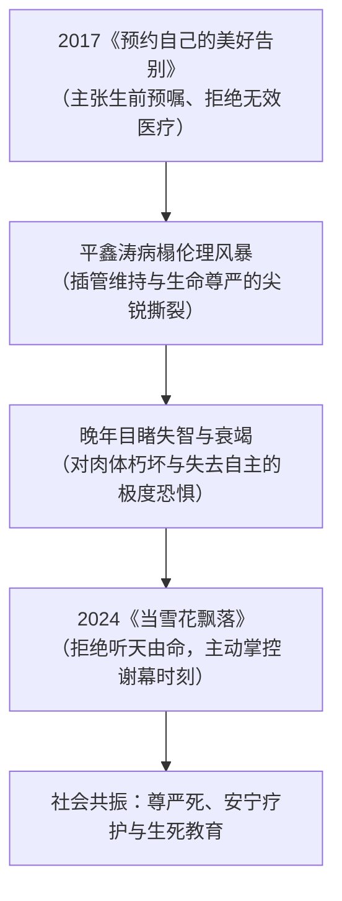
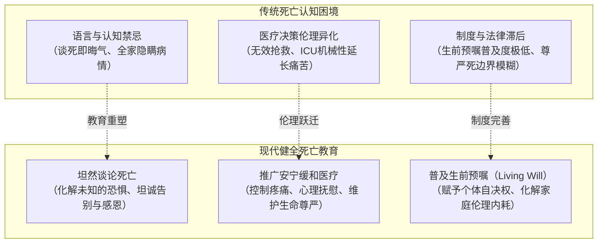
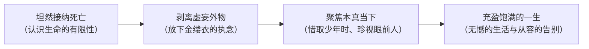

+++
title = '劝君莫惜金缕衣：从琼瑶的翩然谢幕，谈华人社会缺失的死亡教育'
date = '2026-11-21T21:00:00+08:00'
slug = 'qiong-yao-farewell-and-death-education'
draft = false
tags = ['琼瑶', '死亡教育', '生死哲学', '尊严死', '安宁疗护', '劝君莫惜金缕衣']
+++

2024 年冬，86 岁的琼瑶在台湾新北市淡水区的寓所内决然谢幕。在留给世人的绝笔信《当雪花飘落》中，她以一贯炽热而诗意的笔调写道：

> “当雪花飘落的时候，就是我翩然离去的时候……我‘翩然’的去了。‘死亡’是每个人必经之路，也是最后一件‘大事’。我不想听天由命，不想慢慢凋零，我想为这最后的大事‘作主’。”

这位曾以笔墨编织无数痴男怨女、主宰几代华人情感记忆的言情教母，最终用最具戏剧张力的方式，为自己的人生大剧写下了终局。消息传来，舆论哗然。有人惊叹其“至死浪漫、求仁得仁”，有人对“轻生”一词扼腕叹息，亦有专业人士忧虑公众人物此举带来的模仿风险。

然而，若将视野超越个案的喧嚣与争议，琼瑶的决绝告别，实际上像一记沉重的暮鼓，撞击在整个华人文化长期避而不谈的禁区上——**我们从未被认真教授过如何面对老去与死亡。**

晚唐名篇《金缕衣》唱道：“劝君莫惜金缕衣，劝君惜取少年时。花开堪折直须折，莫待无花空折枝。”千百年来，人们习惯于将这首诗读作韶华易逝的劝勉；但在琼瑶的谢幕与生死的沉思前重读此诗，却有了更为冷峻的关照：**究竟什么是人生那件虚妄沉重的“金缕衣”？当我们穷尽一生追求繁华、恐惧衰朽时，又该如何真正完成生命的“惜取”？**

<!-- more -->

---

## 一、最后的剧本：琼瑶的生死观与“自主权”执念

要理解琼瑶的离去，必须回溯她多年来在生死议题上的激烈交锋。

早在 2017 年，79 岁的琼瑶便在社交媒体上公开发表了写给儿子和儿媳的公开信《预约自己的美好告别》。她在信中明确叮嘱：无论未来生了什么重病，绝不动大手术、不送加护病房、不插鼻胃管、不插气管、不使用呼吸机或电击，更希望未来能有合法尊严死的机会。

随后不久，因丈夫平鑫涛患血管性痴呆症及中风，琼瑶与平家子女就“是否插入鼻胃管”爆发了长达数月的伦理冲突。在子女看来，插管是维持父亲生命的必要医疗手段；而在琼瑶看来，让一个失去意识与记忆的生命依赖冰冷的塑料管插在胃里苟延残喘，是对生命本质尊严的残忍凌迟。

这场家庭风波之所以引起全社会的巨大共鸣，是因为它几乎是每一个现代家庭都可能遭遇的现实酷刑：**当医学技术能够将生理死亡的时间无限推迟，我们究竟是在延续生命，还是在延长死亡的过程？**

琼瑶一生追求唯美主义、情节逻辑的严丝合缝与命运的绝对主导权。她无法忍受自己在病床上插满管线、失去意识、任人摆布的凄凉晚景。她的选择，是她个人生命哲学在最后的极端践行——在失去自我掌控力之前，以自己的意志熄灭灯火。

---

## 二、劝君莫惜金缕衣：何为外相？何为本真？

唐代杜秋娘所歌的《金缕衣》，表面上是叹惋时光、劝人折花，实则蕴含着深刻的生命哲学解构：

| 意象 | 世俗维度的认知 | 生死哲学维度的投射 |
| :--- | :--- | :--- |
| **金缕衣** | 锦衣华服、世俗权柄、金钱财富 | **维持无质量生命的执念、社会对衰老的抗拒、空洞的孝道规训** |
| **少年时** | 青春年少、肉身活力、欢愉时刻 | **清醒的意识、独立的尊严、未被病痛彻底剥夺的自主精神** |
| **花开堪折** | 抓住机遇、及时行乐 | **知死而生、在有限的鲜活岁月里尽兴无憾地体验生命** |
| **无花空折枝** | 韶华不再、徒留遗憾 | **肉身机能枯竭、灵魂退场后，仅靠仪器维持的一堆冰冷碳水化合物** |

在东亚传统文化的语境中，人们倾尽全力在编织和守护各种形式的“金缕衣”：

1. **对“生理时长”的盲目执念**：将“活着”简单粗暴地等同于心跳和呼吸的存在，哪怕患者浑身插管、神志丧失、皮肤溃烂，也要不惜一切代价“抢救到底”。这件名为“长寿”的金缕衣，往往由患者极端的生理痛苦和家属的心理安慰剂编织而成。
2. **被世俗规训绑架的“孝道表演”**：不少临终关怀医生指出，许多家属坚持过度抢救，并非出于患者本人的福祉，而是出于恐惧“背负不孝之名”的社会舆论压力。这种孝心，实质上是对外在道德形象（另一件金缕衣）的自私守护。
3. **对死亡与衰朽的病态逃避**：消费主义与现代医疗神话不断向人们灌输“青春永驻”、“战胜疾病”的幻象，使人将衰老与死亡视为可耻的失败，而非自然循环的必然阶段。

琼瑶以她极其决绝的姿态，将这件千斤重的“金缕衣”一把扯下。她用行动宣告：如果生命的本质光芒（尊严、自主、美感）已经走到黄昏边缘，那么徒留一具由管路维持的躯壳，便不过是那枯槁凋零的“空折枝”。

---

## 三、华人文化缺失的“死亡教育”三重大山

琼瑶的选择之所以引发震荡，根源在于华人社会长期以来在“死亡教育”上的系统性失语与空白。

儒家先贤孔子曾言：“未知生，焉知死？”千百年来，这句话常被片面解读为“只关注现世，回避死亡讨论”。在中国人的日常语境中，“死”是一个被高度污名化与禁忌化的词汇：买房避讳带“4”的楼层，生病讳言后事，谈及遗嘱常被斥为“不吉利”。

这种文化禁忌造就了三大现实痛点：

### 1. 瞒骗至死的“合谋”
在许多家庭中，当老人确诊绝症时，家属往往选择对老人隐瞒真相。老人在信息真空与身体恶化的双重折磨中走向终点，至死未能完成对自己人生的盘点、财产的清晰交接，甚至无法与深爱的人坦诚告别。这种“善意的谎言”，剥夺了个体面对死亡的基本知情权。

### 2. 无效医疗（Futile Medical Care）的折磨
现代重症监护技术（ICU）的发达，模糊了自然死亡与生理维持的边界。很多进入终末期的患者，在生命的最后几天甚至几个月里，经历了气管切开、中心静脉置管、心肺复苏时的胸骨骨折、深喉吸痰的剧痛。医学学者葛文德在《最好的告别》（*Being Mortal*）中指出：**技术的过度干预，往往把原本可以安详从容的告别，演变成了一场漫长、残酷且毫无意义的肉体折磨。**

### 3. “生前预嘱”与自决机制的滞后
虽然中国大陆部分城市（如深圳）已在立法层面破冰确立了生前预嘱的法律效力，但对于绝大多数公众而言，“生前预嘱”（Living Will）与“安宁缓和医疗”（Palliative Care）仍然是极为陌生的概念。当个体无法通过成熟、合法且有尊严的社会支持体系决定自己的终点时，有些人在绝望中便可能走向自力了结的极端道路。

---

## 四、警惕浪漫化：理解背后的孤绝，坚守生命的防线

在探讨琼瑶离世时，我们必须保持足够的理性与克制：**可以理解她对生命自决的渴望，但绝不能将“轻生”浪漫化。**

琼瑶作为一位拥有巨额财富、极高文学声望与强大人格自主权的公众人物，她的生活境遇与普通大众存在巨大鸿沟。将她的离去冠以“唯美”、“翩然”、“潇洒”的标签，容易在社会层面引发潜在的认知偏差与次生伤害：

> [!WARNING]
> 自杀绝非一种可以被诗意消费的美学符号。世界卫生组织（WHO）反复强调，公众媒介在报道名人轻生事件时，应严格避免细节美化与方法描摹，防止对处于心理危机与抑郁状态中的脆弱人群产生“维特效应”（Werther Effect）。

事实上，琼瑶选择终结生命的背后，除了哲学上的“尊严诉求”，同样折射出高龄老年人普遍面临的残酷现实：
- **深层的情感孤寂**：随着伴侣离世、同代挚友渐次凋零，老年人在晚年极易陷入巨大的精神旷野；
- **对身体失能的焦虑与抑郁**：肉体机能的不可逆衰退，往往伴随着隐匿的心理应激与老年抑郁症；
- **社会支持系统的隐形缺位**：即便是琼瑶这样生活优渥的长者，面对晚年的虚无与疾病恐惧，亦显得脆弱无助。

真正的死亡教育，**绝非赞美轻生，而是通过破除死亡的禁忌，给活着的人注入更多面对真实苦难的勇气与制度保障**。我们应当倡导的是在医学与法律框架下完善“安宁缓和医疗”与“尊严死”立法，让老人们在充分的阵痛缓解、心理陪伴与家庭关爱中安详谢幕，而非逼迫任何人在孤独中铤而走险。

---

## 五、向死而生：在花开时尽兴，在风起时从容

德国哲学家海德格尔提出“向死而生”（*Sein-zum-Tode*）的概念。他认为，只有当人意识到死亡是自己无法逃避且随时可能降临的必然宿命时，人才能真正摆脱平庸日常的沉沦，找到生命本真的意义。

死亡教育的最终目的，从来不是导向虚无或毁灭，而是为了**更清醒、更热烈、更无憾地生活**。

站在琼瑶谢幕的涟漪之中，我们每个人都可以从现在开始，完成三件至关重要的人生功课：

1. **撕下死亡的封条，开启家庭对话**：
   找一个平静的午后，与父母、伴侣或子女坦诚地聊一聊死亡。探讨如果有一天生命走向不可逆的终末期，我们各自希望以怎样的方式被对待？是否接受过度抢救？希望葬礼怎样举行？签下一份生前预嘱，不仅是对自己的尊重，更是把家人从未来沉重的伦理抉择负罪感中解救出来。

2. **放下对“金缕衣”的虚荣执念**：
   名利、地位、虚饰的人设以及外在的标准，全都是生命旅途中的借用之物。我们无需为了维护外界的眼光而过度透支自我，更不必在生命枯竭时死死抓住那些毫无意义的形式主义。

3. **惜取少年时，活好每一个当下**：
   “少年时”并不仅仅指代生理上的二十岁，它指的是每一个神志清醒、尚能呼吸、尚能去爱与被爱的当下。去爬想爬的山，见想见的人，说出迟疑已久的爱与歉意，在花开时尽情绽放，在果熟时坦然承接风雨。

---

## 结语

雪花飘落，归于尘土；春水消融，化入江海。

琼瑶的一生轰轰烈烈，写尽了人间风月，最终也以她认定的方式走向了永恒的寂静。我们不必神化她的离去，但应当感激这场告别为当代社会敲响的警钟。

劝君莫惜金缕衣，劝君惜取少年时。**生命的尊严，在于它曾经毫无保留地燃烧过；而生命的慈悲，在于我们终于学会了如何坦然地注视余烬，平静地道一声珍重。**
