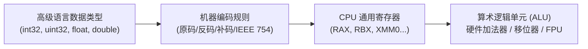
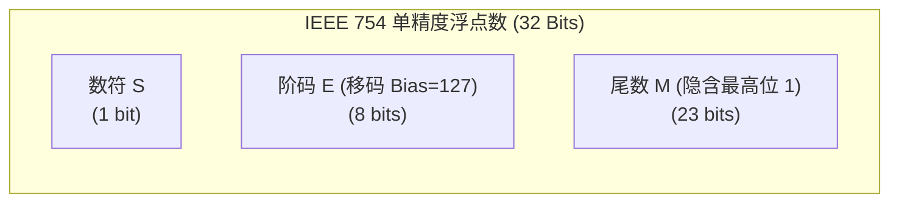
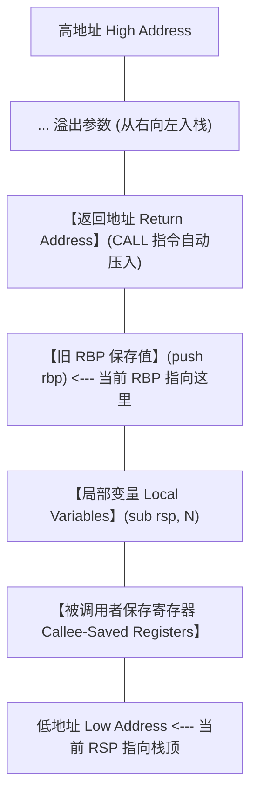
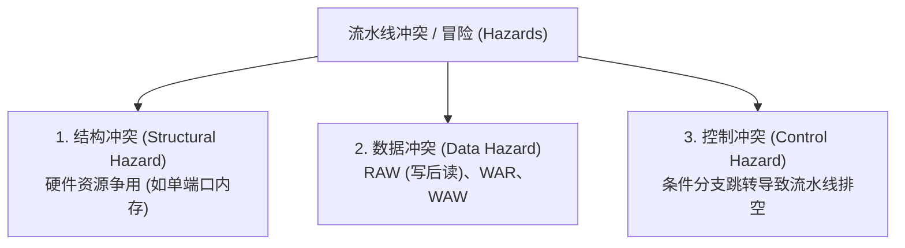
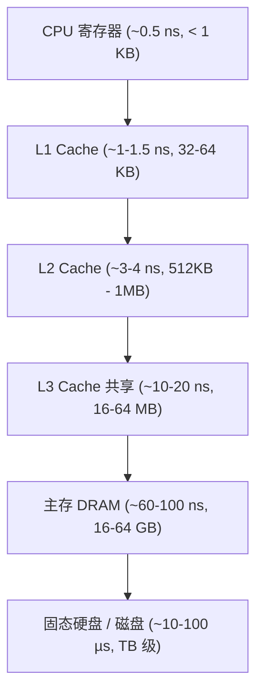
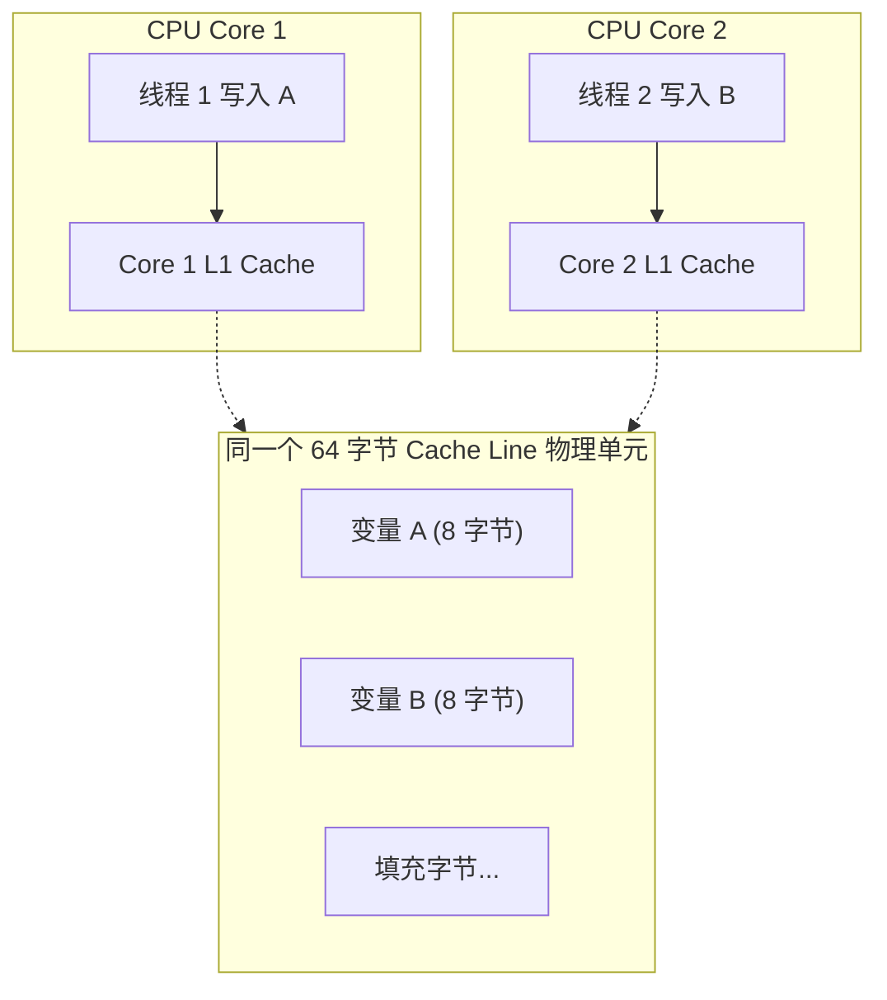
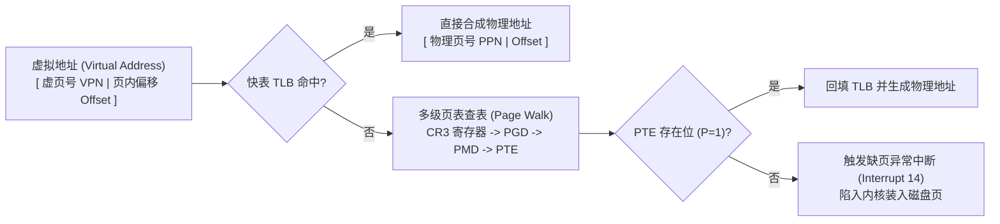
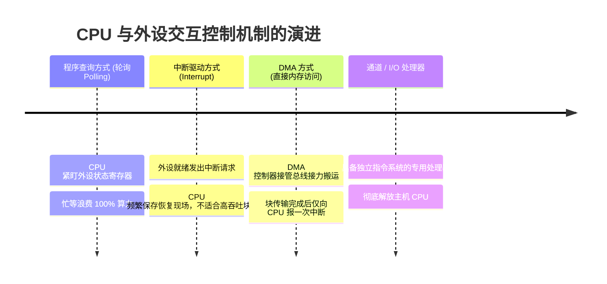
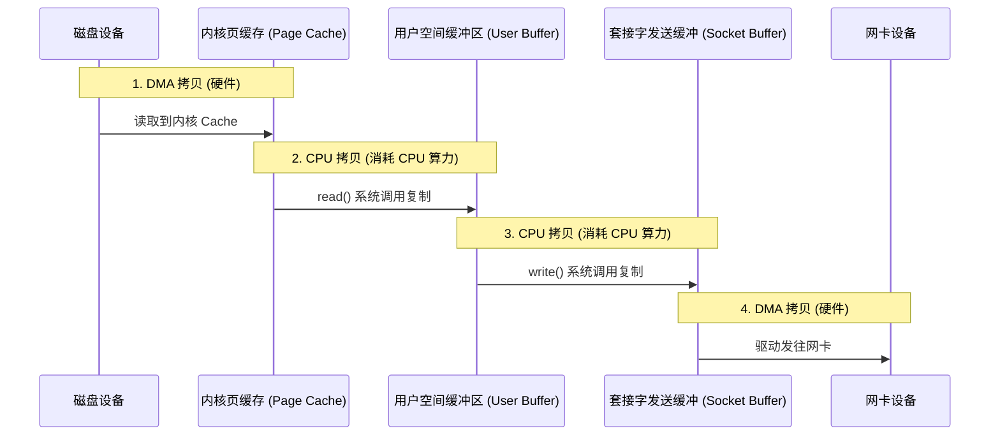

+++
title = '考研 408 计算机组成原理与现代编程实战：从硬件底层重塑编程思维'
date = '2026-11-21T19:50:00+08:00'
slug = '408-computer-organization-and-programming-principles'
draft = false
tags = ['计算机组成原理', '考研408', '底层原理', '体系结构', 'C/C++']
+++

在计算机学科考研（408）的四大核心科目中，**计算机组成原理（Computer Organization and Architecture）** 历来被公认为最硬核、最抽象、也最容易让人产生挫败感的一门课。

许多初学者在备考时，往往陷在复杂的逻辑门电路、控制信号微操作、繁琐的时序图计算中不能自拔，常常疑惑：“我们学这些几十年前的硬件细节，对以后的实际写代码、做系统架构究竟有什么用？”

其实，现代 408 统考大纲与享誉世界的经典教材（如《Computer Organization and Design》与《深入理解计算机系统 CS:APP》）早已指明了方向：**计算机组成原理绝非孤立的硬件造芯片学问，而是让程序员看清“软件是如何穿透抽象屏障在物理硬件上真正运转”的唯一心智钥匙**。

从数据的底层补码表示到浮点数精度黑洞，从函数调用的汇编栈帧到 CPU 流水线分支预测，从高速缓存 Cache 局部性到操作系统的虚拟内存与零拷贝——几乎每一项影响现代高并发、高吞吐、低延迟程序生死的底层性能优化，其物理根基都根植于 408 计算机组成原理之中。

本文将跳出死记硬背的应试怪圈，以**“程序员视角的软硬件协同”**为主线，全面解构 408 计算机组成原理的核心机制及其在真实编程中的具象映射。

<!-- more -->

---

## 一、 数据的机器级表示：每一位（Bit）背后的陷阱与玄机

在高级语言中，我们随手定义 `int`、`float`、`double`，看似只是普通的数值，但在 ALU（算术逻辑单元）眼中，它们只是一串冰冷的 0 与 1 脉冲。



### 1. 补码运算的数学本质与有符号数溢出

408 考研中反复考察的原码、反码、补码转换，并不是硬件设计师刻意刁难，而是为了解决一个核心矛盾：**在电路中让减法运算退化为加法运算，从而省略硬件减法器**。

补码的数学本质是**模运算（Modular Arithmetic）**。对于 $n$ 位二进制数，其模为 $2^n$。减去一个数 $X$，等价于加上该数的补数：
$$X - Y \equiv X + (2^n - Y) \pmod{2^n}$$

这种设计让符号位直接参与运算，极大地精简了 CPU 芯片内部的加法电路。但也带来了现代编程中臭名昭著的**整数溢出（Integer Overflow）**问题。

#### 编程陷阱：无符号与有符号混合比较
在 C/C++ 中，根据隐式类型转换规则，有符号整型与无符号整型混合运算时，有符号整型会被强制提升为无符号整型：

```c
#include <stdio.h>

int main() {
    int a = -1;
    unsigned int b = 1;
    
    // 问：控制台会打印什么？
    if (a < b) {
        printf("a < b\n");
    } else {
        printf("a > b (Warning: 补码全 1 被解释为极大正数!)\n");
    }
    return 0;
}
```

在 32 位系统下，`-1` 的补码是 `0xFFFFFFFF`。当提升为 `unsigned int` 时，它的真值变成了 $2^{32} - 1 = 4,294,967,295$。于是 `-1 < 1` 判定为假！在网络包长度校验、内存分配等场景中，此类隐式转换曾引发无数严重的安全漏洞（如缓冲区越界）。

> [!IMPORTANT]
> 408 考点链接：**有符号整数溢出判定（OF 标志位）** 与 **无符号整数溢出/借位判定（CF 标志位）** 是两套并行的硬件逻辑。ALU 同时计算出这两个标志，由随后的分支跳转指令（`jg`/`jl` 针对有符号数，`ja`/`jb` 针对无符号数）决定走向。

---

### 2. 浮点数 IEEE 754：精度丢失的硬件真相

为什么金融交易系统严禁使用 `float` 或 `double`，而必须使用定点数或整数分（Cent）？

408 必考的 **IEEE 754 标准** 将单精度浮点数（32 位）划分为三部分：
1. **数符 $S$（1 位）**：0 为正，1 为负。
2. **阶码 $E$（8 位）**：使用**移码（Bias = 127）**表示，便于硬件直接进行大小比较。
3. **尾数 $M$（23 位）**：规格化表示，最高位隐含 1（即 $1.M$）。

真值公式为：
$$V = (-1)^S \times 1.M \times 2^{E - 127}$$



由于二进制只能精确表示形如 $\frac{1}{2^k}$ 的分数（如 0.5、0.25、0.125），绝大多数十进制小数（例如 0.1 和 0.2）在二进制中都是无限循环小数。受限于 23 位的尾数长度，必须进行舍入（截断），从而产生无法消除的物理截断误差：

```c
// 经典面试与工程问题：
float x = 0.1f + 0.2f;
if (x == 0.3f) {
    // 永远不会执行
}
// 正确做法：引入机器精度 epsilon
#include <math.h>
if (fabs(x - 0.3f) < 1e-6) {
    // 安全通过
}
```

此外，浮点数的加减法需要经历 **对阶（小阶向大阶看齐）$\rightarrow$ 尾数求和 $\rightarrow$ 规格化 $\rightarrow$ 舍入 $\rightarrow$ 溢出判断**。在“对阶”过程中，小阶数的尾数右移，过小的数字会被完全移出尾数范围，导致**浮点数加法不满足数学上的结合律**：
$$(1e20 + (-1e20)) + 1 = 1 \quad \text{但} \quad 1e20 + ((-1e20) + 1) = 0$$

---

### 3. 大小端字节序（Endianness）

当一个多字节数据（如 32 位整数 `0x12345678`）存放在内存中时，各字节在物理地址上的排布方式由硬件体系结构决定：
- **小端序（Little-Endian，x86 / ARM 常见）**：高位字节存放在高地址，低位字节存放在低地址（“高高低低”）。
- **大端序（Big-Endian，网络字节序 TCP/IP、某些 RISC）**：高位字节存放在低地址。

在跨平台网络通信或读取二进制文件时，若忽略字节序转换（如未调用 `htonl()` / `ntohl()`），原本的整数解析将全盘错乱。

---

## 二、 指令系统与过程调用：代码是如何在硬件上运行的

高级语言的 `if`、`while`、函数调用，最终都会被编译器翻译为指令集体系结构（ISA）规定的机器指令。

### 1. 数组访问与 CPU 寻址方式的完美映射

在 408 计组中，各种寻址方式常让人眼花缭乱：立即寻址、直接寻址、间接寻址、寄存器寻址、基址寻址、变址寻址、相对寻址……

其实在高级语言中，这些都有非常具体的载体：
- **基址寻址（Base Addressing）**：基准地址放入基址寄存器，指令提供偏移量 $\text{EA} = (\text{BR}) + A$。这正是面向对象中**访问类/结构体成员变量**的底层实现方式（`this` 指针作为基址，成员变量偏移作为位移量）。
- **变址寻址（Index Addressing）**：基准地址由指令给出，索引放入变址寄存器 $\text{EA} = A + (\text{IX})$。这正是**数组下标遍历**的底层原型。
- **基址变址比例寻址（x86 复合寻址）**：`MOV EAX, [EBX + ECX * 4 + 8]`
  - `EBX`：数组基地址（Base）
  - `ECX`：索引变量 $i$（Index）
  - `4`：比例因子（Scale Factor，每个 `int` 占 4 字节）
  - `8`：结构体前置偏移（Disp）
  一条机器指令便完成了 `obj->arr[i]` 的内存物理定位。

---

### 2. 函数调用与栈帧（Stack Frame）机制

函数调用是如何实现的？CPU 硬件只提供了极简的指令：`CALL`（将下一条指令 PC 压栈并跳转）与 `RET`（从栈顶弹出 PC 并恢复执行）。

现代操作系统与编译器在此之上构建了严谨的**过程调用标准（ABI，如 System V AMD64 ABI）**：



#### 函数调用的生命周期拆解：
1. **参数传递**：在 x86-64 体系下，前 6 个整型/指针参数优先通过硬件寄存器（`RDI`, `RSI`, `RDX`, `RCX`, `R8`, `R9`）传递，超过部分才走内存压栈。寄存器传参比压栈内存快一个数量级！
2. **建立栈帧**：
   ```assembly
   push   %rbp         ; 保存调用者的栈底基址
   mov    %rsp, %rbp   ; 将当前栈顶作为新栈底
   sub    $0x20, %rsp  ; 分配 32 字节局部变量空间
   ```
3. **执行与清理**：函数退出前执行 `leave`（等价于 `mov %rbp, %rsp` + `pop %rbp`）销毁当前栈帧，最后执行 `ret` 弹回原代码位置。

> [!TIP]
> **编程启示**：
> 1. **频繁调用微小函数** 会产生反复保存寄存器、修改 RSP/RBP 的指令开销。现代编译器支持 `inline` 内联优化，正是直接将函数体展开，消除函数调用的栈帧开销。
> 2. **尾递归优化（Tail-call Optimization, TCO）**：当函数的最后一个动作是递归调用自身且无额外计算时，编译器会将 `call` 指令优化为直接 `jmp`，复用当前栈帧，彻底避免深度递归导致的栈溢出（Stack Overflow）。

---

## 三、 CPU 流水线与分支预测：让指令奔流不息

计算机组成原理第四章“中央处理器”是 408 的半壁江山。核心主线便是：**指令流水线（Instruction Pipeline）**。

### 1. 经典五级流水线与冒险（Hazards）

为了提高 CPU 的吞吐率（Throughput），现代微处理器将一条指令的执行分解为多个独立硬件阶段：
- **IF（取指，Instruction Fetch）**
- **ID（译码，Instruction Decode）**
- **EX（执行，Execute）**
- **MEM（访存，Memory Access）**
- **WB（写回，Write Back）**

在理想情况下，每个时钟周期都能移出一条新指令，吞吐量达到 $\text{CPI} \approx 1$。然而，物理现实中存在三大类**流水线冒险（冲突）**：



1. **结构冲突**：例如取指部件和访存部件同时访问单端口存储器。**现代架构的解法**：采用哈佛结构（Harvard Architecture），在 L1 Cache 层级将指令 Cache（I-Cache）和数据 Cache（D-Cache）物理分离。
2. **数据冲突（RAW，Read-After-Write）**：下一条指令需要使用上一条指令尚未写回的结果。**硬件解法**：数据旁路技术（Forwarding / Bypassing），直接把 EX 阶段的计算结果引线接到下一条指令的 ALU 输入端，避免插入气泡（Stall）。
3. **控制冲突**：执行到 `if (condition)` 分支时，CPU 在 EX 阶段之前不知道下一条指令该去哪里抓取！

---

### 2. 分支预测器：一条让程序快 3 倍的经典代码

面对控制冲突，如果 CPU 每次都傻等分支结果算出来，流水线将充满气泡，性能暴跌。

为此，现代 CPU 引入了极度精密的**分支预测器（Branch Predictor）**（利用 2-bit 饱和计数器、分支目标缓冲 BTB 等），在分支发生前预先猜测跳转方向，进行**推测执行（Speculative Execution）**。如果猜对了，流水线无缝衔接；若猜错了，则付出惨重代价——**清空流水线已排入的所有指令（Pipeline Flush），回滚状态，惩罚通常高达 15~20 个时钟周期**。

在 Stack Overflow 上有一道浏览量超百万的著名问题：**为什么遍历已排序的数组比未排序的数组快 3 倍以上？**

```cpp
#include <algorithm>
#include <ctime>
#include <iostream>
#include <vector>

int main() {
    const unsigned ARRAY_SIZE = 32768;
    std::vector<int> data(ARRAY_SIZE);

    for (unsigned c = 0; c < ARRAY_SIZE; ++c)
        data[c] = std::rand() % 256;

    // !!! 核心对比行：是否先进行排序
    std::sort(data.begin(), data.end());

    clock_t start = clock();
    long long sum = 0;

    for (unsigned i = 0; i < 100000; ++i) {
        for (unsigned c = 0; c < ARRAY_SIZE; ++c) {
            // 条件判断：
            if (data[c] >= 128)
                sum += data[c];
        }
    }

    double elapsedTime = static_cast<double>(clock() - start) / CLOCKS_PER_SEC;
    std::cout << "Elapsed time: " << elapsedTime << " s\n";
    return 0;
}
```

#### 底层原理揭秘：
- **未排序数组**：数值大小完全随机（50% 概率走分支，50% 概率不走），CPU 分支预测器的历史计数器完全失灵，预测错误率接近 50%，导致 CPU 不断触发流水线排空惩罚。
- **已排序数组**：前半段稳定不满足条件，后半段稳定满足条件。分支预测器能够连续猜中成千上万次，流水线全速奔跑，性能自然暴增！

> [!TIP]
> **编程实战准则**：
> 1. 在高性能核心循环中，尽量减少不可预测的 `if/else`。
> 2. 使用位运算消除分支：例如 `sum += data[c] & -(data[c] >= 128)`。
> 3. 利用现代架构的条件传送指令 `CMOV`（Conditional Move）替代条件跳转 `JMP`，因为 `CMOV` 不改变指令流，完全没有分支预测失败的惩罚。
> 4. 在 Linux 内核中广泛使用的宏 `likely()` 和 `unlikely()`，正是通知编译器调整指令生成的汇编排布，让高概率执行的代码块紧随其后，契合 CPU 的静态预测逻辑。

---

## 四、 存储体系与高速缓存（Cache）：性能优化的第一战场

如果说 CPU 是赛车引擎，那么内存访问延迟就是最狭窄的减速带。这就是著名的**“内存墙（Memory Wall）”**问题：CPU 计算速度几十年来提升了数千倍，而 DRAM 内存的访问延迟几乎停滞不前。



408 计组第三章重点考察的 **局部性原理（Principle of Locality）**，是所有软件性能调优的最高指导哲学：
- **时间局部性**：被访问过的数据在不久的将来很可能再次被访问（循环变量、函数内部栈帧）。
- **空间局部性**：被访问数据其临近地址的数据在不久的将来很可能被访问（顺序遍历数组）。

---

### 1. Cache 行（Cache Line）与二维数组遍历之谜

CPU 每次从主存读取数据时，绝不是一次只读 1 个字节或 4 个字节，而是以**Cache 行（Cache Line，现代 x86/ARM 通常为 64 字节）**为最小基本传输单位。

考虑以下经典的 C 语言二维数组遍历对比：

```c
#define ROWS 4096
#define COLS 4096

int matrix[ROWS][COLS];

// 方案 A：行优先遍历 (Row-major)
void loop_row_major() {
    for (int i = 0; i < ROWS; i++) {
        for (int j = 0; j < COLS; j++) {
            matrix[i][j] = 0;
        }
    }
}

// 方案 B：列优先遍历 (Column-major)
void loop_col_major() {
    for (int j = 0; j < COLS; j++) {
        for (int i = 0; i < ROWS; i++) {
            matrix[i][j] = 0;
        }
    }
}
```

在 C 语言中，二维数组在内存中是**按行连续平铺（Row-Major）**的：
- **方案 A（行优先）**：访问 `matrix[i][0]` 时发生一次 Cache Miss，硬件自动将连续的 64 字节（即 16 个 `int`）一次性载入同一个 Cache Line。随后的 15 次访问（`matrix[i][1]` 到 `matrix[i][15]`）全部命中 Cache（Hit）！**Cache 命中率高达 93.75%**。
- **方案 B（列优先）**：每次访问 `matrix[i][j]` 与下一个 `matrix[i+1][j]` 相距整整 $4096 \times 4 = 16\text{ KB}$，完全跳出了当前 Cache Line。每一次访问几乎都触发 Cache Miss，甚至导致旧 Cache Line 被频繁置换（Cache Thrashing）。

在实际硬件评测中，**方案 A 的执行速度比方案 B 轻松快上 5 到 10 倍以上**！

---

### 2. 现代多核并发的隐形杀手：伪共享（False Sharing）

这是 408 Cache 知识延伸到现代高并发多线程编程时最经典的案例。

假设多核 CPU 的 Core 1 和 Core 2 分别运行两个独立的线程，线程 1 只修改变量 `A`，线程 2 只修改变量 `B`。按逻辑来说，两个变量互不相干，完全不需要互斥锁保护。



然而，如果变量 `A` 和 `B` 在内存中恰好相邻，落在**同一个 64 字节的 Cache Line** 中：
1. 依据现代 CPU 的**缓存一致性协议（如 MESI 协议）**，一个核写入该 Cache Line，必须使其他核中对应的 Cache Line 状态变为“无效（Invalid）”。
2. 当 Core 1 修改 `A` 时，Core 2 中的整条 Cache Line 被标记为失效。
3. 当 Core 2 想要修改 `B` 时，必须强制重新从 L3 甚至主存刷新拉取这一整行数据。
4. 两个核心在多核总线上疯狂互掐、互相使绊子，Cache 频繁失效震荡，性能暴跌百倍！这就是**伪共享（False Sharing）**。

#### 工业级解决方案：内存对齐填充（Cacheline Padding）
Java 中的高性能并发队列 Disruptor 以及 C++ 标准库中的并发设计，都会对共享变量进行强制 64 字节内存对齐或填充：

```cpp
#include <new>

// 使用 C++17 内存对齐特性
struct alignas(64) WorkerMetrics {
    uint64_t counter; // 独占一个完整的 64 字节 Cache Line
};
```

---

## 五、 虚拟内存与硬件 MMU：操作系统的安全庇护所

在 408 中，“计算机组成原理”与“操作系统”交集最深的部分莫过于**存储管理**。

### 1. MMU 与页表机制

为什么你的操作系统可以同时运行几十个进程，每个进程内部都显示自己的起始地址是 `0x400000`（或 32 位下的 `0x00000000 ~ 0xBFFFFFFF`）？

这就是**虚拟地址空间（Virtual Address Space）**的魅力。物理硬件上并不存在所谓的直接寻址，而是通过 CPU 内部集成的**内存管理单元（MMU，Memory Management Unit）**进行动态地址转换：



#### 快表（TLB，Translation Lookaside Buffer）的作用
一次多级页表（如 x86-64 的 4 级页表）查询，如果全走内存，访问一个变量需要先访问 4 次页表内存，再加上 1 次真实数据内存，相当于 5 倍的访存延迟！

硬件设计的解法正是 **TLB（地址转换后援缓冲器）**——它本质上是一个高速全相联或组相联 SRAM 缓存，存放最近使用的虚拟页号到物理页号的映射。**TLB 的命中率直接左右了高负载系统的吞吐量**。

### 2. 现代编程应用：大页内存（Huge Pages）
默认情况下，Linux 系统的页大小为 $4\text{ KB}$。对于一个占用 64 GB 内存的 Redis 或数据库系统：
$$\text{页表项数量} = \frac{64\text{ GB}}{4\text{ KB}} = 16,777,216 \text{ 个页表项}$$
如此庞大的页表项远远超出了硬件 TLB 的容纳极限（通常只有几百到几千项），导致系统绝大多数时间都在发生 TLB Miss，CPU 耗费大量时钟周期在“走页表（Page Walk）”。

通过开启 **Linux 2MB / 1GB 大页（Huge Pages）**，页表项数量瞬间骤降 512 倍，极大地减少了 TLB Miss，使高性能中间件的吞吐量提升 15%~30%！

---

## 六、 I/O 与总线机制：打通高吞吐数据流的最后拼图

408 计组第六章是“总线与输入输出系统”。在这里，我们能够找到现代网络服务器实现十万、百万 QPS（如 Nginx、Kafka、Netty）的核心硬件密码。

### 1. I/O 控制方式的演化史



在网络和磁盘进行大块数据吞吐时，**DMA（Direct Memory Access）** 芯片是不可或缺的功臣。它能够直接向内存总线申请控制权，在磁盘/网卡与内存之间直接批量搬运数据，无需 CPU 参与一个字节的复制。

---

### 2. 从硬件 DMA 到操作系统“零拷贝（Zero-Copy）”

在传统的网络文件传输场景（例如读取本地静态文件通过 Socket 发送给客户端）中，如果不做优化，代码通常是：
```c
read(file_fd, buffer, len);
write(socket_fd, buffer, len);
```
这段朴素的代码在硬件与操作系统层面极其昂贵，总共发生了 **4 次上下文切换（User $\leftrightarrow$ Kernel）** 与 **4 次数据拷贝**：



#### 现代高性能核心武器：`sendfile` 与零拷贝
利用 DMA 控制器的 **Scatter-Gather（分散/收集）** 能力与现代 Linux 提供的 `sendfile` 系统调用：
```c
#include <sys/sendfile.h>
sendfile(socket_fd, file_fd, &offset, count);
```
数据流动直接在内核态完成：
1. DMA 将磁盘数据拷贝至内核 Page Cache。
2. 仅将文件描述符的内存指针与数据长度传递给 Socket Buffer（无需真实内存拷贝）。
3. 网卡 DMA 凭借指针直接从内核 Page Cache 中抓取数据发出。

**全过程消除了 CPU 参与的数据拷贝，上下文切换降为 2 次，CPU 负载呈断崖式下降**。这正是 Kafka 等消息引擎能跑满万兆网卡的硬件级底层秘密。

---

## 七、 总结：考研 408 核心知识点与现代编程思维映射表

当我们把 408 考卷上的题目与工程实战中的性能调优放在一起比对时，你会发现它们本就是同一枚硬币的两面：

| 408 计算机组成原理考点 | 物理硬件底层关注点 | 现代程序员的高性能工程映射 |
| :--- | :--- | :--- |
| **定点数补码与溢出** | ALU 标志位（OF、CF）、硬件全加器 | 无符号与有符号安全转换、防御性边界校验 |
| **IEEE 754 浮点表示** | 阶码移码、尾数规格化、截断舍入 | 精度比较容差 `epsilon`、金融领域采用定点整数 |
| **指令系统与寻址方式** | 基址寻址、变址寻址、PC 相对寻址 | 结构体内存对齐、对象成员访问、数组寻址编译优化 |
| **过程调用与堆栈** | CALL/RET 指令、RSP/RBP 栈帧指针 | 避免深度递归（TCO）、内联函数优化、栈溢出防护 |
| **CPU 流水线与冲突** | 数据旁路（Forwarding）、冒险插入气泡 | 分支预测优化、避免循环内不可预测分支、`CMOV` |
| **Cache 结构与映射机制** | Cache Line（64B）、组相联、MESI 协议 | 空间/时间局部性优化、行优先遍历、并发伪共享消除 |
| **虚拟内存与快表 TLB** | MMU 硬件翻译、多级页表、缺页异常 | 大页内存（Huge Pages）配置、内存分页预读 |
| **I/O 系统与 DMA 技术** | 中断响应、总线仲裁、DMA 块传送 | 零拷贝技术（`sendfile`, `io_uring`）、高性能网络库设计 |

学习计算机组成原理，最大的收获从来不是记住“4 位先行进位加法器的布尔表达式”，而是**在脑海中建立起一套自顶向下的“全栈物理心智模型”**。

当你在键盘上敲下一行代码时，你能清晰地感知到它在编译器里变成了怎样的汇编指令序列，这串指令如何在 CPU 内部流水线中解码，数据如何在 Cache 行与内存通道中流淌，外设数据如何被 DMA 无声搬运——这种穿透底层黑盒的洞察力，正是区分平庸码农与顶尖系统工程师的真正分水岭。
