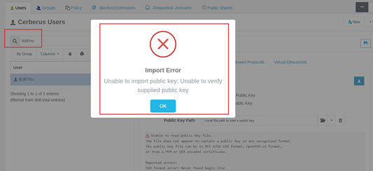
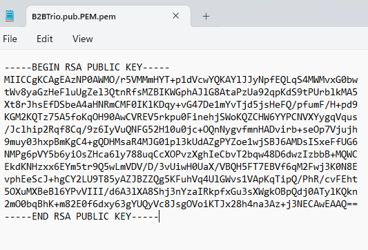
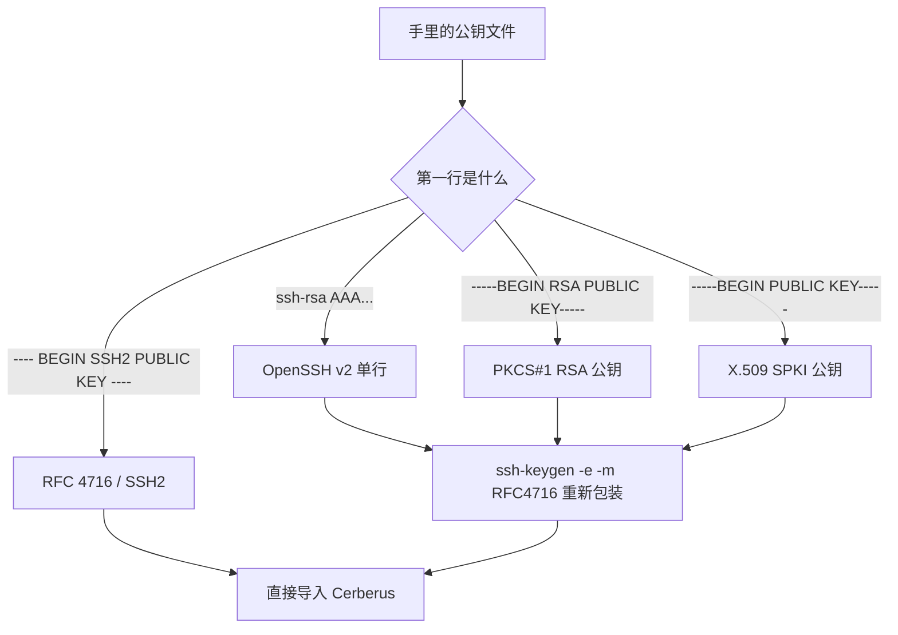

+++
title = 'Cerberus FTP 导入 SSH 公钥报 Unable to verify supplied public key：一次把公钥格式讲透'
date = '2026-11-25T11:00:00+08:00'
slug = 'cerberus-ssh-public-key-formats'
draft = false
tags = ['SSH', '公钥', 'Cerberus', 'SFTP', '运维', 'ssh-keygen']
+++

给 Cerberus FTP Server 建一个 SFTP 账号，兴冲冲把公钥文件传上去，弹窗只回一句 **Unable to import public key: Unable to verify supplied public key**，底下还有一行 `SSH format error: Never found begin line`。换一个文件再传，报一样的错。这篇记录就是从那句报错开始的——问题不在密钥本身，而在**公钥的"外壳格式"**。

<!-- more -->

## 一、现场：一句报错，三张截图

导入失败时的界面是这样的：



弹窗只说"无法校验提供的公钥"，真正有用的是弹窗背后那段灰字：

```text
Unable to read public key file.
The file does not appear to contain a public key in any recognized format.
The public key file can be in RFC 4716 SSH format, OpenSSH v2 format,
or from a PEM or DER encoded certificate.
Reported errors:
SSH format error: Never found begin line
```

这三行其实已经把答案写出来了：Cerberus 认识的公钥只有 **RFC 4716（SSH2）、OpenSSH v2、PEM/DER 证书** 这几类；而报错 `Never found begin line` 的意思是——**它没在文件里找到任何以 "BEGIN" 开头的标记行**。

所以当时手里那两个"看起来都很正常"的 PEM 文件，全都不及格。

第一个，`-----BEGIN PUBLIC KEY-----`：


第二个，`-----BEGIN RSA PUBLIC KEY-----`：



它们明明都有 BEGIN 行，为什么还是报"找不到 begin line"？因为 `Never found begin line` 这句报错来自 Cerberus 内部的 **SSH2 解析器**：它找的不是 `-----BEGIN PUBLIC KEY-----`，而是 `---- BEGIN SSH2 PUBLIC KEY ----`（**四个短横线、空格、没有 "PUBLIC KEY" 的连写法**）。标记不匹配，解析器就直接判定"这文件根本不是公钥"。

## 二、公钥的几个"外壳"

同样一把 RSA 密钥，可以套好几种外壳，内容一样，外壳不同，程序认不认就是另一回事：

| 第一行标记 | 格式名称 | 常见来源 | Cerberus 兼容性 |
| --- | --- | --- | --- |
| `ssh-rsa AAAAB3NzaC1yc2E...` | OpenSSH v2 单行 | `ssh-keygen` 默认输出、GitHub 公钥 | 单行粘贴时容易解析失败 |
| `---- BEGIN SSH2 PUBLIC KEY ----` | RFC 4716 / SSH2 | `ssh-keygen -e -m RFC4716` | 最稳，推荐 |
| `-----BEGIN RSA PUBLIC KEY-----` | PKCS#1（纯 RSA 参数） | 老式 `openssl rsa -pubout -RSAPublicKey_out` | 常报 `Never found begin line` |
| `-----BEGIN PUBLIC KEY-----` | X.509 SubjectPublicKeyInfo（PKCS#8 外层） | `openssl pkey -pubout`、多数现代工具 | 部分版本识别不了 |
| `-----BEGIN CERTIFICATE-----` | X.509 证书（PEM / DER） | 证书体系 | Cerberus 文档声称支持 |

判断顺序很简单，**打开文件看第一行**：



还有一种不靠标记行判断的办法：看第二行 Base64 的开头。

- `MIIBIjANBgkqhkiG9w0BAQEFAAOCAQ8A...`：X.509 SPKI 包装的 RSA 公钥（就是"BEGIN PUBLIC KEY"）
- `MIICCgKCAgEA...` / `MIGfMA0G...`：PKCS#1 的 RSA 公钥
- `AAAAB3NzaC1yc2E...`：SSH 体系里的公钥本体

这三个前缀不是玄学，第一个 Base64 段就是 DER 序列的第一个字节：`MIIBIjAN` 解出来是 `30 82 01 22 30 0d 06 09 ...`（SEQUENCE → AlgorithmIdentifier → RSA），而 PKCS#1 直接是 `SEQUENCE { modulus, exponent }`。

## 三、生成与转换：三条命令走完

Windows 10/11 自带 OpenSSH，PowerShell 里就能跑。先生成一对标准密钥：

```bash
ssh-keygen -t rsa -b 4096 -C "B2BTrio"
```

一路回车，得到 `id_rsa`（私钥）和 `id_rsa.pub`（单行 OpenSSH 公钥）。然后按目标格式"换外壳"：

```bash
# 1) 转 RFC 4716（SSH2），Cerberus 最稳的格式
ssh-keygen -e -f id_rsa.pub -m RFC4716 > ssh2_pub.pem

# 2) 转 X.509 SPKI（BEGIN PUBLIC KEY）
ssh-keygen -e -f id_rsa.pub -m PKCS8 > spki_pub.pem
```

转出来的 SSH2 公钥长这样，第一行就是那个"四个短横线"的标记：

```text
---- BEGIN SSH2 PUBLIC KEY ----
Comment: "4096-bit RSA, converted by trio\cxyu@IT101082 from OpenSSH"
AAAAB3NzaC1yc2EAAAADAQABAAACAQDL1jQKJK8NUZ4cfsobMNVnb5I+NI68uL4f...
---- END SSH2 PUBLIC KEY ----
```

> `Comment:` 这行是 `ssh-keygen` 自动加的，内容带上了生成时的用户名与主机名，不影响导入；不想暴露主机名，事后编辑掉即可——**这行可有可无，标记行必须有**。

Cerberus 自身其实也带密钥生成入口（Security / Generate Keypair），选 RFC4716 导出直接可用。但一般不需要——服务端只需要公钥，私钥留在客户端更合适。

## 四、私钥要不要跟着换？

不用。这是整件事里最容易被误解的一点：

- `ssh-keygen -e` 只做**格式重排**，不重新生成密钥；模数、指数一个字节都没动。
- 所以 `id_rsa.pub` 和转出来的 `ssh2_pub.pem` 是**同一把密钥的两个外壳**，对应的私钥还是原来那一把。
- 客户端（WinSCP、FileZilla、sftp、Git）继续加载原来的 `id_rsa` 私钥即可，Cerberus 那边只导入转换后的公钥。

指纹怎么校验？这里要纠正一个常见（也是我一开始写错的）说法：**`ssh-keygen -lf` 并不认 RFC 4716 和 PEM 公钥**，直接对它跑会报错：

```text
ssh2.pub is not a public key file.
```

正确的比对方式有两种：

```bash
# 方式 A：对私钥本身取指纹（私钥是 OpenSSH 格式，-lf 完全支持）
ssh-keygen -lf id_rsa

# 方式 B：把 SSH2 公钥转回单行 OpenSSH，再取指纹
ssh-keygen -i -f ssh2_pub.pem > ssh2_flat.pub
ssh-keygen -lf ssh2_flat.pub
```

两条输出里的 SHA256 摘要一致，就说明公私钥配对没问题。实跑结果（测试密钥）：

```text
4096 SHA256:MfhfJQq........ZDkm8c blog-test (RSA)     # id_rsa / id_rsa.pub
4096 SHA256:MfhfJQq........ZDkm8c no comment (RSA)    # 由 SSH2 转回的单行公钥
```

注意第二条的注释变成了 `no comment`：`-i` 反向转换丢掉了 comment，但**密钥指纹完全一致**——比对指纹不该看注释。

## 五、踩坑清单

1. **只复制 `ssh-rsa AAAA...` 那一行**：不少版本的 Cerberus 单行解析失败，就是 `Never found begin line` 的来源。
2. **PEM 有 BEGIN 行也照样报错**：`BEGIN PUBLIC KEY` / `BEGIN RSA PUBLIC KEY` 都不是 SSH2 解析器要找的标记，别被"明明有 begin line"绕进去。
3. **传了私钥文件**：`BEGIN RSA PRIVATE KEY` 一导入就失败，而且这是安全事故，私钥永远不出客户端。
4. **手工拼标记行**：多一个空格、少四个短横线（`----` 不是 `-----`）、行尾混进 CRLF 之外的空格，都会让解析器找不到标记。
5. **以为换个格式就得换私钥**：不用，`-e` 只是重排格式。
6. **用 `ssh-keygen -lf` 去校 RFC 4716 公钥**：会直接报 `is not a public key file`，先 `-i` 转回单行再比对。

## 一句话总结

公钥报"无法校验"，九成是外壳不对：**先看第一行标记，不是 SSH2 就用 `ssh-keygen -e -m RFC4716` 重新包装，私钥原地不动。**
