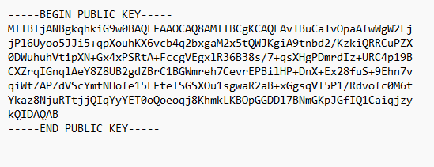
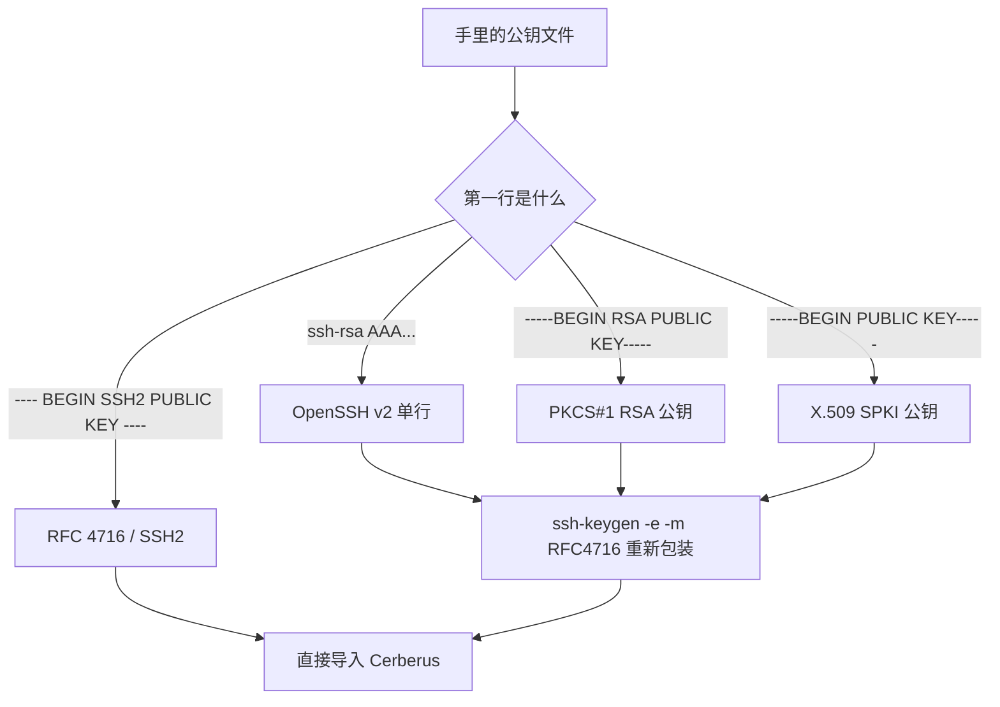

+++
title = 'Cerberus FTP 导入 SSH 公钥报 Unable to verify supplied public key：一次把公钥格式讲透'
date = '2026-11-25T11:00:00+08:00'
slug = 'cerberus-ssh-public-key-formats'
draft = false
tags = ['SSH', '公钥', 'Cerberus', 'SFTP', '运维', 'ssh-keygen']
+++

给 Cerberus FTP Server 建一个 SFTP 账号，兴冲冲把公钥文件传上去，弹窗只回一句 **Unable to import public key: Unable to verify supplied public key**，底下还有一行 `SSH format error: Never found begin line`。换一个文件再传，报一样的错。这篇记录就是从那句报错开始的——问题不在密钥本身，而在**公钥的"外壳格式"**。

<!-- more -->

## 一、现场：一句报错，三张截图

导入失败时的界面是这样的：


弹窗只说"无法校验提供的公钥"，真正有用的是弹窗背后那段灰字：

```text
Unable to read public key file.
The file does not appear to contain a public key in any recognized format.
The public key file can be in RFC 4716 SSH format, OpenSSH v2 format,
or from a PEM or DER encoded certificate.
Reported errors:
SSH format error: Never found begin line
```

这三行其实已经把答案写出来了：Cerberus 认识的公钥只有 **RFC 4716（SSH2）、OpenSSH v2、PEM/DER 证书** 这几类；而报错 `Never found begin line` 的意思是——**它没在文件里找到任何以 "BEGIN" 开头的标记行**。

所以当时手里那两个"看起来都很正常"的 PEM 文件，全都不及格。

第一个，`-----BEGIN PUBLIC KEY-----`：



第二个，`-----BEGIN RSA PUBLIC KEY-----`：


它们明明都有 BEGIN 行，为什么还是报"找不到 begin line"？因为 `Never found begin line` 这句报错来自 Cerberus 内部的 **SSH2 解析器**：它找的不是 `-----BEGIN PUBLIC KEY-----`，而是 `---- BEGIN SSH2 PUBLIC KEY ----`（**四个短横线、空格、没有 "PUBLIC KEY" 的连写法**）。标记不匹配，解析器就直接判定"这文件根本不是公钥"。

## 二、公钥的几个"外壳"

同样一把 RSA 密钥，可以套好几种外壳，内容一样，外壳不同，程序认不认就是另一回事：

| 第一行标记 | 格式名称 | 常见来源 | Cerberus 兼容性 |
| --- | --- | --- | --- |
| `ssh-rsa AAAAB3NzaC1yc2E...` | OpenSSH v2 单行 | `ssh-keygen` 默认输出、GitHub 公钥 | 单行粘贴时容易解析失败 |
| `---- BEGIN SSH2 PUBLIC KEY ----` | RFC 4716 / SSH2 | `ssh-keygen -e -m RFC4716` | 最稳，推荐 |
| `-----BEGIN RSA PUBLIC KEY-----` | PKCS#1（纯 RSA 参数） | 老式 `openssl rsa -pubout -RSAPublicKey_out` | 常报 `Never found begin line` |
| `-----BEGIN PUBLIC KEY-----` | X.509 SubjectPublicKeyInfo（PKCS#8 外层） | `openssl pkey -pubout`、多数现代工具 | 部分版本识别不了 |
| `-----BEGIN CERTIFICATE-----` | X.509 证书（PEM / DER） | 证书体系 | Cerberus 文档声称支持 |

判断顺序很简单，**打开文件看第一行**：



还有一种不靠标记行判断的办法：看第二行 Base64 的开头。

- `MIIBIjANBgkqhkiG9w0BAQEFAAOCAQ8A...`：X.509 SPKI 包装的 RSA 公钥（就是"BEGIN PUBLIC KEY"）
- `MIICCgKCAgEA...` / `MIGfMA0G...`：PKCS#1 的 RSA 公钥
- `AAAAB3NzaC1yc2E...`：SSH 体系里的公钥本体

这三个前缀不是玄学，第一个 Base64 段就是 DER 序列的第一个字节：`MIIBIjAN` 解出来是 `30 82 01 22 30 0d 06 09 ...`（SEQUENCE → AlgorithmIdentifier → RSA），而 PKCS#1 直接是 `SEQUENCE { modulus, exponent }`。

## 三、生成与转换：先造密钥，再换外壳

Windows 10/11 自带的 OpenSSH 客户端，cmd 或 PowerShell 里都能跑。先生成一对标准密钥：

```bash
ssh-keygen -t rsa -b 4096 -C "B2BTrio"
```

| 参数 | 含义 |
| --- | --- |
| `-t rsa` | 密钥类型为 RSA |
| `-b 4096` | 长度 4096 位（省略默认 3072，1024 位已不被接受） |
| `-C "B2BTrio"` | 公钥末尾的注释，只起标识作用，不参与加解密 |
| `-N ""` | 可选：把口令设为空，配合 `-f` 可全自动无交互 |

这条命令是**交互式**的，实测会连着问三件事：

```text
Enter file in which to save the key (C:\Users\cxyu\.ssh\id_rsa): B2BTrio
Enter passphrase (empty for no passphrase):
Enter same passphrase again:
Your identification has been saved in B2BTrio
Your public key has been saved in B2BTrio.pub
```

- 第一问是保存名：输入 `B2BTrio`，得到 `B2BTrio`（私钥）+ `B2BTrio.pub`（单行公钥）
- 后两问是**给私钥加口令**（下一节单独说），直接回车就是不加

产物：私钥 `B2BTrio`（`BEGIN OPENSSH PRIVATE KEY`，设了口令时内容整体是加密态），公钥 `B2BTrio.pub`（单行 `ssh-rsa AAAAB3...`）。

然后按目标格式"换外壳"：

```bash
# 1) 转 RFC 4716（SSH2）—— Cerberus 最稳的格式
ssh-keygen -e -f B2BTrio.pub -m RFC4716 > B2BTrio.pub.RFC4716.pem

# 2) 转 PKCS#1（BEGIN RSA PUBLIC KEY）—— 这一步的产物导入失败
ssh-keygen -e -f B2BTrio.pub -m PEM > B2BTrio.pub.PEM.pem

# 3) 转 X.509 SPKI（BEGIN PUBLIC KEY）
ssh-keygen -e -f B2BTrio.pub -m PKCS8 > B2BTrio.pub.PKCS8.pem
```

- `-e`：export，读取公钥、转换后输出到 stdout；反方向的 `-i` 是 RFC4716/PEM → OpenSSH 单行
- `-f`：输入文件
- `-m`：目标格式，三个取值是三条不同的路

`-m PEM` 和 `-m PKCS8` 极易混，实测对照：

| `-m` 参数 | 第一行 | 第二行 Base64 开头 | 结构 |
| --- | --- | --- | --- |
| `RFC4716` | `---- BEGIN SSH2 PUBLIC KEY ----` | `AAAAB3NzaC1yc2E` | SSH2 封装 |
| `PEM` | `-----BEGIN RSA PUBLIC KEY-----` | `MIICCgKCAgEA` | PKCS#1，纯 RSA 参数 |
| `PKCS8` | `-----BEGIN PUBLIC KEY-----` | `MIIBIjANBgkqhkiG9w0BAQEFAAOCAQ8A` | X.509 SPKI |

三条命令产出的**都是同一把 B2BTrio 密钥**，只是包装不同；私钥 `B2BTrio` 从头到尾没变。

转出来的 SSH2 公钥长这样，第一行就是那个"四个短横线"的标记：

```text
---- BEGIN SSH2 PUBLIC KEY ----
Comment: "4096-bit RSA, converted by trio\cxyu@IT101082 from OpenSSH"
AAAAB3NzaC1yc2EAAAADAQABAAACAQDL1jQKJK8NUZ4cfsobMNVnb5I+NI68uL4f...
---- END SSH2 PUBLIC KEY ----
```

> `Comment:` 这行是 `ssh-keygen` 自动加的，内容带上了生成时的用户名与主机名，不影响导入；不想暴露主机名，事后编辑掉即可——**这行可有可无，标记行必须有**。

Cerberus 自身其实也带密钥生成入口（Security / Generate Keypair），选 RFC4716 导出直接可用。但一般不需要——服务端只需要公钥，私钥留在客户端更合适。

## 四、那个 `Enter passphrase` 是干什么的

口令不是登录服务器的密码，也不是 Cerberus 的账号密码，更不是 `-C` 那个注释。它只做一件事：**用对称算法加密私钥文件本身**。

- 设了口令：私钥文件里存的是密文，别人拷走文件也用不了
- 留空回车：私钥以可直接解析的形式保存，谁拿到文件谁就能登录
- 对服务端毫无影响：公钥里不携带任何口令信息，`-e` 转出来的格式与口令完全无关

所以它防的场景很具体——**私钥文件泄露**（笔记本丢失、目录被同步到网盘、终端被人翻）。它防不住服务器被攻破。

怎么选：

| 场景 | 建议 |
| --- | --- |
| 人工登录、临时传文件 | 设口令，多一道锁，代价只是每次输一次 |
| 脚本、定时任务、无人值守对接 | 空口令，否则任务会卡在口令提示上；靠文件权限、专用账号、网络隔离来补 |
| 设了口令想改或去掉 | `ssh-keygen -p -f B2BTrio`，改口令，或直接回车清空 |

带口令的私钥在客户端（WinSCP、FileZilla、sftp）每次连接都要输口令，可以在会话里保存，或用 ssh-agent / Pageant 缓存到内存。

顺带说明：截图里那段 `+---[RSA 4096]---+` 的随机图案（randomart）是给人眼比对的指纹可视化，和下面那行 `SHA256:5zBz...` 是同一个指纹的两种表示，不是加密内容。

## 五、私钥要不要跟着换？

不用。这是整件事里最容易被误解的一点：

- `ssh-keygen -e` 只做**格式重排**，不重新生成密钥；模数、指数一个字节都没动。
- 所以 `B2BTrio.pub` 和转出来的 `B2BTrio.pub.RFC4716.pem` 是**同一把密钥的两个外壳**，对应的私钥还是原来那一把。
- 客户端（WinSCP、FileZilla、sftp、Git）继续加载原来的 `B2BTrio` 私钥即可，Cerberus 那边只导入转换后的公钥。

指纹怎么校验？这里要纠正一个常见（也是我一开始写错的）说法：**`ssh-keygen -lf` 并不认 RFC 4716 和 PEM 公钥**，直接对它跑会报错：

```text
ssh2.pub is not a public key file.
```

正确的比对方式有两种：

```bash
# 方式 A：对私钥本身取指纹（私钥是 OpenSSH 格式，-lf 完全支持）
ssh-keygen -lf B2BTrio

# 方式 B：把 SSH2 公钥转回单行 OpenSSH，再取指纹
ssh-keygen -i -f B2BTrio.pub.RFC4716.pem > B2BTrio.flat.pub
ssh-keygen -lf B2BTrio.flat.pub
```

两条输出里的 SHA256 摘要一致，就说明公私钥配对没问题。实跑结果（测试密钥）：

```text
4096 SHA256:MfhfJQq........ZDkm8c blog-test (RSA)     # 私钥 / 单行公钥
4096 SHA256:MfhfJQq........ZDkm8c no comment (RSA)    # 由 SSH2 转回的单行公钥
```

注意第二条的注释变成了 `no comment`：`-i` 反向转换丢掉了 comment，但**密钥指纹完全一致**——比对指纹不该看注释。

## 六、踩坑清单

1. **只复制 `ssh-rsa AAAA...` 那一行**：不少版本的 Cerberus 单行解析失败，就是 `Never found begin line` 的来源。
2. **PEM 有 BEGIN 行也照样报错**：`BEGIN PUBLIC KEY` / `BEGIN RSA PUBLIC KEY` 都不是 SSH2 解析器要找的标记，别被"明明有 begin line"绕进去。
3. **传了私钥文件**：`BEGIN RSA PRIVATE KEY` 一导入就失败，而且这是安全事故，私钥永远不出客户端。
4. **手工拼标记行**：多一个空格、少四个短横线（`----` 不是 `-----`）、行尾混进多余空格，都会让解析器找不到标记。
5. **以为换个格式就得换私钥**：不用，`-e` 只是重排格式。
6. **用 `ssh-keygen -lf` 去校 RFC 4716 公钥**：会直接报 `is not a public key file`，先 `-i` 转回单行再比对。
7. **重定向的编码坑**：cmd 和 PowerShell 7 里 `>` 写出的是 UTF-8（无 BOM），没问题；但在 **Windows PowerShell 5.1** 里 `>` 默认输出 UTF-16LE 带 BOM，文件直接变乱码，Cerberus 依旧报 `Never found begin line`。保险写法是 `ssh-keygen -e ... | Out-File -Encoding ascii 目标文件`。
8. **被后缀名骗**：`.RFC4716.pem`、`.PEM.pem` 里的 `pem` 只是习惯命名，RFC 4716 与 PEM 是两套完全不同的格式，判断格式只认第一行标记。
9. **以为口令会影响导入**：`Enter passphrase` 设的是私钥口令，公钥导入失败与它无关；设了再复杂的口令，该报的格式错误一个都不会少。

## 一句话总结

公钥报"无法校验"，九成是外壳不对：**先看第一行标记，不是 SSH2 就用 `ssh-keygen -e -m RFC4716` 重新包装，私钥原地不动。**
